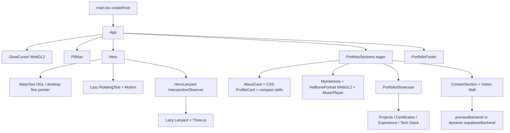

# Architecture and verified stack

Audit date: 14 November 2026. Owner: Muhammad Shehroz, Lahore, Pakistan. Inspected checkout: `/workspace/Shehroz.my.id`, branch `work`, commit `6839347096468ec0ff98a5c01e5a1df0f03e1cfd`. Evidence labels: **S — verified source**, **O — direct local-browser observation**, **M — measured lab result**, **R — verified external research**, **J — professional judgment**, **H — unverified hypothesis**.

The requested `perf/portfolio-speed-optimization` branch was absent locally and from the accessible GitHub branch listing. The initial checkout was clean. Historical 38.1→22.2 s Hero, 19.1→13.3 s About, 16 browser tests and pixel-identical frames remain user-provided history, not verified before/after results. Current source and existing documentation were preserved. This audit makes no application changes.

Browser results describe a production Vite build served locally with explicit gzip and cache headers, default **preview** Contact configuration, Chromium 156 and **SwiftShader software graphics**. They are not measurements of the deployed domain or real-user field data. Public-site access failed through the environment proxy and web retrieval tool. Live Supabase configuration, delivery and hosted caching were not verified.

## Repository and execution architecture

The initial inventory contains 176 tracked files and 62 TypeScript modules under `src/`. Source, tests, deployment workflows, backend functions, SQL migrations and existing docs were inspected. `node_modules` and `dist` already existed. Builds and diagnostics ran in an isolated tracked-file copy under `/workspace/work/audit/repo`; the original `dist` was not overwritten. The available local `dist` has the same main bundle filenames and sizes as the new default build, but that does not prove live deployment equivalence.

| Area | Role |
|---|---|
| `src/main.tsx` | `createRoot` with StrictMode and global CSS; client rendering, no SSR/hydration |
| `src/app/App.tsx` | Global background, navigation, Hero, all portfolio sections, Footer; active-anchor state |
| `src/components/` | Custom reusable visual systems, Hero and Three.js card |
| `src/sections/` | About/ProfileCard, Interests/Music, tabbed showcase, Contact/Visitor Wall |
| `src/content/portfolio.ts` and `src/sections/config/profile.ts` | Separate identity/link stores; inconsistent role/contact settings need coordination |
| `src/styles/` | Tailwind v4 imports, dark theme tokens, three self-hosted Latin variable fonts |
| `public/` | Badge PNGs, About portrait, logo/favicons and manifest; un-hashed filenames |
| `src/sections/**/assets/` | Bundler-hashed portraits, concept previews, sample PDFs and icons |
| `supabase/functions/` | Public submission, private submission, photo reads, owner management and shared validation |
| `supabase/migrations/` | Historical permission repair and additive contact/photo cleanup schema |
| `tests/` | Vitest unit/component/edge tests, browser scenarios, SQL fixtures |
| `.github/workflows/` | PR validation and main-branch Pages deployment |
| `docs/` | Existing architecture/design and contact deployment evidence; not overwritten |

## Versions

| Package | Declared | Locked / inspected install |
| --- | --- | --- |
| @fontsource-variable/inter | ^5.3.0 | 5.3.0 |
| @fontsource-variable/jetbrains-mono | ^5.3.0 | 5.3.0 |
| @fontsource-variable/space-grotesk | ^5.3.0 | 5.3.0 |
| @hugeicons/core-free-icons | ^4.4.0 | 4.4.0 |
| @marsidev/react-turnstile | 1.6.3 | 1.6.3 |
| @supabase/supabase-js | 2.119.0 | 2.119.0 |
| firebase | ^12.19.0 | 12.19.0 |
| lucide-react | ^1.72.0 | 1.72.0 |
| motion | ^14.12.0 | 14.12.0 |
| ogl | ^1.0.11 | 1.0.11 |
| react | ^19.3.1 | 19.3.1 |
| react-dom | ^19.3.1 | 19.3.1 |
| react-icons | ^5.7.0 | 5.7.0 |
| three | ^0.187.0 | 0.187.0 |
| @axe-core/playwright | 4.14.0 | 4.14.0 |
| @imagemagick/magick-wasm | 0.0.30 | 0.0.30 |
| @playwright/test | 1.65.0 | 1.65.0 |
| @supabase/server | 1.9.2 | 1.9.2 |
| @tailwindcss/vite | ^4.3.5 | 4.3.5 |
| @testing-library/react | 16.3.3 | 16.3.3 |
| @types/node | ^24.19.2 | 24.19.2 |
| @types/react | ^19.3.0 | 19.3.0 |
| @types/react-dom | ^19.3.0 | 19.3.0 |
| @types/three | ^0.187.0 | 0.187.0 |
| @vitejs/plugin-react | ^6.3.0 | 6.3.0 |
| jose | 6.2.17 | 6.2.17 |
| jsdom | 31.0.1 | 31.0.1 |
| tailwindcss | ^4.3.5 | 4.3.5 |
| typescript | ^7.0.2 | 7.0.2 |
| vite | ^8.3.8 | 8.3.8 |
| vitest | 5.1.0 | 5.1.0 |

Node on this machine is 24.22.1; package engine is >=22.12.0 and CI selects Node 24. Chromium is 156.0.8078.79. Vite 8 uses Rolldown; recommendations based on older Rollup configuration syntax need version-specific verification. There is **no React Three Fiber, Drei, Rapier, Redux or React Router dependency** in the inspected manifest. The card's physics are handwritten Three.js vector/quaternion calculations, not a physics package. Motion resolves through framer-motion/motion-dom in the role-text chunk. The dependency list alone does not prove every package executes in the browser.

## Routing and state

[`src/app/App.tsx:10`](https://github.com/shehroz-codes/Shehroz.my.id/blob/6839347096468ec0ff98a5c01e5a1df0f03e1cfd/src/app/App.tsx#L10) declares Home/About/My Interests/Projects/Contact fragment links. `#home` is the main element wrapping all sections. `#skills` is a span in the Projects container, interpreted by the showcase hashchange effect to select the Tech Stack tab. There are no route files or data router. Direct `#about` and `#skills` entry must be included in any future lazy-loading test.

State is local: App activeHref; Hero media/notice state; HeroLanyard near/wide/reduced state; Lanyard ready/side/failure state with mutable simulation refs; About one-time visibility; Showcase active tab/project/document; Music genre/current track; Contact backend/loading/cooldown; forms, feed, image failure and pagination. No global state store. DOM refs/CSS custom properties carry frame-by-frame physics and tilt, avoiding React state on every frame. App still re-renders on active section changes; its scroll work is coalesced into requestAnimationFrame and removes listeners on unmount.

StrictMode double effects are a development behavior; these measurements used a production bundle. Do not blame production delays on development StrictMode without evidence.

## Styling and visual systems

[`src/styles/tokens.css:1`](https://github.com/shehroz-codes/Shehroz.my.id/blob/6839347096468ec0ff98a5c01e5a1df0f03e1cfd/src/styles/tokens.css#L1) defines background `#050310`, surface `#0B0A1F`, primary `#5B21F0`, secondary `#4F46E5`, text `#F8FAFC`, muted `#A7A3BA`, accent `#A78BFA`; Space Grotesk/Inter/JetBrains Mono are self-hosted Latin variable fonts with `font-display: swap`. Local component CSS is extensive; CSS effects include glass backgrounds, blur, masks, blending, infinite drift/pulse and finite reveals. These are distinct costs from React reconciliation.

Four WebGL contexts were observed on desktop: GlowCursor, HalftonePortrait, WarpText and Lanyard. Mobile disables enhanced WarpText through `useHeroMotion` but keeps the card and existing other effects. About ProfileCard uses CSS transforms, masks and blends, not a WebGL renderer. Preferred recommendations preserve this design system.

## Supabase and network boundary

[`src/sections/components/contact/config.ts:17`](https://github.com/shehroz-codes/Shehroz.my.id/blob/6839347096468ec0ff98a5c01e5a1df0f03e1cfd/src/sections/components/contact/config.ts#L17) defaults Contact to preview unless explicitly built live. `loadBackend` dynamically imports Supabase only in live mode; local preview storage stays in the browser. `getSupabase` validates a specific project URL and publishable-key prefix. With variables absent in the audited build, unreachable SDK setup is tree-shaken; the **5,351-byte backend chunk is not the size of a configured live Supabase SDK integration**.

The live adapter selects explicit published/non-demo columns, orders newest first, requests page size + 1, aborts reads after 15 seconds and polls every 30 seconds. It does not use a Realtime channel. Public photos are read through an Edge Function that verifies publication and uses `no-store`. Writes require explicit feature gates, Auth/Turnstile and server validation; public and private messages have separate handlers. Owner actions require non-anonymous admin membership. No production records, keys, logs or database settings were queried or changed by this audit.

Static security review found explicit RLS/revokes in the supplied migrations, public column minimization, server-side CAPTCHA/JWT validation paths, image verification and no service-role key in frontend source. This is not a deployed security certification. Preserve the earlier warning in `docs/contact/COMPLETION_AND_RELEASE.md`: the historical permission migration's local timestamp differs from the recorded remote timestamp; never blindly replay the migrations. CORS in `_shared/contact.ts:1` expects `https://shehroz-codes.github.io`; a real custom-domain move would need separately approved origin verification.

## Deployment and test architecture

[`vite.config.ts:6`](https://github.com/shehroz-codes/Shehroz.my.id/blob/6839347096468ec0ff98a5c01e5a1df0f03e1cfd/vite.config.ts#L6) sets base `/Shehroz.my.id/`. The Pages workflow builds on main, injects public Supabase/Turnstile variables, sets live mode and disables public submissions. It uploads `dist` and deploys Pages with scoped permissions. No CNAME was found among tracked files. This supports the GitHub Pages project URL; the requested custom hostname cannot be confirmed from this checkout.

Current type checks and all 77 unit tests pass. The existing browser configuration uses Vite **development** servers at 4173/4174 and controlled preview/mocked-live environments. Those tests validate behavior, not production timings. Separate audit scripts measured the built static files on port 4180. SQL tests were not run because the task did not require schema execution; no hosted write tests were performed. Final current browser-suite results are in report 06.

## Full TypeScript component/module inventory

This mechanically derived index records direct imports and use-prefixed identifiers, including hooks with TypeScript generic arguments. A use-prefixed helper such as useProgram is not necessarily a React hook, and import presence is not proof of runtime execution. Lifecycle details in the section reports distinguish React hooks from ordinary helpers. See individual section reports for initialization and cost reasoning. Type declarations and retained historical modules are included so an AI does not confuse them with active sections.

| Source module | Lines | Hooks / APIs discovered | Direct imports |
| --- | --- | --- | --- |
| [`src/main.tsx:1`](https://github.com/shehroz-codes/Shehroz.my.id/blob/6839347096468ec0ff98a5c01e5a1df0f03e1cfd/src/main.tsx#L1) | 16 | None | react, react-dom/client, ./app/App, ./styles/index.css |
| [`src/vite-env.d.ts:1`](https://github.com/shehroz-codes/Shehroz.my.id/blob/6839347096468ec0ff98a5c01e5a1df0f03e1cfd/src/vite-env.d.ts#L1) | 8 | None |  |
| [`src/app/App.tsx:1`](https://github.com/shehroz-codes/Shehroz.my.id/blob/6839347096468ec0ff98a5c01e5a1df0f03e1cfd/src/app/App.tsx#L1) | 128 | useEffect, useState | react, ../components/GlowCursor/GlowCursor, ../components/PillNav/PillNav, ../components/PillNav/PillNav, ./App.css, ../sections/PortfolioSections, ../components/Hero/Hero, ../components/PortfolioFooter |
| [`src/components/PortfolioFooter.tsx:1`](https://github.com/shehroz-codes/Shehroz.my.id/blob/6839347096468ec0ff98a5c01e5a1df0f03e1cfd/src/components/PortfolioFooter.tsx#L1) | 277 | useActiveSection, useEffect, useState | react, react, ../sections/config/profile, ./PortfolioFooter.css |
| [`src/content/portfolio.ts:1`](https://github.com/shehroz-codes/Shehroz.my.id/blob/6839347096468ec0ff98a5c01e5a1df0f03e1cfd/src/content/portfolio.ts#L1) | 32 | None | ../components/SocialSpotlight/SocialSpotlight |
| [`src/hooks/useHeroMotion.ts:1`](https://github.com/shehroz-codes/Shehroz.my.id/blob/6839347096468ec0ff98a5c01e5a1df0f03e1cfd/src/hooks/useHeroMotion.ts#L1) | 52 | useEffect, useHeroMotion, useRef, useState | react |
| [`src/hooks/usePortfolioLike.ts:1`](https://github.com/shehroz-codes/Shehroz.my.id/blob/6839347096468ec0ff98a5c01e5a1df0f03e1cfd/src/hooks/usePortfolioLike.ts#L1) | 25 | useEffect, usePortfolioLike, useRef, useState | react, ../services/likePersistence |
| [`src/lib/firebase.ts:1`](https://github.com/shehroz-codes/Shehroz.my.id/blob/6839347096468ec0ff98a5c01e5a1df0f03e1cfd/src/lib/firebase.ts#L1) | 25 | None | firebase/app, firebase/firestore |
| [`src/lib/supabase.ts:1`](https://github.com/shehroz-codes/Shehroz.my.id/blob/6839347096468ec0ff98a5c01e5a1df0f03e1cfd/src/lib/supabase.ts#L1) | 48 | None | @supabase/supabase-js, @supabase/supabase-js, ../sections/components/contact/types |
| [`src/sections/PortfolioSections.tsx:1`](https://github.com/shehroz-codes/Shehroz.my.id/blob/6839347096468ec0ff98a5c01e5a1df0f03e1cfd/src/sections/PortfolioSections.tsx#L1) | 62 | None | ./components/AboutCard, ./components/ProfileCard/ProfileCard, ./components/my-interests/MyInterests, ./components/showcase/PortfolioShowcase, ./components/contact/ContactSection, ./config/aboutCardData, ./config/profile, ./PortfolioSections.css |
| [`src/services/likePersistence.ts:1`](https://github.com/shehroz-codes/Shehroz.my.id/blob/6839347096468ec0ff98a5c01e5a1df0f03e1cfd/src/services/likePersistence.ts#L1) | 18 | None |  |
| [`src/components/GlowCursor/GlowCursor.tsx:1`](https://github.com/shehroz-codes/Shehroz.my.id/blob/6839347096468ec0ff98a5c01e5a1df0f03e1cfd/src/components/GlowCursor/GlowCursor.tsx#L1) | 1296 | useEffect, useProgram, useRef, useState | react, react, ./GlowCursor.css |
| [`src/components/Hero/Hero.tsx:1`](https://github.com/shehroz-codes/Shehroz.my.id/blob/6839347096468ec0ff98a5c01e5a1df0f03e1cfd/src/components/Hero/Hero.tsx#L1) | 184 | useEffect, useHeroMotion, useState | react, ../../content/portfolio, ../../hooks/useHeroMotion, ../WarpText/WarpText, ../Magnet/Magnet, ../SocialSpotlight/SocialSpotlight, ./Hero.css, ./HeroLanyard |
| [`src/components/Hero/HeroLanyard.tsx:1`](https://github.com/shehroz-codes/Shehroz.my.id/blob/6839347096468ec0ff98a5c01e5a1df0f03e1cfd/src/components/Hero/HeroLanyard.tsx#L1) | 90 | useEffect, useRef, useState | react, ../../content/portfolio |
| [`src/components/Lanyard/Lanyard.tsx:1`](https://github.com/shehroz-codes/Shehroz.my.id/blob/6839347096468ec0ff98a5c01e5a1df0f03e1cfd/src/components/Lanyard/Lanyard.tsx#L1) | 1974 | useEffect, useRef, useState | react, react, three, ./Lanyard.css |
| [`src/components/Magnet/Magnet.tsx:1`](https://github.com/shehroz-codes/Shehroz.my.id/blob/6839347096468ec0ff98a5c01e5a1df0f03e1cfd/src/components/Magnet/Magnet.tsx#L1) | 312 | useEffect, useRef | react, react |
| [`src/components/PillNav/PillNav.tsx:1`](https://github.com/shehroz-codes/Shehroz.my.id/blob/6839347096468ec0ff98a5c01e5a1df0f03e1cfd/src/components/PillNav/PillNav.tsx#L1) | 1090 | useEffect, useId, useLayoutEffect, useRef, useState | react, react, ./PillNav.css |
| [`src/components/PulseHeart/PulseHeart.tsx:1`](https://github.com/shehroz-codes/Shehroz.my.id/blob/6839347096468ec0ff98a5c01e5a1df0f03e1cfd/src/components/PulseHeart/PulseHeart.tsx#L1) | 355 | useEffect, useLayoutEffect, useRef, useState | react, @hugeicons/core-free-icons, ./PulseHeart.css, react |
| [`src/components/RotatingText/RotatingText.tsx:1`](https://github.com/shehroz-codes/Shehroz.my.id/blob/6839347096468ec0ff98a5c01e5a1df0f03e1cfd/src/components/RotatingText/RotatingText.tsx#L1) | 468 | useCallback, useEffect, useImperativeHandle, useIsomorphicLayoutEffect, useLayoutEffect, useMemo, useMotionValue, useReducedMotion, useRef, useState | react, motion/react, ./RotatingText.css, react, motion/react |
| [`src/components/SocialSpotlight/SocialSpotlight.tsx:1`](https://github.com/shehroz-codes/Shehroz.my.id/blob/6839347096468ec0ff98a5c01e5a1df0f03e1cfd/src/components/SocialSpotlight/SocialSpotlight.tsx#L1) | 79 | useId, useLayoutEffect, useRef, useState | react, ./SocialSpotlight.css |
| [`src/components/WarpText/WarpText.tsx:1`](https://github.com/shehroz-codes/Shehroz.my.id/blob/6839347096468ec0ff98a5c01e5a1df0f03e1cfd/src/components/WarpText/WarpText.tsx#L1) | 814 | useEffect, useRef, useState | react, ogl, ./WarpText.css, react, ogl |
| [`src/sections/components/AboutCard.tsx:1`](https://github.com/shehroz-codes/Shehroz.my.id/blob/6839347096468ec0ff98a5c01e5a1df0f03e1cfd/src/sections/components/AboutCard.tsx#L1) | 362 | useEffect, useId, useInView, useRef, useState | react, lucide-react, ./icons, ./AboutCard.css, / |
| [`src/sections/components/icons.tsx:1`](https://github.com/shehroz-codes/Shehroz.my.id/blob/6839347096468ec0ff98a5c01e5a1df0f03e1cfd/src/sections/components/icons.tsx#L1) | 189 | None | react, lucide-react, ../config/profile |
| [`src/sections/config/aboutCardData.tsx:1`](https://github.com/shehroz-codes/Shehroz.my.id/blob/6839347096468ec0ff98a5c01e5a1df0f03e1cfd/src/sections/config/aboutCardData.tsx#L1) | 60 | None | ../components/AboutCard, ../components/icons, ./profile |
| [`src/sections/config/profile.ts:1`](https://github.com/shehroz-codes/Shehroz.my.id/blob/6839347096468ec0ff98a5c01e5a1df0f03e1cfd/src/sections/config/profile.ts#L1) | 165 | None |  |
| [`src/sections/components/ProfileCard/ProfileCard.tsx:1`](https://github.com/shehroz-codes/Shehroz.my.id/blob/6839347096468ec0ff98a5c01e5a1df0f03e1cfd/src/sections/components/ProfileCard/ProfileCard.tsx#L1) | 408 | useEffect, useRef | react, lucide-react, ./ProfileCard.css, ./profile-card-violet.css |
| [`src/sections/components/contact/ContactForm.tsx:1`](https://github.com/shehroz-codes/Shehroz.my.id/blob/6839347096468ec0ff98a5c01e5a1df0f03e1cfd/src/sections/components/contact/ContactForm.tsx#L1) | 75 | useRef, useState | react, react, @marsidev/react-turnstile, ./config, lucide-react, ./types, ./FormParts, ./FormParts |
| [`src/sections/components/contact/ContactProfile.tsx:1`](https://github.com/shehroz-codes/Shehroz.my.id/blob/6839347096468ec0ff98a5c01e5a1df0f03e1cfd/src/sections/components/contact/ContactProfile.tsx#L1) | 45 | None | lucide-react, react-icons/fa, ./config, ./assets/profile.png |
| [`src/sections/components/contact/ContactSection.tsx:1`](https://github.com/shehroz-codes/Shehroz.my.id/blob/6839347096468ec0ff98a5c01e5a1df0f03e1cfd/src/sections/components/contact/ContactSection.tsx#L1) | 47 | useCooldown, useEffect, useState | react, lucide-react, ./types, ./config, ./services/backend, ./services/storage, ./useCooldown, ./ContactProfile, ./ContactForm, ./VisitorComposer, ./VisitorWall, ./ContactSection.css |
| [`src/sections/components/contact/FormParts.tsx:1`](https://github.com/shehroz-codes/Shehroz.my.id/blob/6839347096468ec0ff98a5c01e5a1df0f03e1cfd/src/sections/components/contact/FormParts.tsx#L1) | 21 | None | react |
| [`src/sections/components/contact/VisitorComposer.tsx:1`](https://github.com/shehroz-codes/Shehroz.my.id/blob/6839347096468ec0ff98a5c01e5a1df0f03e1cfd/src/sections/components/contact/VisitorComposer.tsx#L1) | 215 | useEffect, useRef, useState | react, react, lucide-react, ./types, ./types, ./config, ./services/suggest, ./services/storage, ./FormParts, ./FormParts, @marsidev/react-turnstile, @marsidev/react-turnstile, ./config, ./services/photo |
| [`src/sections/components/contact/VisitorWall.tsx:1`](https://github.com/shehroz-codes/Shehroz.my.id/blob/6839347096468ec0ff98a5c01e5a1df0f03e1cfd/src/sections/components/contact/VisitorWall.tsx#L1) | 70 | useEffect, useState | react, lucide-react, ./types, ./config |
| [`src/sections/components/contact/config.ts:1`](https://github.com/shehroz-codes/Shehroz.my.id/blob/6839347096468ec0ff98a5c01e5a1df0f03e1cfd/src/sections/components/contact/config.ts#L1) | 23 | None | ../../config/profile |
| [`src/sections/components/contact/env.d.ts:1`](https://github.com/shehroz-codes/Shehroz.my.id/blob/6839347096468ec0ff98a5c01e5a1df0f03e1cfd/src/sections/components/contact/env.d.ts#L1) | 9 | None |  |
| [`src/sections/components/contact/types.ts:1`](https://github.com/shehroz-codes/Shehroz.my.id/blob/6839347096468ec0ff98a5c01e5a1df0f03e1cfd/src/sections/components/contact/types.ts#L1) | 44 | None |  |
| [`src/sections/components/contact/useCooldown.ts:1`](https://github.com/shehroz-codes/Shehroz.my.id/blob/6839347096468ec0ff98a5c01e5a1df0f03e1cfd/src/sections/components/contact/useCooldown.ts#L1) | 34 | useCallback, useCooldown, useEffect, useState, useSyncExternalStore | react, ./services/storage |
| [`src/sections/components/my-interests/HalftonePortrait.tsx:1`](https://github.com/shehroz-codes/Shehroz.my.id/blob/6839347096468ec0ff98a5c01e5a1df0f03e1cfd/src/sections/components/my-interests/HalftonePortrait.tsx#L1) | 909 | useEffect, useProgram, useRef | react |
| [`src/sections/components/my-interests/InterestCard.tsx:1`](https://github.com/shehroz-codes/Shehroz.my.id/blob/6839347096468ec0ff98a5c01e5a1df0f03e1cfd/src/sections/components/my-interests/InterestCard.tsx#L1) | 34 | None | lucide-react, ./interestsData |
| [`src/sections/components/my-interests/MusicPlayer.tsx:1`](https://github.com/shehroz-codes/Shehroz.my.id/blob/6839347096468ec0ff98a5c01e5a1df0f03e1cfd/src/sections/components/my-interests/MusicPlayer.tsx#L1) | 106 | useState | react, lucide-react, ./musicData |
| [`src/sections/components/my-interests/MyInterests.tsx:1`](https://github.com/shehroz-codes/Shehroz.my.id/blob/6839347096468ec0ff98a5c01e5a1df0f03e1cfd/src/sections/components/my-interests/MyInterests.tsx#L1) | 50 | None | lucide-react, ./HalftonePortrait, ./InterestCard, ./MusicPlayer, ./interestsData, ./MyInterests.css |
| [`src/sections/components/my-interests/interestsData.ts:1`](https://github.com/shehroz-codes/Shehroz.my.id/blob/6839347096468ec0ff98a5c01e5a1df0f03e1cfd/src/sections/components/my-interests/interestsData.ts#L1) | 110 | None | lucide-react, lucide-react, ../../assets/portraits/real-portrait.png, ../../assets/portraits/anime-portrait.png, ./HalftonePortrait |
| [`src/sections/components/my-interests/musicData.ts:1`](https://github.com/shehroz-codes/Shehroz.my.id/blob/6839347096468ec0ff98a5c01e5a1df0f03e1cfd/src/sections/components/my-interests/musicData.ts#L1) | 59 | None |  |
| [`src/sections/components/showcase/CertificatesPanel.tsx:1`](https://github.com/shehroz-codes/Shehroz.my.id/blob/6839347096468ec0ff98a5c01e5a1df0f03e1cfd/src/sections/components/showcase/CertificatesPanel.tsx#L1) | 71 | None | ./portfolioData, ./types, ./Icon |
| [`src/sections/components/showcase/DocumentPreview.tsx:1`](https://github.com/shehroz-codes/Shehroz.my.id/blob/6839347096468ec0ff98a5c01e5a1df0f03e1cfd/src/sections/components/showcase/DocumentPreview.tsx#L1) | 79 | useEffect, useState | react, ./types, ./Modal, ./Icon |
| [`src/sections/components/showcase/ExperiencePanel.tsx:1`](https://github.com/shehroz-codes/Shehroz.my.id/blob/6839347096468ec0ff98a5c01e5a1df0f03e1cfd/src/sections/components/showcase/ExperiencePanel.tsx#L1) | 84 | None | ./portfolioData, ./types, ./Icon |
| [`src/sections/components/showcase/Icon.tsx:1`](https://github.com/shehroz-codes/Shehroz.my.id/blob/6839347096468ec0ff98a5c01e5a1df0f03e1cfd/src/sections/components/showcase/Icon.tsx#L1) | 87 | None | react |
| [`src/sections/components/showcase/Modal.tsx:1`](https://github.com/shehroz-codes/Shehroz.my.id/blob/6839347096468ec0ff98a5c01e5a1df0f03e1cfd/src/sections/components/showcase/Modal.tsx#L1) | 113 | useEffect, useId, useRef | react, react, ./Icon |
| [`src/sections/components/showcase/PortfolioShowcase.tsx:1`](https://github.com/shehroz-codes/Shehroz.my.id/blob/6839347096468ec0ff98a5c01e5a1df0f03e1cfd/src/sections/components/showcase/PortfolioShowcase.tsx#L1) | 212 | useEffect, useId, useRef, useState | react, react, ./types, ./Icon, ./Icon, ./portfolioData, ./ProjectCard, ./ProjectDetails, ./CertificatesPanel, ./ExperiencePanel, ./TechStackPanel, ./DocumentPreview, ./PortfolioShowcase.css |
| [`src/sections/components/showcase/ProjectCard.tsx:1`](https://github.com/shehroz-codes/Shehroz.my.id/blob/6839347096468ec0ff98a5c01e5a1df0f03e1cfd/src/sections/components/showcase/ProjectCard.tsx#L1) | 129 | useEffect, useRef | react, ./portfolioData, react, ./types, ./Icon, ./TechnologyIcons, ./ProjectLinks |
| [`src/sections/components/showcase/ProjectDetails.tsx:1`](https://github.com/shehroz-codes/Shehroz.my.id/blob/6839347096468ec0ff98a5c01e5a1df0f03e1cfd/src/sections/components/showcase/ProjectDetails.tsx#L1) | 70 | None | ./types, ./Modal, ./ProjectLinks, ./TechnologyIcons, ./Icon |
| [`src/sections/components/showcase/ProjectLinks.tsx:1`](https://github.com/shehroz-codes/Shehroz.my.id/blob/6839347096468ec0ff98a5c01e5a1df0f03e1cfd/src/sections/components/showcase/ProjectLinks.tsx#L1) | 62 | None | ./types, ./portfolioData, ./Icon |
| [`src/sections/components/showcase/TechStackPanel.tsx:1`](https://github.com/shehroz-codes/Shehroz.my.id/blob/6839347096468ec0ff98a5c01e5a1df0f03e1cfd/src/sections/components/showcase/TechStackPanel.tsx#L1) | 121 | None | react, react-icons/si, react-icons/fa, react-icons/vsc, lucide-react, ./assets/antigravity.svg, ./types |
| [`src/sections/components/showcase/TechnologyIcons.tsx:1`](https://github.com/shehroz-codes/Shehroz.my.id/blob/6839347096468ec0ff98a5c01e5a1df0f03e1cfd/src/sections/components/showcase/TechnologyIcons.tsx#L1) | 25 | None | ./portfolioData |
| [`src/sections/components/showcase/portfolioData.ts:1`](https://github.com/shehroz-codes/Shehroz.my.id/blob/6839347096468ec0ff98a5c01e5a1df0f03e1cfd/src/sections/components/showcase/portfolioData.ts#L1) | 186 | None | ./types, ./assets/project-1.webp, ./assets/project-2.webp, ./assets/project-3.webp, ./assets/project-4.webp, ./assets/certificate-1.webp, ./assets/certificate-2.webp, ./assets/certificate-sample.pdf, ./assets/letter-1.webp, ./assets/letter-2.webp, ./assets/experience-sample.pdf, ./assets/react.svg, ./assets/typescript.svg, ./assets/tailwindcss.svg, ./assets/vite.svg |
| [`src/sections/components/showcase/types.ts:1`](https://github.com/shehroz-codes/Shehroz.my.id/blob/6839347096468ec0ff98a5c01e5a1df0f03e1cfd/src/sections/components/showcase/types.ts#L1) | 57 | None |  |
| [`src/sections/components/contact/services/backend.ts:1`](https://github.com/shehroz-codes/Shehroz.my.id/blob/6839347096468ec0ff98a5c01e5a1df0f03e1cfd/src/sections/components/contact/services/backend.ts#L1) | 10 | None | ../config, ../types, ./previewBackend |
| [`src/sections/components/contact/services/firebaseBackend.ts:1`](https://github.com/shehroz-codes/Shehroz.my.id/blob/6839347096468ec0ff98a5c01e5a1df0f03e1cfd/src/sections/components/contact/services/firebaseBackend.ts#L1) | 105 | None | firebase/firestore, ../../../../lib/firebase, ../config, ../types, ../types |
| [`src/sections/components/contact/services/photo.ts:1`](https://github.com/shehroz-codes/Shehroz.my.id/blob/6839347096468ec0ff98a5c01e5a1df0f03e1cfd/src/sections/components/contact/services/photo.ts#L1) | 26 | None |  |
| [`src/sections/components/contact/services/previewBackend.ts:1`](https://github.com/shehroz-codes/Shehroz.my.id/blob/6839347096468ec0ff98a5c01e5a1df0f03e1cfd/src/sections/components/contact/services/previewBackend.ts#L1) | 81 | None | ../config, ../types, ../types, ./storage |
| [`src/sections/components/contact/services/storage.ts:1`](https://github.com/shehroz-codes/Shehroz.my.id/blob/6839347096468ec0ff98a5c01e5a1df0f03e1cfd/src/sections/components/contact/services/storage.ts#L1) | 19 | None |  |
| [`src/sections/components/contact/services/suggest.ts:1`](https://github.com/shehroz-codes/Shehroz.my.id/blob/6839347096468ec0ff98a5c01e5a1df0f03e1cfd/src/sections/components/contact/services/suggest.ts#L1) | 66 | None |  |
| [`src/sections/components/contact/services/supabaseBackend.ts:1`](https://github.com/shehroz-codes/Shehroz.my.id/blob/6839347096468ec0ff98a5c01e5a1df0f03e1cfd/src/sections/components/contact/services/supabaseBackend.ts#L1) | 130 | None | @supabase/supabase-js, ../../../../lib/supabase, ../config, ../types, ../types |

## Existing optimizations to preserve

- Lazy Lanyard/Three.js, lazy rotating roles, IntersectionObserver near loading, reduced-motion fallbacks.
- Texture image promise cache within one card instance; canvas texture reuse and explicit disposal; geometry/material/renderer cleanup.
- Adaptive card DPR/FPS, page visibility/focus pause, offscreen pause, finite timestep bounds and scratch vectors.
- WarpText 30-FPS cap, font readiness wait and visibility cleanup; fine-pointer gating for enhanced Hero behavior.
- GlowCursor low preset, DPR cap, idle sleep and context fallback; Halftone idle/visibility gating.
- ProfileCard memoization and a spring loop that stops when settled.
- Font self-hosting/subsetting; compact WebP project thumbnails; on-demand Spotify iframe; pagination and image fallback for the wall.

Do not mistake these existing safeguards for newly recommended or newly implemented work. No before/after optimization comparison is possible without the missing historical changes.
