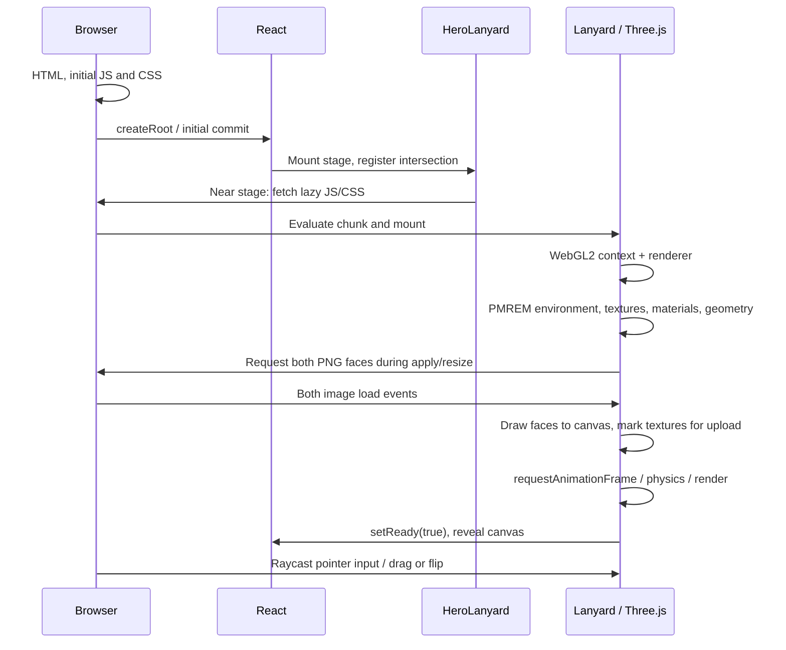

# Hero and 3D Lanyard — forensic deep dive

Audit date: 14 November 2026. Owner: Muhammad Shehroz, Lahore, Pakistan. Inspected checkout: `/workspace/Shehroz.my.id`, branch `work`, commit `6839347096468ec0ff98a5c01e5a1df0f03e1cfd`. Evidence labels: **S — verified source**, **O — direct local-browser observation**, **M — measured lab result**, **R — verified external research**, **J — professional judgment**, **H — unverified hypothesis**.

The requested `perf/portfolio-speed-optimization` branch was absent locally and from the accessible GitHub branch listing. The initial checkout was clean. Historical 38.1→22.2 s Hero, 19.1→13.3 s About, 16 browser tests and pixel-identical frames remain user-provided history, not verified before/after results. Current source and existing documentation were preserved. This audit makes no application changes.

Browser results describe a production Vite build served locally with explicit gzip and cache headers, default **preview** Contact configuration, Chromium 156 and **SwiftShader software graphics**. They are not measurements of the deployed domain or real-user field data. Public-site access failed through the environment proxy and web retrieval tool. Live Supabase configuration, delivery and hosted caching were not verified.

## Implementation map and protected design

| Source | Responsibility |
|---|---|
| [`src/components/Hero/Hero.tsx:12`](https://github.com/shehroz-codes/Shehroz.my.id/blob/6839347096468ec0ff98a5c01e5a1df0f03e1cfd/src/components/Hero/Hero.tsx#L12) | Name, greeting, roles, CTAs, socials; media-query state and Hero motion |
| [`src/components/Hero/HeroLanyard.tsx:8`](https://github.com/shehroz-codes/Shehroz.my.id/blob/6839347096468ec0ff98a5c01e5a1df0f03e1cfd/src/components/Hero/HeroLanyard.tsx#L8) | 150 px near-viewport observer; reduced-motion fallback; breakpoint at 851 px; lazy import |
| [`src/components/Lanyard/Lanyard.tsx:178`](https://github.com/shehroz-codes/Shehroz.my.id/blob/6839347096468ec0ff98a5c01e5a1df0f03e1cfd/src/components/Lanyard/Lanyard.tsx#L178) | Dimensions, simulation constants, materials and procedural geometry |
| [`src/components/Lanyard/Lanyard.tsx:424`](https://github.com/shehroz-codes/Shehroz.my.id/blob/6839347096468ec0ff98a5c01e5a1df0f03e1cfd/src/components/Lanyard/Lanyard.tsx#L424) | Cached image promises, async decoding hint and error handling |
| [`src/components/Lanyard/Lanyard.tsx:560`](https://github.com/shehroz-codes/Shehroz.my.id/blob/6839347096468ec0ff98a5c01e5a1df0f03e1cfd/src/components/Lanyard/Lanyard.tsx#L560) | Generated light-panel environment and PMREM conversion |
| [`src/components/Lanyard/Lanyard.tsx:606`](https://github.com/shehroz-codes/Shehroz.my.id/blob/6839347096468ec0ff98a5c01e5a1df0f03e1cfd/src/components/Lanyard/Lanyard.tsx#L606) | Seeded 128×128 grain/weave textures |
| [`src/components/Lanyard/Lanyard.tsx:1141`](https://github.com/shehroz-codes/Shehroz.my.id/blob/6839347096468ec0ff98a5c01e5a1df0f03e1cfd/src/components/Lanyard/Lanyard.tsx#L1141) | Renderer lifecycle, setup and resources |
| [`src/components/Lanyard/Lanyard.tsx:1401`](https://github.com/shehroz-codes/Shehroz.my.id/blob/6839347096468ec0ff98a5c01e5a1df0f03e1cfd/src/components/Lanyard/Lanyard.tsx#L1401) | Settings application, geometry keys and image fetching |
| [`src/components/Lanyard/Lanyard.tsx:1600`](https://github.com/shehroz-codes/Shehroz.my.id/blob/6839347096468ec0ff98a5c01e5a1df0f03e1cfd/src/components/Lanyard/Lanyard.tsx#L1600) | Render, readiness marker and animation loop |
| [`src/components/Lanyard/Lanyard.tsx:1737`](https://github.com/shehroz-codes/Shehroz.my.id/blob/6839347096468ec0ff98a5c01e5a1df0f03e1cfd/src/components/Lanyard/Lanyard.tsx#L1737) | Pointer hit testing, grab/drag/release/flip |
| [`src/components/Lanyard/Lanyard.tsx:1890`](https://github.com/shehroz-codes/Shehroz.my.id/blob/6839347096468ec0ff98a5c01e5a1df0f03e1cfd/src/components/Lanyard/Lanyard.tsx#L1890) | Cleanup and resource disposal |
| [`src/components/Hero/Hero.css:183`](https://github.com/shehroz-codes/Shehroz.my.id/blob/6839347096468ec0ff98a5c01e5a1df0f03e1cfd/src/components/Hero/Hero.css#L183) | Reserved stage, desktop full-viewport framing, mobile card-first order |

Protect the front/back artwork, 3:4 aspect, portrait body dimensions 1.6875×2.25, existing size 0.67, corner radius, strap dimensions/length/color, silver hardware, glossy finish, lighting appearance, motion, drag and flip. The card uses no downloaded GLB/model/HDR. Geometry, environment, surface normals and strap art are generated in JavaScript/canvas. Its identity is valuable; a static replacement is a rejected preferred optimization. The existing reduced-motion/error fallback is a separate accessibility/resilience behavior to retain.

## Actual startup sequence

This ordering matters: texture downloads do **not** start from HTML or initial React mount. Expensive setup occurs before `apply()` launches the requests. Dynamic import alone does not make the overall critical path fast.

## Measured timeline: constrained desktop cold run 1

| Stage | Navigation-relative timestamp | What it proves |
|---|---:|---|
| Initial JS request → response end | 0.21 → 1.33 s | Gzipped shell delivery on local throttled HTTP |
| React DOM observed | 2.08 s | First audit observation of committed Hero/About nodes; not exact React profiler mount time |
| FCP / latest initial LCP | 2.28 s | Text/image candidate, not card readiness |
| Lanyard chunk request → end | 3.49 → 7.99 s | 151,567-byte encoded body in this server's gzip output |
| Lanyard DOM observed | 8.18 s | Lazy component present |
| Lanyard canvas observed | 8.93 s | Setup has appended a WebGL canvas; still hidden |
| Front/back request start | 8.94 s | Image discovery after setup |
| Back PNG response end | 34.40 s | 1,822,339 bytes delivered |
| Front PNG response end | 37.24 s | 2,394,468 bytes delivered |
| Ready marker after render | 38.60 s | Both artwork images loaded and first render returned |

Source: `evidence/desktop-constrained-cold-1.json`. The remaining ~1.36 s between final response end and marker includes event dispatch, decode/draw/upload/first render and scheduling; it is **not** a measured pure image-decode duration. Independent shader compile, texture decode and physical GPU presentation durations were not available.

| Profile | Cache | Runs | FCP / observed LCP (s) | Card first-frame marker (s) | About after scroll (s) |
| --- | --- | --- | --- | --- | --- |
| desktop-fast | cold | 2 | 0.68 | 5.81 | 4.20 |
| desktop-fast | warm | 2 | 0.58 | 5.18 | 3.89 |
| mobile-fast | cold | 2 | 0.78 | 1.87 | 3.37 |
| mobile-fast | warm | 2 | 0.50 | 1.54 | 3.17 |
| desktop-constrained | cold | 2 | 2.28 | 38.64 | 5.00 |
| desktop-constrained | warm | 2 | 1.57 | 8.96 | 4.73 |
| mobile-constrained | cold | 2 | 2.86 | 38.15 | 3.56 |
| mobile-constrained | warm | 2 | 1.09 | 3.25 | 3.69 |

Main experiments use two runs per condition. In the second constrained desktop cold run, the marker was 38.67 s. In constrained mobile cold runs it was 38.11 / 38.19 s. Cold versus warm is a comparison of these test navigations, not a reconstructed historic optimization diff.

## What consumes time

**M/S — transfer and late discovery, high confidence.** The PNG faces total 4.22 MB decimal. At 200,000 bytes/s, their payload alone has an ideal lower bound of ~21.08 seconds before protocol, scheduling or competing bytes. The first desktop constrained run also loaded ~1.65 MB of real/anime Interests portraits and the 0.64 MB About portrait before the card finished. Their presence is verified in resource timings; the exact counterfactual time saved by deferring each was not measured.

**M — shared graphics stalls, high confidence for this environment; attribution limited.** The trace records a ~2,819 ms `GPUTask` overlapping a ~2,820 ms compositor `Commit`. These durations overlap and must not be added. The CPU profile attributes much of elapsed time to `(program)`/native work; it does not justify labeling all of it Three.js evaluation or GLSL compilation. The GL probe measured context acquisition at roughly 12 ms GlowCursor, 4.3 ms Halftone, 64.3 ms WarpText and 7 ms Lanyard in that separate instrumented run. Context creation itself is therefore not a sufficient explanation for the multi-second delay. PMREM rendering, surface rasterization, material programs and GPU command completion remain candidates for native graphics cost.

**S/M — dependencies and evaluation.** The emitted card chunk is 594,388 raw bytes (~152.7 kB Vite gzip estimate); its four bundled modules include Three core/module, the 1,974-line card component and CSS. It is requested almost immediately after the visible Hero activates, despite being split. The role-text chunk adds 164,358 raw bytes and 302 modules from Motion and supporting code. Importing a large package is not proof its entire npm package ships; module attribution is in `evidence/bundle-modules.json`.

**S — render loops, bounded but persistent while visible.** `MAX_STEP=1/960`, two constraint iterations, four joints and 72 strap samples support detailed physics. The displayed breeze is 0.5, so the zero-breeze resting exit is not reached in normal use. FPS caps are 60/30 active/idle for capable devices or 30/15 otherwise; the host reports three CPUs and takes the latter path. This does not guarantee achieved FPS. The code also pauses hidden, unfocused and nonintersecting views. Simulation object mutation happens outside React. An every-render `applyRef` effect rechecks keys, but no evidence establishes excessive React reconciliation as the dominant bottleneck.

## Geometry, textures and memory

The implementation builds a beveled extruded body, front/back face geometry, torus hardware, clamp and deforming band. Faces use physical materials with clearcoat; the glossy settings keep foil strength zero although support for other finishes exists. Light panels generate an environment texture; temporary PMREM inputs are disposed. Grain/weave are deterministic 128×128 textures. Both faces are painted at 1086×1448 into canvases and uploaded as sRGB CanvasTextures, with anisotropy capped at 8.

Two RGBA face levels alone are 12,580,224 bytes (~12.58 MB). With a complete mip pyramid the rough texture estimate is ~16.77 MB, excluding alignment, decoded images, CPU canvases, multisampling, depth, environment render targets and other canvases. This is a calculation, not measured VRAM. Main-run JS heap samples were approximately 11–23 MB and exclude native/GPU allocations. A trace field peaked above 57 MB in graphics `used_bytes`, but its accounting scope is not equivalent to card-only memory. No long-duration leak test was performed; existing cleanup is extensive and should be preserved.

## Interaction and resilience

Raycasting determines whether a pointer intersects the card. Desktop uses window-level pointer handling while avoiding underlying controls; mobile uses the canvas. Grab positions use inverse quaternion transforms, movement over six pixels cancels click-flip intent, and releases under 450 ms can flip. Flip adds angular velocity and updates `data-side`. Observed desktop pointer and mobile touch taps changed the side to back; drag began with the expected grabbing state and screenshots captured the moved card. These behavioral probes happen after readiness, and are not an INP measurement.

**Accessibility issue:** the group has a readable status but no tab stop or keyboard flip handler/control in rendered JSX. `.lanyard-flip` CSS exists without a corresponding rendered control. This is an actual source/DOM gap, not a CSS-selector assumption. Add equivalent keyboard operation without removing drag. Context loss and missing-artwork failures fall back to a static face; resize across the desktop breakpoint rebuilds the effect because `viewport` is a dependency. Test cleanup, both orientations and mid-drag resize after any change.

## Why did historical desktop performance reportedly remain unchanged?

That before/after result cannot be verified: neither the optimization branch nor its uncommitted diff or traces is present. **H:** an optimization aimed at cold network downloads could leave warm desktop native graphics/initialization largely unchanged; desktop enables WarpText and uses a larger card rendering surface. Current warm/cold and mobile/desktop differences are consistent with multiple bottlenecks, but do not prove the historical explanation. Never infer a regression or discard earlier work from this baseline.

## Preferred optimization experiments

1. Launch face image requests before context/environment/procedural setup, using a shared promise with the correct cross-origin/credentials mode. Test resource initiation and duplicates; preserve first-frame completeness and error fallback.
2. Move Interests context creation/texture upload and nonvisible portraits to near-viewport initialization with reserved layout. Test fast scrolling and deep links. This is scheduling work, not removing the effect.
3. Unify the duplicate real portrait URL. Evaluate lossless image encoding only with decoded-pixel equality and 3D frame comparison; no savings are assumed in advance.
4. Measure phase boundaries around PMREM, texture generation, artwork decode/upload and first render on a real GPU. Evaluate Three.js `compileAsync` only with the full lighting/material state and extension support; do not promise it removes every graphics stall.
5. Investigate precomputed deterministic grain/weave or reusable environment resources only after profiling. Lifecycle sharing has disposal and color-space risks; retain exact seeds, dimensions, filtering, lights and tone mapping.
6. Keep physics and pixel ratio unchanged initially. Reducing DPR, strap samples, solver steps or frame rate is a visual/interaction trade-off, not an invisible optimization.

References: [Three.js WebGLRenderer](https://threejs.org/docs/pages/WebGLRenderer.html) documents asynchronous compilation support; [MDN WebGL best practices](https://developer.mozilla.org/en-US/docs/Web/API/WebGL_API/WebGL_best_practices) explains synchronous query/stall hazards. See the full recommendation fields and tests in [report 07](07-OPTIMIZATION-ROADMAP.md).
