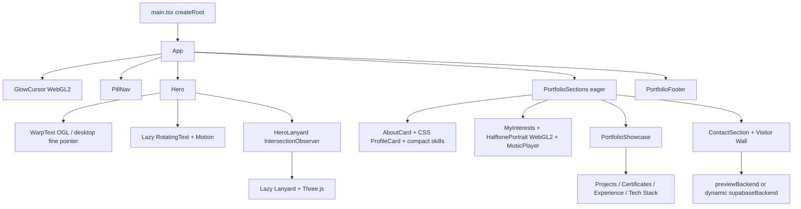
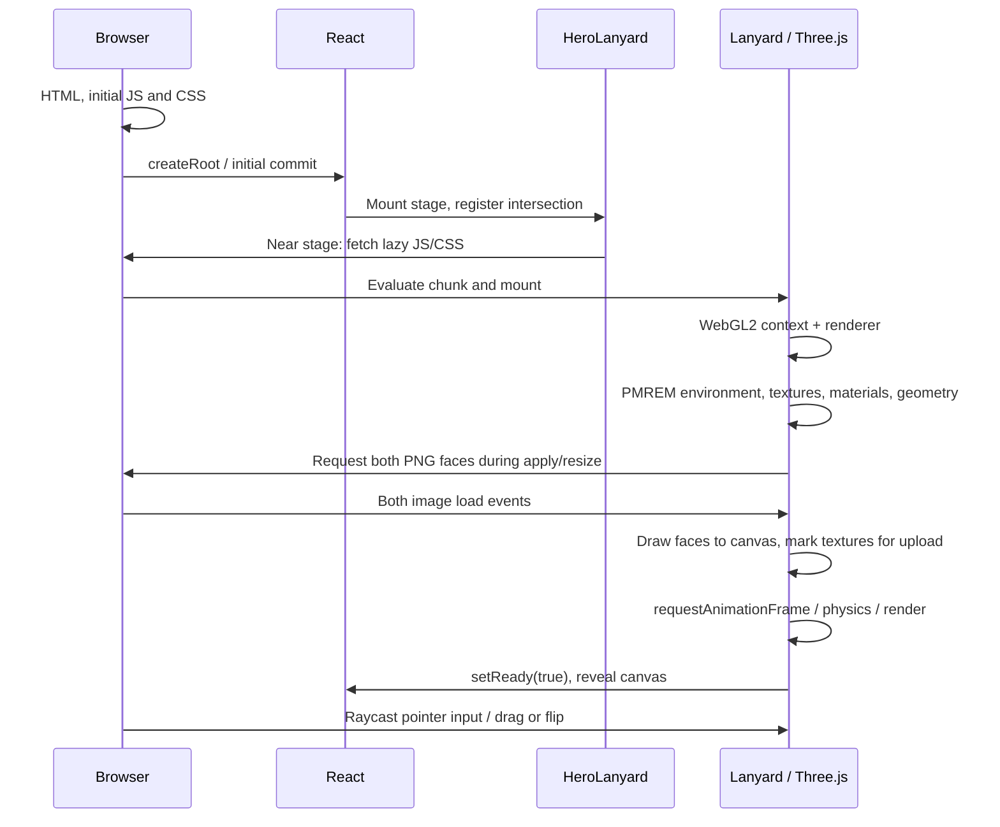

# Complete portfolio forensic performance audit and engineering handover

**Muhammad Shehroz · Shehroz.my.id · source snapshot 6839347096468ec0ff98a5c01e5a1df0f03e1cfd.** Technical evidence and research collected 14 November 2026; resumed documentation and focused interaction checks 15 November 2026.

This single report includes the essential source architecture, Hero/About diagnosis, every actual section, asset/network audit, Chromium methodology and results, full prioritized recommendation register, recruiter/market research and future engineering guardrails. It is usable without the companion Markdown files for understanding the conclusions. It does **not** contain or replace full application source, raw screenshots or trace binaries; implementing a change requires those exact artifacts and source history.

The application remained locked: no React/TypeScript/CSS/theme/layout/art/animation/content/navigation/dependency/configuration/backend edits, no commit/push/merge/deploy. Only audit documentation and diagnostic artifacts were created. Available branch is `work`, initially clean; the requested optimization branch and its historic uncommitted diff are unavailable. Therefore this is an audit of the available snapshot, not verification of its historical optimization gains. The historical 38.1→22.2 s Hero and 19.1→13.3 s About claims are explicitly separated below.

Local production-bundle Chromium used software graphics and default preview Contact. Live domain/CDN, hosted Supabase and third-party playback could not be verified in this environment. No lab result is presented as field Core Web Vitals. No hiring statistics, completed employment/credentials or future optimization savings are invented.

## Reading map

The chapters below follow executive conclusions, architecture, Hero, About, section-specific digest, assets/network, Chromium results, prioritized roadmap, recruiter/market review, then practical engineering continuation. Source citations are pinned to the audited commit. `evidence/` and `diagnostics/` paths refer to the accompanying audit directory. Research references include URLs/dates in this document, so the market analysis remains interpretable when this file is uploaded alone. Final evidence-integrity status is recorded in the accompanying verification report; this document's limitations remain applicable independently.

## Portfolio audit — executive summary

Audit date: 14 November 2026. Owner: Muhammad Shehroz, Lahore, Pakistan. Inspected checkout: `/workspace/Shehroz.my.id`, branch `work`, commit `6839347096468ec0ff98a5c01e5a1df0f03e1cfd`. Evidence labels: **S — verified source**, **O — direct local-browser observation**, **M — measured lab result**, **R — verified external research**, **J — professional judgment**, **H — unverified hypothesis**.

The requested `perf/portfolio-speed-optimization` branch was absent locally and from the accessible GitHub branch listing. The initial checkout was clean. Historical 38.1→22.2 s Hero, 19.1→13.3 s About, 16 browser tests and pixel-identical frames remain user-provided history, not verified before/after results. Current source and existing documentation were preserved. This audit makes no application changes.

Browser results describe a production Vite build served locally with explicit gzip and cache headers, default **preview** Contact configuration, Chromium 156 and **SwiftShader software graphics**. They are not measurements of the deployed domain or real-user field data. Public-site access failed through the environment proxy and web retrieval tool. Live Supabase configuration, delivery and hosted caching were not verified.

### Overall assessment

**J:** This is a distinctive, cohesive frontend demonstration with a substantial custom interaction implementation. Its current presentation is not yet a strong evidence package for employment or freelance conversion: the project gallery contains concepts/placeholders, no project live/source URLs are supplied, and the Hero CV and contact actions do not complete their advertised tasks. Keep the violet/indigo identity, artwork, dimensions and preferred interactions. Prioritize usable contact and verified project evidence alongside invisible loading work.

### Principal findings

1. **M/S — slow card readiness has a substantial transfer component.** Front/back PNGs total **4,216,807 bytes**. In desktop constrained cold run 1, their requests began near 8.94 s, the last response ended at 37.24 s, and the first-render marker appeared at 38.60 s. Real/anime/About portraits also transfer early. Start artwork work earlier and reduce competing initial work, preserving both card faces and their pixels.
2. **M — warm caches do not eliminate desktop cost.** Median first-frame marker: 38.64 s constrained cold / 8.96 s constrained warm; 5.81 s unthrottled cold / 5.19 s unthrottled warm. The diagnostic trace contains an overlapping 2.82 s graphics task/commit; this is software-renderer evidence, not proof of a specific hardware shader bottleneck.
3. **S/M — About is eager, with an intentional reveal gate.** It mounts in the initial React tree, uses no WebGL itself, and has no Suspense boundary. Its 11 skills yield an actions animation ending nominally 2.75 s after intersection. The observed post-scroll readiness range was 3.08–5.22 s across the main runs. Delaying the user's scroll also delays navigation-relative readiness; those clocks must not be conflated.
4. **S — startup includes avoidable unrelated work.** Interests creates its WebGL context at mount and eagerly references two portraits. The identical 640,933-byte real portrait is served at two URLs. Lower-page section implementations are eagerly imported, alongside 116,159 bytes of initial CSS; Lanyard and rotating role text retain separate lazy chunks. Firebase, PulseHeart and the like hook are not in the active UI path.
5. **O/S — conversion gaps outweigh any need for a new visual theme.** `cvPath` and `contactHref` are null in Hero data. About contact routes to GitHub. Project, certificate and employment materials are explicitly labeled samples. These honest labels should remain until real records replace them.
6. **S/O — accessibility and discovery need targeted work.** The card has pointer interactions but no keyboard flip control. There is no skip link, meaningful description metadata, canonical link or social-preview metadata. Automated accessibility results and manual limitations are detailed in report 06/09; an automated scan is not WCAG certification.

### Measurements

| Profile | Cache | Runs | FCP / observed LCP (s) | Card first-frame marker (s) | About after scroll (s) |
| --- | --- | --- | --- | --- | --- |
| desktop-fast | cold | 2 | 0.68 | 5.81 | 4.20 |
| desktop-fast | warm | 2 | 0.58 | 5.18 | 3.89 |
| mobile-fast | cold | 2 | 0.78 | 1.87 | 3.37 |
| mobile-fast | warm | 2 | 0.50 | 1.54 | 3.17 |
| desktop-constrained | cold | 2 | 2.28 | 38.64 | 5.00 |
| desktop-constrained | warm | 2 | 1.57 | 8.96 | 4.73 |
| mobile-constrained | cold | 2 | 2.86 | 38.15 | 3.56 |
| mobile-constrained | warm | 2 | 1.09 | 3.25 | 3.69 |

FCP/LCP refer to text/image candidates; the interactive WebGL card is not represented by that LCP value. Card readiness means the existing `data-ready=true` marker after `renderer.render`, not guaranteed GPU presentation, settled animation or input responsiveness. About means actions reveal complete and portrait images loaded after an explicit instant scroll. Two samples per condition support a directional comparison, not a population percentile.

### First priorities

- **High:** recover the missing optimization branch/work before proposing replacement patches; reproduce this audit on its exact diff.
- **High:** begin both card image requests before expensive renderer setup; prioritize them against below-fold portrait/graphics initialization. Preserve the original art and all interactions.
- **High:** provide a real CV, a working contact destination and one genuine portfolio case study with source/demo evidence. Do not invent client work or employment.
- **High:** provide keyboard access to the card's flip function; review continuous motion controls and focus behavior.
- **Medium:** use one URL for identical portrait bytes, investigate pixel-preserving asset encoding, and defer inactive showcase modules while retaining navigation/layout dimensions.
- **Medium:** add accurate metadata after confirming the intended canonical hostname. The repository deploys a GitHub Pages project path; custom-domain operation was not verified.

All implementation is future work requiring owner authorization. No redesign, schema action, deployment, commit or push was performed. See [roadmap](07-OPTIMIZATION-ROADMAP.md), [Chromium evidence](06-CHROMIUM-PERFORMANCE-RESULTS.md), [market review](09-PORTFOLIO-RECRUITER-UX-MARKET-RESEARCH.md) and [combined handover](PERFORMANCE-AUDIT-COMPLETE.md).

## Architecture and verified stack

### Repository and execution architecture

The initial inventory contains 176 tracked files and 62 TypeScript modules under `src/`. Source, tests, deployment workflows, backend functions, SQL migrations and existing docs were inspected. `node_modules` and `dist` already existed. Builds and diagnostics ran in an isolated tracked-file copy under `/workspace/work/audit/repo`; the original `dist` was not overwritten. The available local `dist` has the same main bundle filenames and sizes as the new default build, but that does not prove live deployment equivalence.

| Area | Role |
|---|---|
| `src/main.tsx` | `createRoot` with StrictMode and global CSS; client rendering, no SSR/hydration |
| `src/app/App.tsx` | Global background, navigation, Hero, all portfolio sections, Footer; active-anchor state |
| `src/components/` | Custom reusable visual systems, Hero and Three.js card |
| `src/sections/` | About/ProfileCard, Interests/Music, tabbed showcase, Contact/Visitor Wall |
| `src/content/portfolio.ts` and `src/sections/config/profile.ts` | Separate identity/link stores; inconsistent role/contact settings need coordination |
| `src/styles/` | Tailwind v4 imports, dark theme tokens, three self-hosted Latin variable fonts |
| `public/` | Badge PNGs, About portrait, logo/favicons and manifest; un-hashed filenames |
| `src/sections/**/assets/` | Bundler-hashed portraits, concept previews, sample PDFs and icons |
| `supabase/functions/` | Public submission, private submission, photo reads, owner management and shared validation |
| `supabase/migrations/` | Historical permission repair and additive contact/photo cleanup schema |
| `tests/` | Vitest unit/component/edge tests, browser scenarios, SQL fixtures |
| `.github/workflows/` | PR validation and main-branch Pages deployment |
| `docs/` | Existing architecture/design and contact deployment evidence; not overwritten |

### Versions

| Package | Declared | Locked / inspected install |
| --- | --- | --- |
| @fontsource-variable/inter | ^5.3.0 | 5.3.0 |
| @fontsource-variable/jetbrains-mono | ^5.3.0 | 5.3.0 |
| @fontsource-variable/space-grotesk | ^5.3.0 | 5.3.0 |
| @hugeicons/core-free-icons | ^4.4.0 | 4.4.0 |
| @marsidev/react-turnstile | 1.6.3 | 1.6.3 |
| @supabase/supabase-js | 2.119.0 | 2.119.0 |
| firebase | ^12.19.0 | 12.19.0 |
| lucide-react | ^1.72.0 | 1.72.0 |
| motion | ^14.12.0 | 14.12.0 |
| ogl | ^1.0.11 | 1.0.11 |
| react | ^19.3.1 | 19.3.1 |
| react-dom | ^19.3.1 | 19.3.1 |
| react-icons | ^5.7.0 | 5.7.0 |
| three | ^0.187.0 | 0.187.0 |
| @axe-core/playwright | 4.14.0 | 4.14.0 |
| @imagemagick/magick-wasm | 0.0.30 | 0.0.30 |
| @playwright/test | 1.65.0 | 1.65.0 |
| @supabase/server | 1.9.2 | 1.9.2 |
| @tailwindcss/vite | ^4.3.5 | 4.3.5 |
| @testing-library/react | 16.3.3 | 16.3.3 |
| @types/node | ^24.19.2 | 24.19.2 |
| @types/react | ^19.3.0 | 19.3.0 |
| @types/react-dom | ^19.3.0 | 19.3.0 |
| @types/three | ^0.187.0 | 0.187.0 |
| @vitejs/plugin-react | ^6.3.0 | 6.3.0 |
| jose | 6.2.17 | 6.2.17 |
| jsdom | 31.0.1 | 31.0.1 |
| tailwindcss | ^4.3.5 | 4.3.5 |
| typescript | ^7.0.2 | 7.0.2 |
| vite | ^8.3.8 | 8.3.8 |
| vitest | 5.1.0 | 5.1.0 |

Node on this machine is 24.22.1; package engine is >=22.12.0 and CI selects Node 24. Chromium is 156.0.8078.79. Vite 8 uses Rolldown; recommendations based on older Rollup configuration syntax need version-specific verification. There is **no React Three Fiber, Drei, Rapier, Redux or React Router dependency** in the inspected manifest. The card's physics are handwritten Three.js vector/quaternion calculations, not a physics package. Motion resolves through framer-motion/motion-dom in the role-text chunk. The dependency list alone does not prove every package executes in the browser.

### Routing and state

[`src/app/App.tsx:10`](https://github.com/shehroz-codes/Shehroz.my.id/blob/6839347096468ec0ff98a5c01e5a1df0f03e1cfd/src/app/App.tsx#L10) declares Home/About/My Interests/Projects/Contact fragment links. `#home` is the main element wrapping all sections. `#skills` is a span in the Projects container, interpreted by the showcase hashchange effect to select the Tech Stack tab. There are no route files or data router. Direct `#about` and `#skills` entry must be included in any future lazy-loading test.

State is local: App activeHref; Hero media/notice state; HeroLanyard near/wide/reduced state; Lanyard ready/side/failure state with mutable simulation refs; About one-time visibility; Showcase active tab/project/document; Music genre/current track; Contact backend/loading/cooldown; forms, feed, image failure and pagination. No global state store. DOM refs/CSS custom properties carry frame-by-frame physics and tilt, avoiding React state on every frame. App still re-renders on active section changes; its scroll work is coalesced into requestAnimationFrame and removes listeners on unmount.

StrictMode double effects are a development behavior; these measurements used a production bundle. Do not blame production delays on development StrictMode without evidence.

### Styling and visual systems

[`src/styles/tokens.css:1`](https://github.com/shehroz-codes/Shehroz.my.id/blob/6839347096468ec0ff98a5c01e5a1df0f03e1cfd/src/styles/tokens.css#L1) defines background `#050310`, surface `#0B0A1F`, primary `#5B21F0`, secondary `#4F46E5`, text `#F8FAFC`, muted `#A7A3BA`, accent `#A78BFA`; Space Grotesk/Inter/JetBrains Mono are self-hosted Latin variable fonts with `font-display: swap`. Local component CSS is extensive; CSS effects include glass backgrounds, blur, masks, blending, infinite drift/pulse and finite reveals. These are distinct costs from React reconciliation.

Four WebGL contexts were observed on desktop: GlowCursor, HalftonePortrait, WarpText and Lanyard. Mobile disables enhanced WarpText through `useHeroMotion` but keeps the card and existing other effects. About ProfileCard uses CSS transforms, masks and blends, not a WebGL renderer. Preferred recommendations preserve this design system.

### Supabase and network boundary

[`src/sections/components/contact/config.ts:17`](https://github.com/shehroz-codes/Shehroz.my.id/blob/6839347096468ec0ff98a5c01e5a1df0f03e1cfd/src/sections/components/contact/config.ts#L17) defaults Contact to preview unless explicitly built live. `loadBackend` dynamically imports Supabase only in live mode; local preview storage stays in the browser. `getSupabase` validates a specific project URL and publishable-key prefix. With variables absent in the audited build, unreachable SDK setup is tree-shaken; the **5,351-byte backend chunk is not the size of a configured live Supabase SDK integration**.

The live adapter selects explicit published/non-demo columns, orders newest first, requests page size + 1, aborts reads after 15 seconds and polls every 30 seconds. It does not use a Realtime channel. Public photos are read through an Edge Function that verifies publication and uses `no-store`. Writes require explicit feature gates, Auth/Turnstile and server validation; public and private messages have separate handlers. Owner actions require non-anonymous admin membership. No production records, keys, logs or database settings were queried or changed by this audit.

Static security review found explicit RLS/revokes in the supplied migrations, public column minimization, server-side CAPTCHA/JWT validation paths, image verification and no service-role key in frontend source. This is not a deployed security certification. Preserve the earlier warning in `docs/contact/COMPLETION_AND_RELEASE.md`: the historical permission migration's local timestamp differs from the recorded remote timestamp; never blindly replay the migrations. CORS in `_shared/contact.ts:1` expects `https://shehroz-codes.github.io`; a real custom-domain move would need separately approved origin verification.

### Deployment and test architecture

[`vite.config.ts:6`](https://github.com/shehroz-codes/Shehroz.my.id/blob/6839347096468ec0ff98a5c01e5a1df0f03e1cfd/vite.config.ts#L6) sets base `/Shehroz.my.id/`. The Pages workflow builds on main, injects public Supabase/Turnstile variables, sets live mode and disables public submissions. It uploads `dist` and deploys Pages with scoped permissions. No CNAME was found among tracked files. This supports the GitHub Pages project URL; the requested custom hostname cannot be confirmed from this checkout.

Current type checks and all 77 unit tests pass. The existing browser configuration uses Vite **development** servers at 4173/4174 and controlled preview/mocked-live environments. Those tests validate behavior, not production timings. Separate audit scripts measured the built static files on port 4180. SQL tests were not run because the task did not require schema execution; no hosted write tests were performed. Final current browser-suite results are in report 06.

### Source inventory boundary

The companion architecture report and evidence inventory list all 62 TypeScript modules and their imports/use-prefixed identifiers, including inactive historical code. Important source paths and active lifecycle relationships are included throughout this combined report. Use source inspection, not a package/dependency name alone, to decide runtime participation.

### Existing optimizations to preserve

- Lazy Lanyard/Three.js, lazy rotating roles, IntersectionObserver near loading, reduced-motion fallbacks.
- Texture image promise cache within one card instance; canvas texture reuse and explicit disposal; geometry/material/renderer cleanup.
- Adaptive card DPR/FPS, page visibility/focus pause, offscreen pause, finite timestep bounds and scratch vectors.
- WarpText 30-FPS cap, font readiness wait and visibility cleanup; fine-pointer gating for enhanced Hero behavior.
- GlowCursor low preset, DPR cap, idle sleep and context fallback; Halftone idle/visibility gating.
- ProfileCard memoization and a spring loop that stops when settled.
- Font self-hosting/subsetting; compact WebP project thumbnails; on-demand Spotify iframe; pagination and image fallback for the wall.

Do not mistake these existing safeguards for newly recommended or newly implemented work. No before/after optimization comparison is possible without the missing historical changes.

## Hero and 3D Lanyard — forensic deep dive

### Implementation map and protected design

| Source | Responsibility |
|---|---|
| [`src/components/Hero/Hero.tsx:12`](https://github.com/shehroz-codes/Shehroz.my.id/blob/6839347096468ec0ff98a5c01e5a1df0f03e1cfd/src/components/Hero/Hero.tsx#L12) | Name, greeting, roles, CTAs, socials; media-query state and Hero motion |
| [`src/components/Hero/HeroLanyard.tsx:8`](https://github.com/shehroz-codes/Shehroz.my.id/blob/6839347096468ec0ff98a5c01e5a1df0f03e1cfd/src/components/Hero/HeroLanyard.tsx#L8) | 150 px near-viewport observer; reduced-motion fallback; breakpoint at 851 px; lazy import |
| [`src/components/Lanyard/Lanyard.tsx:178`](https://github.com/shehroz-codes/Shehroz.my.id/blob/6839347096468ec0ff98a5c01e5a1df0f03e1cfd/src/components/Lanyard/Lanyard.tsx#L178) | Dimensions, simulation constants, materials and procedural geometry |
| [`src/components/Lanyard/Lanyard.tsx:424`](https://github.com/shehroz-codes/Shehroz.my.id/blob/6839347096468ec0ff98a5c01e5a1df0f03e1cfd/src/components/Lanyard/Lanyard.tsx#L424) | Cached image promises, async decoding hint and error handling |
| [`src/components/Lanyard/Lanyard.tsx:560`](https://github.com/shehroz-codes/Shehroz.my.id/blob/6839347096468ec0ff98a5c01e5a1df0f03e1cfd/src/components/Lanyard/Lanyard.tsx#L560) | Generated light-panel environment and PMREM conversion |
| [`src/components/Lanyard/Lanyard.tsx:606`](https://github.com/shehroz-codes/Shehroz.my.id/blob/6839347096468ec0ff98a5c01e5a1df0f03e1cfd/src/components/Lanyard/Lanyard.tsx#L606) | Seeded 128×128 grain/weave textures |
| [`src/components/Lanyard/Lanyard.tsx:1141`](https://github.com/shehroz-codes/Shehroz.my.id/blob/6839347096468ec0ff98a5c01e5a1df0f03e1cfd/src/components/Lanyard/Lanyard.tsx#L1141) | Renderer lifecycle, setup and resources |
| [`src/components/Lanyard/Lanyard.tsx:1401`](https://github.com/shehroz-codes/Shehroz.my.id/blob/6839347096468ec0ff98a5c01e5a1df0f03e1cfd/src/components/Lanyard/Lanyard.tsx#L1401) | Settings application, geometry keys and image fetching |
| [`src/components/Lanyard/Lanyard.tsx:1600`](https://github.com/shehroz-codes/Shehroz.my.id/blob/6839347096468ec0ff98a5c01e5a1df0f03e1cfd/src/components/Lanyard/Lanyard.tsx#L1600) | Render, readiness marker and animation loop |
| [`src/components/Lanyard/Lanyard.tsx:1737`](https://github.com/shehroz-codes/Shehroz.my.id/blob/6839347096468ec0ff98a5c01e5a1df0f03e1cfd/src/components/Lanyard/Lanyard.tsx#L1737) | Pointer hit testing, grab/drag/release/flip |
| [`src/components/Lanyard/Lanyard.tsx:1890`](https://github.com/shehroz-codes/Shehroz.my.id/blob/6839347096468ec0ff98a5c01e5a1df0f03e1cfd/src/components/Lanyard/Lanyard.tsx#L1890) | Cleanup and resource disposal |
| [`src/components/Hero/Hero.css:183`](https://github.com/shehroz-codes/Shehroz.my.id/blob/6839347096468ec0ff98a5c01e5a1df0f03e1cfd/src/components/Hero/Hero.css#L183) | Reserved stage, desktop full-viewport framing, mobile card-first order |

Protect the front/back artwork, 3:4 aspect, portrait body dimensions 1.6875×2.25, existing size 0.67, corner radius, strap dimensions/length/color, silver hardware, glossy finish, lighting appearance, motion, drag and flip. The card uses no downloaded GLB/model/HDR. Geometry, environment, surface normals and strap art are generated in JavaScript/canvas. Its identity is valuable; a static replacement is a rejected preferred optimization. The existing reduced-motion/error fallback is a separate accessibility/resilience behavior to retain.

### Actual startup sequence

This ordering matters: texture downloads do **not** start from HTML or initial React mount. Expensive setup occurs before `apply()` launches the requests. Dynamic import alone does not make the overall critical path fast.

### Measured timeline: constrained desktop cold run 1

| Stage | Navigation-relative timestamp | What it proves |
|---|---:|---|
| Initial JS request → response end | 0.21 → 1.33 s | Gzipped shell delivery on local throttled HTTP |
| React DOM observed | 2.08 s | First audit observation of committed Hero/About nodes; not exact React profiler mount time |
| FCP / latest initial LCP | 2.28 s | Text/image candidate, not card readiness |
| Lanyard chunk request → end | 3.49 → 7.99 s | 151,567-byte encoded body in this server's gzip output |
| Lanyard DOM observed | 8.18 s | Lazy component present |
| Lanyard canvas observed | 8.93 s | Setup has appended a WebGL canvas; still hidden |
| Front/back request start | 8.94 s | Image discovery after setup |
| Back PNG response end | 34.40 s | 1,822,339 bytes delivered |
| Front PNG response end | 37.24 s | 2,394,468 bytes delivered |
| Ready marker after render | 38.60 s | Both artwork images loaded and first render returned |

Source: `evidence/desktop-constrained-cold-1.json`. The remaining ~1.36 s between final response end and marker includes event dispatch, decode/draw/upload/first render and scheduling; it is **not** a measured pure image-decode duration. Independent shader compile, texture decode and physical GPU presentation durations were not available.

| Profile | Cache | Runs | FCP / observed LCP (s) | Card first-frame marker (s) | About after scroll (s) |
| --- | --- | --- | --- | --- | --- |
| desktop-fast | cold | 2 | 0.68 | 5.81 | 4.20 |
| desktop-fast | warm | 2 | 0.58 | 5.18 | 3.89 |
| mobile-fast | cold | 2 | 0.78 | 1.87 | 3.37 |
| mobile-fast | warm | 2 | 0.50 | 1.54 | 3.17 |
| desktop-constrained | cold | 2 | 2.28 | 38.64 | 5.00 |
| desktop-constrained | warm | 2 | 1.57 | 8.96 | 4.73 |
| mobile-constrained | cold | 2 | 2.86 | 38.15 | 3.56 |
| mobile-constrained | warm | 2 | 1.09 | 3.25 | 3.69 |

Main experiments use two runs per condition. In the second constrained desktop cold run, the marker was 38.67 s. In constrained mobile cold runs it was 38.11 / 38.19 s. Cold versus warm is a comparison of these test navigations, not a reconstructed historic optimization diff.

### What consumes time

**M/S — transfer and late discovery, high confidence.** The PNG faces total 4.22 MB decimal. At 200,000 bytes/s, their payload alone has an ideal lower bound of ~21.08 seconds before protocol, scheduling or competing bytes. The first desktop constrained run also loaded ~1.65 MB of real/anime Interests portraits and the 0.64 MB About portrait before the card finished. Their presence is verified in resource timings; the exact counterfactual time saved by deferring each was not measured.

**M — shared graphics stalls, high confidence for this environment; attribution limited.** The trace records a ~2,819 ms `GPUTask` overlapping a ~2,820 ms compositor `Commit`. These durations overlap and must not be added. The CPU profile attributes much of elapsed time to `(program)`/native work; it does not justify labeling all of it Three.js evaluation or GLSL compilation. The GL probe measured context acquisition at roughly 12 ms GlowCursor, 4.3 ms Halftone, 64.3 ms WarpText and 7 ms Lanyard in that separate instrumented run. Context creation itself is therefore not a sufficient explanation for the multi-second delay. PMREM rendering, surface rasterization, material programs and GPU command completion remain candidates for native graphics cost.

**S/M — dependencies and evaluation.** The emitted card chunk is 594,388 raw bytes (~152.7 kB Vite gzip estimate); its four bundled modules include Three core/module, the 1,974-line card component and CSS. It is requested almost immediately after the visible Hero activates, despite being split. The role-text chunk adds 164,358 raw bytes and 302 modules from Motion and supporting code. Importing a large package is not proof its entire npm package ships; module attribution is in `evidence/bundle-modules.json`.

**S — render loops, bounded but persistent while visible.** `MAX_STEP=1/960`, two constraint iterations, four joints and 72 strap samples support detailed physics. The displayed breeze is 0.5, so the zero-breeze resting exit is not reached in normal use. FPS caps are 60/30 active/idle for capable devices or 30/15 otherwise; the host reports three CPUs and takes the latter path. This does not guarantee achieved FPS. The code also pauses hidden, unfocused and nonintersecting views. Simulation object mutation happens outside React. An every-render `applyRef` effect rechecks keys, but no evidence establishes excessive React reconciliation as the dominant bottleneck.

### Geometry, textures and memory

The implementation builds a beveled extruded body, front/back face geometry, torus hardware, clamp and deforming band. Faces use physical materials with clearcoat; the glossy settings keep foil strength zero although support for other finishes exists. Light panels generate an environment texture; temporary PMREM inputs are disposed. Grain/weave are deterministic 128×128 textures. Both faces are painted at 1086×1448 into canvases and uploaded as sRGB CanvasTextures, with anisotropy capped at 8.

Two RGBA face levels alone are 12,580,224 bytes (~12.58 MB). With a complete mip pyramid the rough texture estimate is ~16.77 MB, excluding alignment, decoded images, CPU canvases, multisampling, depth, environment render targets and other canvases. This is a calculation, not measured VRAM. Main-run JS heap samples were approximately 11–23 MB and exclude native/GPU allocations. A trace field peaked above 57 MB in graphics `used_bytes`, but its accounting scope is not equivalent to card-only memory. No long-duration leak test was performed; existing cleanup is extensive and should be preserved.

### Interaction and resilience

Raycasting determines whether a pointer intersects the card. Desktop uses window-level pointer handling while avoiding underlying controls; mobile uses the canvas. Grab positions use inverse quaternion transforms, movement over six pixels cancels click-flip intent, and releases under 450 ms can flip. Flip adds angular velocity and updates `data-side`. Observed desktop pointer and mobile touch taps changed the side to back; drag began with the expected grabbing state and screenshots captured the moved card. These behavioral probes happen after readiness, and are not an INP measurement.

**Accessibility issue:** the group has a readable status but no tab stop or keyboard flip handler/control in rendered JSX. `.lanyard-flip` CSS exists without a corresponding rendered control. This is an actual source/DOM gap, not a CSS-selector assumption. Add equivalent keyboard operation without removing drag. Context loss and missing-artwork failures fall back to a static face; resize across the desktop breakpoint rebuilds the effect because `viewport` is a dependency. Test cleanup, both orientations and mid-drag resize after any change.

### Why did historical desktop performance reportedly remain unchanged?

That before/after result cannot be verified: neither the optimization branch nor its uncommitted diff or traces is present. **H:** an optimization aimed at cold network downloads could leave warm desktop native graphics/initialization largely unchanged; desktop enables WarpText and uses a larger card rendering surface. Current warm/cold and mobile/desktop differences are consistent with multiple bottlenecks, but do not prove the historical explanation. Never infer a regression or discard earlier work from this baseline.

### Preferred optimization experiments

1. Launch face image requests before context/environment/procedural setup, using a shared promise with the correct cross-origin/credentials mode. Test resource initiation and duplicates; preserve first-frame completeness and error fallback.
2. Move Interests context creation/texture upload and nonvisible portraits to near-viewport initialization with reserved layout. Test fast scrolling and deep links. This is scheduling work, not removing the effect.
3. Unify the duplicate real portrait URL. Evaluate lossless image encoding only with decoded-pixel equality and 3D frame comparison; no savings are assumed in advance.
4. Measure phase boundaries around PMREM, texture generation, artwork decode/upload and first render on a real GPU. Evaluate Three.js `compileAsync` only with the full lighting/material state and extension support; do not promise it removes every graphics stall.
5. Investigate precomputed deterministic grain/weave or reusable environment resources only after profiling. Lifecycle sharing has disposal and color-space risks; retain exact seeds, dimensions, filtering, lights and tone mapping.
6. Keep physics and pixel ratio unchanged initially. Reducing DPR, strap samples, solver steps or frame rate is a visual/interaction trade-off, not an invisible optimization.

References: [Three.js WebGLRenderer](https://threejs.org/docs/pages/WebGLRenderer.html) documents asynchronous compilation support; [MDN WebGL best practices](https://developer.mozilla.org/en-US/docs/Web/API/WebGL_API/WebGL_best_practices) explains synchronous query/stall hazards. See the full recommendation fields and tests in [report 07](07-OPTIMIZATION-ROADMAP.md).

## About — loading and interaction deep dive

### Exact architecture

`PortfolioSections` statically imports and immediately renders `AboutCard`, injecting `ProfileCard` through `profileSlot`. There is no About dynamic import or Suspense boundary. The fallback image code in AboutCard is not the selected path; the supplied ProfileCard renders the actual portrait. Sources: [`src/sections/PortfolioSections.tsx:1`](https://github.com/shehroz-codes/Shehroz.my.id/blob/6839347096468ec0ff98a5c01e5a1df0f03e1cfd/src/sections/PortfolioSections.tsx#L1), [`src/sections/components/AboutCard.tsx:149`](https://github.com/shehroz-codes/Shehroz.my.id/blob/6839347096468ec0ff98a5c01e5a1df0f03e1cfd/src/sections/components/AboutCard.tsx#L149), [`src/sections/components/ProfileCard/ProfileCard.tsx:105`](https://github.com/shehroz-codes/Shehroz.my.id/blob/6839347096468ec0ff98a5c01e5a1df0f03e1cfd/src/sections/components/ProfileCard/ProfileCard.tsx#L105), [`src/sections/config/aboutCardData.tsx:17`](https://github.com/shehroz-codes/Shehroz.my.id/blob/6839347096468ec0ff98a5c01e5a1df0f03e1cfd/src/sections/config/aboutCardData.tsx#L17), [`src/sections/config/profile.ts:78`](https://github.com/shehroz-codes/Shehroz.my.id/blob/6839347096468ec0ff98a5c01e5a1df0f03e1cfd/src/sections/config/profile.ts#L78).

The section contains identity, CSS portrait card, availability, role/specialty/bio, location/GitHub/education/LinkedIn label, 11 compact skills and two contact/GitHub actions. The same content is not an employment history. University name is supplied by the owner in this task, but the current site only displays BS Computer Science in progress; no degree completion is implied.

### Lifecycle and readiness

1. Initial HTML fetch loads a client-rendered shell; React commits About with every other top-level section.
2. ProfileCard initializes a CSS-variable spring engine at mount, reads size, registers pointer and ResizeObserver handlers, and starts its 1.4-second slow intro phase even if below the fold.
3. The portrait `` is browser-scheduled. In observed initial loads it is close enough to request early; `loading=lazy` does not guarantee it waits for a user scroll. Pattern/backdrop assets are CSS resources. Fonts are shared with the rest of the page.
4. About's `useInView` observes its section with a 15% threshold. It sets `is-visible` once and disconnects.
5. Root entry lasts 0.9 s; child `.ac-reveal` uses 0.7 s duration and `index * 90 ms + 250 ms` delay. With 11 skills, `actionsIndex=9+11=20`: **20×90+250+700 = 2,750 ms** until the button row finishes its reveal. This is intentional visual timing.
6. Pointer movement writes `--mx/--my` directly; portrait hover/touch writes light/rotation/parallax variables through a damped spring RAF. React need not re-render every animation frame. The portrait loop stops when settled and removes listeners on unmount.

References: [`src/sections/components/AboutCard.tsx:100`](https://github.com/shehroz-codes/Shehroz.my.id/blob/6839347096468ec0ff98a5c01e5a1df0f03e1cfd/src/sections/components/AboutCard.tsx#L100), [`src/sections/components/AboutCard.tsx:178`](https://github.com/shehroz-codes/Shehroz.my.id/blob/6839347096468ec0ff98a5c01e5a1df0f03e1cfd/src/sections/components/AboutCard.tsx#L178), [`src/sections/components/AboutCard.tsx:187`](https://github.com/shehroz-codes/Shehroz.my.id/blob/6839347096468ec0ff98a5c01e5a1df0f03e1cfd/src/sections/components/AboutCard.tsx#L187), [`src/sections/components/AboutCard.css:270`](https://github.com/shehroz-codes/Shehroz.my.id/blob/6839347096468ec0ff98a5c01e5a1df0f03e1cfd/src/sections/components/AboutCard.css#L270), [`src/sections/components/ProfileCard/ProfileCard.tsx:136`](https://github.com/shehroz-codes/Shehroz.my.id/blob/6839347096468ec0ff98a5c01e5a1df0f03e1cfd/src/sections/components/ProfileCard/ProfileCard.tsx#L136), [`src/sections/components/ProfileCard/ProfileCard.tsx:260`](https://github.com/shehroz-codes/Shehroz.my.id/blob/6839347096468ec0ff98a5c01e5a1df0f03e1cfd/src/sections/components/ProfileCard/ProfileCard.tsx#L260).

### Distinguishing causes

| Category | Verified finding | Implication |
|---|---|---|
| Network | `public/sections/about/profile.png` is 640,933 bytes; requested at 2.19 s and ends 17.81 s in desktop constrained cold run 1 | Slow first arrival can wait for the portrait; browser lazy scheduling competes with eager Interests images |
| JavaScript | About/ProfileCard code is in the initial 505,710-byte shell | No separate About-chunk fetch explains the delay |
| React mount | About DOM observed at 2.085 s in that run | It is not mounted only at 13 or 19 seconds |
| Image decoding | Browser image completion observed; decode duration not separately instrumented | Do not assign the entire request/ready gap to decode |
| Animation | Nominal actions reveal finishes 2.75 s after intersection | Optimizing JS alone cannot remove this designed wait |
| Mount versus visibility | Root/children are animated from a hidden/reveal state until intersection | DOM present is not equivalent to visible or fully interactive content |
| Graphics | ProfileCard has CSS holographic/blend/filter effects; no About WebGL context | Other page WebGL and compositor work can contend; no isolated About GPU timing |
| Layout | Pointer handling reads bounding rect; spring writes multiple CSS variables; size reads on ResizeObserver | Batch layout reads and consider pausing unseen intro work only after profiling |
| Hardware | Software rendering and CPU throttling affect animation-event delivery | Cloud timings cannot predict all ordinary devices |

### Measured results and clocks

The main-run About measurement begins with an explicit instant scroll **after** the card experiment. It ends when the action-row animation has ended and ProfileCard images have natural dimensions. Medians: desktop fast cold 4.20 s; desktop constrained cold 5.00 s; mobile fast cold 3.37 s; mobile constrained cold 3.56 s. The portrait is already loaded in those post-card measurements. These values primarily capture reveal and shared scheduling, not a fresh About image download. Screenshots are taken between phases, so navigation-to-About in this sequence includes test-script time and must not be reported as a general section-loading score.

Additional direct `#about` navigations, measured under the constrained profile, are reported in [report 06](06-CHROMIUM-PERFORMANCE-RESULTS.md). They capture initial arrival without waiting for the Hero experiment. They are still not a reproduction of the historical 19.1→13.3 s result because its exact test script, source revision and readiness definition are missing.

Recovered direct-entry results: desktop 18.615 / 17.548 s; mobile 17.909 / 17.757 s from navigation to observed loaded images plus completed actions. The DOM appears at 1.981–2.339 s, and action animation ends at 6.876–7.116 s. The remaining wait is consistent with the portrait resource timing, not a delayed About component import. The direct-entry harness explicitly scrolls to the already targeted fragment once attached to make placement consistent; it is a controlled arrival scenario, not a field measurement.

The first automatic hover test timed out while Playwright waited for the continuously floating card to become geometrically stable. This is an automation precondition failure, not proof the user-facing hover interaction is broken. A follow-up uses an instant scroll and ordinary pointer coordinates; its outcome is retained with the original failed diagnostic in the evidence.

That saved follow-up passed: `--pc-rotate-y` changed from approximately 0° to −2.713° on desktop and −7.258° with pointer emulation at the mobile viewport. The latter is not a device-orientation or physical-phone test. Source still sets `enableMobileTilt=false`.

### Existing good behavior

The CSS design is coherent and the portrait gives clear identity. The reduced-motion CSS disables decorative animation; device-orientation permission is not requested because `enableMobileTilt=false`. Skill names are text-labeled, without invented percentage proficiency. Location and in-progress education are truthful. All contact data is centrally adapted and unavailable URLs are not fabricated.

### Content and accessibility observations

The role says Full Stack Web Developer, while Hero says Web/Frontend/AI enthusiast and the toolkit labels backend technologies as learning. This need not be dishonest, but the lack of linked implementation evidence makes the stronger role harder to evaluate. Prefer a consistent evidence-backed primary role. The LinkedIn row is present as plain text without a link, and the portrait Contact / Let's Connect actions currently route to GitHub because `links.email=null`. Do not claim they provide direct email delivery.

### Recommendations and risks

**Optimize Internally:** unify the real portrait URL with Interests; examine lossless smaller delivery; initialize a below-fold tilt intro closer to visibility while preserving its visual phase; coalesce pointer writes if a trace shows expensive repeated layout. These can retain colors, dimensions, animation curves and content.

**Investigate Further:** profile CSS rasterization and native graphics on real hardware; measure first pointer response separately from animation completion; check if near-viewport prefetching helps direct About entry without starving the Hero. No measured isolated per-component CPU or VRAM budget is claimed.

**Improve, owner approval:** direct contact destination, consistent role wording and verified LinkedIn/CV content. Shortening the 2.75-second stagger is a visible motion change and therefore belongs to an optional design decision, not the invisible-optimization tier. Removing ProfileCard or replacing it with a static portrait is not the preferred recommendation.

Regression tests must cover default Hero-first entry, `#about` entry, 390/1440 px layouts, 320 px reflow, reduced motion, image failure, fast reverse scrolling, focus and touch scrolling. Compare matched screenshots rather than unmatched frames from the floating animation.

## Complete section inventory

The actual page contains Navbar, Hero, About, My Interests, a tabbed Portfolio Showcase, Contact/Visitor Wall and Footer, plus a global background. Skills is both a compact About subsection and a Tech Stack tab; it is not a separate full-page route. Certificates and Experience are tabs, Music is an Interests subsection, and Lanyard is inside Hero. This index separates them for independent engineering review without inventing top-level sections.

| Report | Actual role |
|---|---|
| [Navbar](sections/01-navbar.md) | Top-level navigation |
| [Hero introduction and actions](sections/02-hero.md) | Top-level section |
| [Interactive 3D Lanyard](sections/03-lanyard.md) | Hero subcomponent |
| [About and ProfileCard](sections/04-about.md) | Top-level section |
| [Compact About skills](sections/05-compact-skills.md) | About subsection |
| [My Interests and HalftonePortrait](sections/06-interests.md) | Top-level section |
| [Music playlist](sections/07-music-playlist.md) | Interests subsection |
| [Projects and showcase shell](sections/08-projects-showcase.md) | Top-level section / default tab |
| [Certificates](sections/09-certificates.md) | Showcase tab |
| [Experience](sections/10-experience.md) | Showcase tab |
| [Development Toolkit / Tech Stack](sections/11-development-toolkit.md) | Showcase tab, #skills destination |
| [Contact and private-message form](sections/12-contact.md) | Top-level section |
| [Visitor Wall and public composer](sections/13-visitor-wall.md) | Contact subsection |
| [Footer](sections/14-footer.md) | Top-level footer |
| [Global GlowCursor and shared visual effects](sections/15-global-effects.md) | Cross-section system |

### Navigation and ordering

`main#home` wraps Hero → `#about` → `#interests` → `#projects` (including `#skills`) → `#contact`; Footer is outside main. App navigation follows this order except Skills is reachable through the tab/hash. Mobile CSS puts the Lanyard before Hero copy. Certificates and Experience unmount when another showcase tab is selected.

### Coverage and limits

Every listed report addresses purpose, exact source, technology, initialization, loading, rendering, animation, requests, measured/unknown costs, readiness, problems, fixes, risks and recommendation. Individual CPU/GPU costs were not isolated for each small subsection; those reports explicitly say so instead of allocating the page total. Functional screenshots establish rendered layouts, not precise first-interactive timing for each region. Preview Contact and blocked third-party media are kept distinct from the inaccessible live site.

### Independent section digest

The following essential per-region findings complement the full standalone A–N section reports. Unmeasured individual CPU/GPU costs are not inferred from whole-page totals.

#### Navbar

**B. Source architecture:** [`src/app/App.tsx:10`](https://github.com/shehroz-codes/Shehroz.my.id/blob/6839347096468ec0ff98a5c01e5a1df0f03e1cfd/src/app/App.tsx#L10); [`src/components/PillNav/PillNav.tsx:203`](https://github.com/shehroz-codes/Shehroz.my.id/blob/6839347096468ec0ff98a5c01e5a1df0f03e1cfd/src/components/PillNav/PillNav.tsx#L203); `PillNav.css`, `App.css`, and `public/icons/web-app-manifest-192x192.png`.

**D. Initialization:** App renders navigation with the initial shell. PillNav measures a hidden menu row to decide collapse, initializes intro/indicator state and observes resize. App observes section sizes and schedules active-anchor updates on scroll.

**I. Performance:** No standalone navbar CPU duration was isolated. Width reads, resize observation and App getBoundingClientRect checks are real work; App already coalesces scroll callbacks into one RAF. Logo bytes are an opportunity, not evidence of the main 38-second bottleneck.

**J. Timing and readiness:** Navigation is committed with the initial shell. Full functional scripts exercised desktop Projects navigation and the mobile menu. See `evidence/functional-desktop.json` / `functional-mobile.json`; section-root commitment in primary runs precedes card readiness.

**N. Recommendation:** Keep Unchanged: theme, pill navigation and native fragments. Improve: skip navigation. Investigate Further: duplicated active-section algorithms and logo delivery.

#### Hero introduction and actions

**B. Source architecture:** [`src/components/Hero/Hero.tsx:12`](https://github.com/shehroz-codes/Shehroz.my.id/blob/6839347096468ec0ff98a5c01e5a1df0f03e1cfd/src/components/Hero/Hero.tsx#L12); [`src/content/portfolio.ts:19`](https://github.com/shehroz-codes/Shehroz.my.id/blob/6839347096468ec0ff98a5c01e5a1df0f03e1cfd/src/content/portfolio.ts#L19); `Hero.css`, `WarpText`, `RotatingText`, `Magnet`, `SocialSpotlight`, `HeroLanyard` and `useHeroMotion`.

**D. Initialization:** Hero text and CTAs render in the initial shell. useHeroMotion activates visible non-reduced sessions; enhanced text additionally requires fine hover and more than two hardware threads. RotatingText loads lazily; Lanyard has its own near-view gate.

**I. Performance:** FCP/latest initial LCP medians are 0.68 s desktop fast cold and 2.28 s desktop constrained cold. These exclude canvas readiness as a metric. Larger dependencies and text rasterization share startup resources with the card.

**J. Timing and readiness:** The heading/intro DOM is observed with About/Interests/Projects at initial React commit. The card marker is separately measured. A functional click on Contact Me displayed the missing-contact notice; this is verified behavior, not successful contact conversion.

**N. Recommendation:** Keep Unchanged: violet identity, greeting and creative composition. Improve: CV/contact and semantics, high priority. Optimize Internally: role-module loading only after proof.

#### Interactive 3D Lanyard

**B. Source architecture:** [`src/components/Hero/HeroLanyard.tsx:8`](https://github.com/shehroz-codes/Shehroz.my.id/blob/6839347096468ec0ff98a5c01e5a1df0f03e1cfd/src/components/Hero/HeroLanyard.tsx#L8); [`src/components/Lanyard/Lanyard.tsx:1141`](https://github.com/shehroz-codes/Shehroz.my.id/blob/6839347096468ec0ff98a5c01e5a1df0f03e1cfd/src/components/Lanyard/Lanyard.tsx#L1141); `Lanyard.css`, `Hero.css`, `public/images/lanyard/card-front.png` / `card-back.png`.

**D. Initialization:** 150 px root-margin observer enables lazy import. Effect creates context/renderer, environment, materials and textures, applies dimensions, then requests both PNGs. Both loads must succeed before artworkReady; a returned renderer.render call sets ready. The blank Suspense fallback does not show a temporary card.

**I. Performance:** Median constrained cold markers: desktop 38.64 s / mobile 38.15 s; warm: 8.96 / 3.25 s. Separate trace has a shared ~2.82 s graphics stall, not uniquely attributable to the card. Two face textures imply ~16.77 MB with mipmaps before other allocations; this is an estimate.

**J. Timing and readiness:** See report 02 for the timestamped lifecycle. data-ready=true means render returned with artwork, not physical presentation or settled input. Pointer flip, mobile touch tap and drag initiation were exercised after loading.

**N. Recommendation:** Optimize Internally / Improve keyboard access / Investigate Further GPU phase attribution. Reject static replacement as the preferred performance fix. Full details: [Hero deep dive](02-HERO-3D-LANYARD-DEEP-DIVE.md).

#### About and ProfileCard

**B. Source architecture:** [`src/sections/PortfolioSections.tsx:25`](https://github.com/shehroz-codes/Shehroz.my.id/blob/6839347096468ec0ff98a5c01e5a1df0f03e1cfd/src/sections/PortfolioSections.tsx#L25); [`src/sections/components/AboutCard.tsx:149`](https://github.com/shehroz-codes/Shehroz.my.id/blob/6839347096468ec0ff98a5c01e5a1df0f03e1cfd/src/sections/components/AboutCard.tsx#L149); [`src/sections/components/ProfileCard/ProfileCard.tsx:136`](https://github.com/shehroz-codes/Shehroz.my.id/blob/6839347096468ec0ff98a5c01e5a1df0f03e1cfd/src/sections/components/ProfileCard/ProfileCard.tsx#L136); `AboutCard.css`, `ProfileCard.css`, `profile-card-violet.css`, `aboutCardData.tsx`, `profile.ts`.

**D. Initialization:** About is eager. ProfileCard starts its intro and observers at mount. The section remains reveal-gated until intersection; portrait loading is delegated to the browser. root entry and staggered children are independent of fetching the component.

**I. Performance:** Initial mount observed at ~2.085 s in constrained desktop run 1; portrait response ends at 17.81 s. After the card experiment, the image is cached/loaded and post-scroll About medians range ~3.17–5.00 s. These are not isolated React or decode costs.

**J. Timing and readiness:** Measured end requires actions animationend plus loaded portrait images. Direct #about tests are separate in report 06. DOM presence alone does not satisfy visual readiness.

**N. Recommendation:** Optimize Internally and Improve contact clarity. Preserve portrait composition and theme. Full diagnosis: [About deep dive](03-ABOUT-SECTION-DEEP-DIVE.md).

#### Compact About skills

**B. Source architecture:** [`src/sections/config/profile.ts:145`](https://github.com/shehroz-codes/Shehroz.my.id/blob/6839347096468ec0ff98a5c01e5a1df0f03e1cfd/src/sections/config/profile.ts#L145); [`src/sections/config/aboutCardData.tsx:32`](https://github.com/shehroz-codes/Shehroz.my.id/blob/6839347096468ec0ff98a5c01e5a1df0f03e1cfd/src/sections/config/aboutCardData.tsx#L32); [`src/sections/components/AboutCard.tsx:290`](https://github.com/shehroz-codes/Shehroz.my.id/blob/6839347096468ec0ff98a5c01e5a1df0f03e1cfd/src/sections/components/AboutCard.tsx#L290); `src/sections/components/icons.tsx` and AboutCard CSS.

**D. Initialization:** All 11 chips are rendered inside About on initial commit; their reveal timing starts when the About observer triggers. Skills do not require another bundle or a network response.

**I. Performance:** No separate chip CPU timing was isolated. Inline SVG DOM contributes to initial rendering. More chips would increase DOM and push action reveal later because the current calculation depends on list length.

**J. Timing and readiness:** DOM is present with About. Last chip nominal completion is 19×90+250+700=2,660 ms; actual event delivery can be later under contention. This derived timing is not an independently measured stopwatch result.

**N. Recommendation:** Keep Unchanged: labeled, percentage-free presentation. Improve: supporting evidence for AI/automation claims. No new Skills section is needed.

#### My Interests and HalftonePortrait

**B. Source architecture:** [`src/sections/components/my-interests/MyInterests.tsx:15`](https://github.com/shehroz-codes/Shehroz.my.id/blob/6839347096468ec0ff98a5c01e5a1df0f03e1cfd/src/sections/components/my-interests/MyInterests.tsx#L15); `interestsData.ts`, `InterestCard.tsx`, `MyInterests.css`; [`src/sections/components/my-interests/HalftonePortrait.tsx:375`](https://github.com/shehroz-codes/Shehroz.my.id/blob/6839347096468ec0ff98a5c01e5a1df0f03e1cfd/src/sections/components/my-interests/HalftonePortrait.tsx#L375) and `src/sections/assets/portraits/`.

**D. Initialization:** MyInterests mounts eagerly below About. Halftone useEffect acquires WebGL and compiles programs immediately; observation mainly gates frame scheduling. The image onload uploads the anime texture even while the section is below the fold.

**I. Performance:** Both portrait requests begin ~2.087 s in constrained desktop cold run 1, before card images begin ~8.94 s. The raw GL probe observed a separate context before the Lanyard. This is verified early work; the number of seconds saved by deferral is unmeasured.

**J. Timing and readiness:** The section DOM mounts with About, but it is below the viewport. Functional scroll captures confirm displayed cards and images. The original follow-up keyboard test had an ambiguous `.hp` selector; the resumed `.mi-portrait` test in `resume-targeted-checks.json` and Enter/Space screenshots confirms real/anime toggling in both viewports. Screenshot elapsed times include capture overhead and are not first-paint metrics.

**N. Recommendation:** Optimize Internally: high-priority loading schedule and duplicate URL. Keep Unchanged: personality and reveal concept. Optional: section order after recruiter testing.

#### Music playlist

**B. Source architecture:** [`src/sections/components/my-interests/MusicPlayer.tsx:5`](https://github.com/shehroz-codes/Shehroz.my.id/blob/6839347096468ec0ff98a5c01e5a1df0f03e1cfd/src/sections/components/my-interests/MusicPlayer.tsx#L5); `musicData.ts` and playlist styles in `MyInterests.css`.

**D. Initialization:** Default genre is Lo-Fi; there is no current track and no iframe. A song click supplies a track; iframe is then mounted by track ID. Genre changes clear the selected player.

**I. Performance:** On-demand embed is already an effective optimization worth preserving. Initial desktop runs recorded one failed Spotify artwork URL, while initial mobile runs did not request it before their snapshot. This is environmental failure, not proof of a dead URL.

**J. Timing and readiness:** Buttons are ready with the initial React tree. Functional checks switched genres, created the expected iframe URL and removed it on Favorites. They did not prove third-party playback success.

**N. Recommendation:** Keep Unchanged: user-controlled player. Investigate Further: real-device third-party behavior. Optional placement change only with owner approval.

#### Projects and showcase shell

**B. Source architecture:** [`src/sections/components/showcase/PortfolioShowcase.tsx:64`](https://github.com/shehroz-codes/Shehroz.my.id/blob/6839347096468ec0ff98a5c01e5a1df0f03e1cfd/src/sections/components/showcase/PortfolioShowcase.tsx#L64); [`src/sections/components/showcase/portfolioData.ts:52`](https://github.com/shehroz-codes/Shehroz.my.id/blob/6839347096468ec0ff98a5c01e5a1df0f03e1cfd/src/sections/components/showcase/portfolioData.ts#L52); `ProjectCard.tsx`, `ProjectDetails.tsx`, `ProjectLinks.tsx`, `Modal.tsx`, `TechnologyIcons.tsx`, `PortfolioShowcase.css`.

**D. Initialization:** Shell and all panel modules are statically imported; only the chosen tab content mounts. Default Projects maps four records. Selecting #skills chooses Tech Stack; #projects returns Projects.

**I. Performance:** Project cards are small compared with portrait/texture downloads. Inactive panels still contribute JavaScript/icon parsing to the initial shell; safe dynamic imports are plausible but exact savings require measuring built module output.

**J. Timing and readiness:** Root DOM commits initially; functional scroll checks display cards. Tabs switched and keyboard End selected Tech Stack. The first Details test used the wrong accessible name. `followup.json` verifies the preview path; `resume-targeted-checks.json` verifies the correctly named Details button itself, including focus inside the dialog and restoration after Escape, at both viewports.

**N. Recommendation:** Improve: highest-priority project evidence. Optimize Internally: inactive panel code loading. Keep Unchanged: tabbed layout, explicit sample labeling until replacement and guarded links.

#### Certificates

**B. Source architecture:** [`src/sections/components/showcase/CertificatesPanel.tsx:13`](https://github.com/shehroz-codes/Shehroz.my.id/blob/6839347096468ec0ff98a5c01e5a1df0f03e1cfd/src/sections/components/showcase/CertificatesPanel.tsx#L13); [`src/sections/components/showcase/portfolioData.ts:125`](https://github.com/shehroz-codes/Shehroz.my.id/blob/6839347096468ec0ff98a5c01e5a1df0f03e1cfd/src/sections/components/showcase/portfolioData.ts#L125); `DocumentPreview.tsx`, `Modal.tsx`, shared showcase CSS and certificate sample assets.

**D. Initialization:** Module loads as part of the shell, but cards mount only when Certificates is selected. Preview button sets document state, mounts dialog and creates a preview of the selected file.

**I. Performance:** Modest assets; statically imported panel code remains an initial JS opportunity. No independent CPU or memory measurement was isolated for this small panel.

**J. Timing and readiness:** Desktop/mobile functional tab selection succeeded. Follow-up opens image certificate preview and closes with Escape. PDF viewer behavior needs a separate browser-specific check if replacing samples with real PDFs.

**N. Recommendation:** Improve content when real records exist. Keep sample disclosure until replacement. Optional suppression of empty tab requires owner approval; not a performance emergency.

#### Experience

**B. Source architecture:** [`src/sections/components/showcase/ExperiencePanel.tsx:1`](https://github.com/shehroz-codes/Shehroz.my.id/blob/6839347096468ec0ff98a5c01e5a1df0f03e1cfd/src/sections/components/showcase/ExperiencePanel.tsx#L1); [`src/sections/components/showcase/portfolioData.ts:149`](https://github.com/shehroz-codes/Shehroz.my.id/blob/6839347096468ec0ff98a5c01e5a1df0f03e1cfd/src/sections/components/showcase/portfolioData.ts#L149); `DocumentPreview.tsx`, `Modal.tsx`, shared CSS and letter sample assets.

**D. Initialization:** Experience module is statically imported; content is only rendered for the Experience tab. Preview requests are initiated by a user action.

**I. Performance:** A small inactive-panel splitting opportunity, not a primary bottleneck. No isolated duration was measured for panel computation.

**J. Timing and readiness:** The tab rendered on both viewports in the functional run; followup.json records preview/Escape behavior. Screenshot-based elapsed values include capture and are not tab interaction latency.

**N. Recommendation:** Keep truthful limitations; Improve only with genuine records. An additional work timeline is optional and currently unnecessary.

#### Development Toolkit / Tech Stack

**B. Source architecture:** [`src/sections/components/showcase/TechStackPanel.tsx:23`](https://github.com/shehroz-codes/Shehroz.my.id/blob/6839347096468ec0ff98a5c01e5a1df0f03e1cfd/src/sections/components/showcase/TechStackPanel.tsx#L23); `TechnologyIcons.tsx`, `portfolioData.ts`, `types.ts`, `PortfolioShowcase.tsx:68` and showcase CSS.

**D. Initialization:** Module is eagerly imported but rendered only for active tech tab; #skills selects it on initial hash/navigation. It is not a second top-level independent section.

**I. Performance:** Tree-shaken react-icons/si code contributes to the shell; module inventory reports ~28,324 pre-minification rendered bytes for the selected icon module. This is not the full installed icon package size or direct transfer cost.

**J. Timing and readiness:** Tech Stack tab and End-key navigation succeeded on desktop/mobile. Direct #skills behavior is source-verified and should be rechecked after any lazy-mount refactor.

**N. Recommendation:** Keep Unchanged: grouping and honesty. Improve supporting context; Optimize Internally inactive-tab imports. No new toolkit section is needed.

#### Contact and private-message form

**B. Source architecture:** [`src/sections/components/contact/ContactSection.tsx:14`](https://github.com/shehroz-codes/Shehroz.my.id/blob/6839347096468ec0ff98a5c01e5a1df0f03e1cfd/src/sections/components/contact/ContactSection.tsx#L14); `ContactProfile.tsx`, `ContactForm.tsx`, `FormParts.tsx`, `config.ts`, `services/backend.ts`, `ContactSection.css`; private server handler in `supabase/functions/submit-private-message/index.ts`.

**D. Initialization:** Contact mounts with the shell and immediately loads its backend, even below the fold. Default local build chooses preview. Live build uses the Supabase adapter and its guarded session flow. A failed load remains an error with Retry, never silently becomes preview.

**I. Performance:** Large portrait is a below-fold image opportunity, but not an initial request in the representative Hero trace. Backend startup/polling begins before visibility in live architecture. Quantifying hosted SDK/download/API cost is outside this preview measurement.

**J. Timing and readiness:** Initial Contact DOM observed with About; functional scroll capture found form/labels. Existing browser tests validate preview behavior and mocked live state. No real message or email/Telegram notification was sent in this audit.

**N. Recommendation:** Improve contact conversion, high priority. Keep validation and privacy separation. Investigate Further live delivery; no backend changes were made.

#### Visitor Wall and public composer

**B. Source architecture:** [`src/sections/components/contact/VisitorWall.tsx:36`](https://github.com/shehroz-codes/Shehroz.my.id/blob/6839347096468ec0ff98a5c01e5a1df0f03e1cfd/src/sections/components/contact/VisitorWall.tsx#L36); `VisitorComposer.tsx`, `useCooldown.ts`, `services/supabaseBackend.ts`, `previewBackend.ts`, `storage.ts`, `photo.ts`; public/photo/owner Supabase handlers and migrations.

**D. Initialization:** Once backend resolves, VisitorWall subscribes with pageSize=5 and refreshes on retry/limit changes. Preview reads local records; live starts a GET immediately and polls every 30 seconds. No Realtime websocket is used.

**I. Performance:** A 30-second polling timer runs even when this section is not visible; potential battery/network waste depends on session duration and live usage, not measured in the preview build. Do not cache private/publication-sensitive photo responses indiscriminately.

**J. Timing and readiness:** Local empty feed and composer rendered on desktop/mobile. Existing tests cover mocked published feed, disabled writes, injection escaping and error retry; those are not proof of hosted publishing. No wall network-read latency is claimed from preview.

**N. Recommendation:** Keep safety boundaries and read-only release gates. Optimize Internally visibility-aware polling after tests. Investigate Further hosted integration; no schema or settings change.

#### Footer

**B. Source architecture:** [`src/components/PortfolioFooter.tsx:57`](https://github.com/shehroz-codes/Shehroz.my.id/blob/6839347096468ec0ff98a5c01e5a1df0f03e1cfd/src/components/PortfolioFooter.tsx#L57); `PortfolioFooter.css`, shared profile links and App composition.

**D. Initialization:** Eagerly rendered outside main after PortfolioSections. Its independent active-section observer uses a narrow center band. Copyright year derives from current time.

**I. Performance:** Small relative to startup dependencies; no isolated CPU timing. A second section observer has low expected cost, but correctness consistency with App is worth checking before consolidating.

**J. Timing and readiness:** Functional scripts scrolled to the footer and exercised Back to top on both viewports. The initial timing observer used a wrong footer selector, so no footer-specific mount timestamp is claimed; the actual DOM/screenshot confirms it exists.

**N. Recommendation:** Keep Unchanged. Improve verified links when owner data is available. No footer performance rewrite justified.

#### Global GlowCursor and shared visual effects

**B. Source architecture:** [`src/app/App.tsx:62`](https://github.com/shehroz-codes/Shehroz.my.id/blob/6839347096468ec0ff98a5c01e5a1df0f03e1cfd/src/app/App.tsx#L62); [`src/components/GlowCursor/GlowCursor.tsx:427`](https://github.com/shehroz-codes/Shehroz.my.id/blob/6839347096468ec0ff98a5c01e5a1df0f03e1cfd/src/components/GlowCursor/GlowCursor.tsx#L427); `GlowCursor.css`, `App.css`, `styles/tokens.css`; WarpText is documented separately in Hero.

**D. Initialization:** App always renders the component with low quality and max DPR 1.5. Effect acquires WebGL2 and requires EXT_color_buffer_float, compiles passes, allocates targets on size changes and clears the surface. Failure falls back to the static background.

**I. Performance:** The probe measured its context acquisition around 12 ms, far below the shared 2.82 s graphics task. Native task attribution was insufficient to assign that stall to this effect. CPU/GPU utilization percentages and watts were not available.

**J. Timing and readiness:** Its canvas appears during initial mount. The background does not gate a content-ready state; card and About definitions are independent. Pointer actions in functional scripts necessarily stimulate the effect and can affect capture timing.

**N. Recommendation:** Keep existing design/safeguards. Investigate Further shared graphics costs and motion controls; optimize internally only with matched-frame verification.

## Assets, bundles and network

Snapshot `6839347096468ec0ff98a5c01e5a1df0f03e1cfd`, branch `work`. Measurements collected 14 November 2026; report completed during the 15 November resumption. Sources: [asset inventory](evidence/asset-inventory.json), [build inventory](evidence/build-assets.json), [module attribution](evidence/bundle-modules.json), [build log](evidence/build.log), and [resource timing](evidence/desktop-constrained-cold-1.json). Bytes are exact file sizes unless labeled otherwise. MB/kB are decimal. This is a local production build with preview backend, not an inspected live CDN deployment.

### Asset inventory

| Asset | File path | Bytes | Used by | Load stage | Performance impact |
| --- | --- | --- | --- | --- | --- |
| apple-touch-icon.png | `public/icons/apple-touch-icon.png` | 73,463 | Document / manifest icon metadata | Browser-dependent icon/manifest fetch | Do not count every icon in the page initial transfer |
| favicon-96x96.png | `public/icons/favicon-96x96.png` | 24,161 | Document / manifest icon metadata | Browser-dependent icon/manifest fetch | Do not count every icon in the page initial transfer |
| favicon.ico | `public/icons/favicon.ico` | 15,086 | Document / manifest icon metadata | Browser-dependent icon/manifest fetch | Do not count every icon in the page initial transfer |
| favicon.svg | `public/icons/favicon.svg` | 32,367 | Document / manifest icon metadata | Browser-dependent icon/manifest fetch | Do not count every icon in the page initial transfer |
| site.webmanifest | `public/icons/site.webmanifest` | 474 | Document / manifest icon metadata | Browser-dependent icon/manifest fetch | Do not count every icon in the page initial transfer |
| web-app-manifest-192x192.png | `public/icons/web-app-manifest-192x192.png` | 82,775 | PillNav brand logo | Initial render | 82.8 kB PNG; identity artwork is protected |
| web-app-manifest-512x512.png | `public/icons/web-app-manifest-512x512.png` | 466,677 | Web app manifest icon | Manifest/install consumer, not proven initial fetch | 466.7 kB; absence from TS imports does not mean unused |
| card-back.png | `public/images/lanyard/card-back.png` | 1,822,339 | HeroLanyard / Lanyard | After lazy chunk and procedural setup | Critical first-card transfer; preserve both original faces |
| card-front.png | `public/images/lanyard/card-front.png` | 2,394,468 | HeroLanyard / Lanyard | After lazy chunk and procedural setup | Critical first-card transfer; preserve both original faces |
| iconpattern.svg | `public/sections/about/iconpattern.svg` | 1,094 | ProfileCard mask/backdrop | CSS / initial card styling | Small SVG; retain gradients and mask; Vite emits backdrop asset |
| portrait-backdrop.svg | `public/sections/about/portrait-backdrop.svg` | 5,798 | ProfileCard mask/backdrop | CSS / initial card styling | Small SVG; retain gradients and mask; Vite emits backdrop asset |
| profile.png | `public/sections/about/profile.png` | 640,933 | ProfileCard via profile config | Browser lazy, observed near initial load | 0.64 MB; browser threshold does not prevent initial request |
| anime-portrait.png | `src/sections/assets/portraits/anime-portrait.png` | 1,008,321 | HalftonePortrait | Eager initial img plus texture Image | 1.01 MB competes with Hero; defer initialization only with scroll/deep-link tests |
| real-portrait.png | `src/sections/assets/portraits/real-portrait.png` | 640,933 | HalftonePortrait | Eager initial img | Duplicate decoded pixels and bytes of About portrait under a different URL |
| profile.png | `src/sections/components/contact/assets/profile.png` | 1,853,228 | ContactProfile | Lazy near Contact | 1.85 MB below fold; not an initial Hero transfer in recorded run |
| antigravity.svg | `src/sections/components/showcase/assets/antigravity.svg` | 7,949 | TechStackPanel | Selected toolkit panel | Small SVG; not a material first-card bottleneck |
| certificate-1.webp | `src/sections/components/showcase/assets/certificate-1.webp` | 30,218 | CertificatesPanel / document modal | Selected Certificates panel or document interaction | Not every emitted file downloads on first navigation |
| certificate-2.webp | `src/sections/components/showcase/assets/certificate-2.webp` | 39,318 | CertificatesPanel / document modal | Selected Certificates panel or document interaction | Not every emitted file downloads on first navigation |
| certificate-sample.pdf | `src/sections/components/showcase/assets/certificate-sample.pdf` | 59,774 | CertificatesPanel / document modal | Selected Certificates panel or document interaction | Not every emitted file downloads on first navigation |
| experience-sample.pdf | `src/sections/components/showcase/assets/experience-sample.pdf` | 51,069 | ExperiencePanel / document modal | Selected Experience panel or document interaction | Sample content; preserve truthful labels |
| letter-1.webp | `src/sections/components/showcase/assets/letter-1.webp` | 22,648 | ExperiencePanel / document modal | Selected Experience panel or document interaction | Sample content; preserve truthful labels |
| letter-2.webp | `src/sections/components/showcase/assets/letter-2.webp` | 34,576 | ExperiencePanel / document modal | Selected Experience panel or document interaction | Sample content; preserve truthful labels |
| project-1.webp | `src/sections/components/showcase/assets/project-1.webp` | 21,252 | ProjectCard / details | Lazy preview, selected Projects panel | Four previews total 107,566 bytes; already WebP with dimensions |
| project-2.webp | `src/sections/components/showcase/assets/project-2.webp` | 31,860 | ProjectCard / details | Lazy preview, selected Projects panel | Four previews total 107,566 bytes; already WebP with dimensions |
| project-3.webp | `src/sections/components/showcase/assets/project-3.webp` | 37,682 | ProjectCard / details | Lazy preview, selected Projects panel | Four previews total 107,566 bytes; already WebP with dimensions |
| project-4.webp | `src/sections/components/showcase/assets/project-4.webp` | 16,772 | ProjectCard / details | Lazy preview, selected Projects panel | Four previews total 107,566 bytes; already WebP with dimensions |
| react.svg | `src/sections/components/showcase/assets/react.svg` | 2,930 | Showcase data icon imports | Build may inline SVG / render selected use | Raw-file presence is not proof of a separate request |
| tailwindcss.svg | `src/sections/components/showcase/assets/tailwindcss.svg` | 606 | Showcase data icon imports | Build may inline SVG / render selected use | Raw-file presence is not proof of a separate request |
| typescript.svg | `src/sections/components/showcase/assets/typescript.svg` | 1,298 | Showcase data icon imports | Build may inline SVG / render selected use | Raw-file presence is not proof of a separate request |
| vite.svg | `src/sections/components/showcase/assets/vite.svg` | 913 | Showcase data icon imports | Build may inline SVG / render selected use | Raw-file presence is not proof of a separate request |
| inter Latin variable WOFF2 | `node_modules/@fontsource-variable/inter/files/inter-latin-wght-normal.woff2` | 48,256 | Global typography | CSS font discovery | Self hosted, swap; preserve family and metrics |
| space-grotesk Latin variable WOFF2 | `node_modules/@fontsource-variable/space-grotesk/files/space-grotesk-latin-wght-normal.woff2` | 22,288 | Global typography | CSS font discovery | Self hosted, swap; preserve family and metrics |
| jetbrains-mono Latin variable WOFF2 | `node_modules/@fontsource-variable/jetbrains-mono/files/jetbrains-mono-latin-wght-normal.woff2` | 40,404 | Global typography | CSS font discovery | Self hosted, swap; preserve family and metrics |

The inventory's `references` field was generated by textual filename matching: it can include tests or unrelated files using the same basename. The explicit Used by column above resolves the actual active consumer. For example ContactProfile imports its own portrait; About uses the public profile URL. Source images and a build-emitted counterpart are the same resource, not two transfers merely because both exist on disk. The build asset list is not a HAR of all navigation downloads.

### Emitted JavaScript and CSS

| Production chunk | Raw bytes | Diagnostic gzip bytes |
| --- | --- | --- |
| `assets/Lanyard-BUJBlfLP.css` | 595 | 325 |
| `assets/Lanyard-CD_tL8ZQ.js` | 594,388 | 150,221 |
| `assets/RotatingText-B7BL-bgu.css` | 624 | 310 |
| `assets/RotatingText-UhVjntJK.js` | 164,358 | 54,926 |
| `assets/index-Bk1_npaR.js` | 505,710 | 162,019 |
| `assets/index-bD8Zdz39.css` | 116,159 | 24,745 |
| `assets/supabaseBackend-CRslbejq.js` | 5,351 | 2,119 |

The gzip column is an offline compressor estimate from `build-assets.json`; it is **not** the browser's encoded transfer count. Vite's build log estimates 164.54 kB initial JS, 152.66 kB Lanyard, 55.59 kB RotatingText and 25.01 kB initial CSS. The static server's gzip bodies in the representative run are 163,119 / 151,567 / 55,085 / 24,907 bytes respectively. Compressor settings explain these small differences. PNG, WebP and WOFF2 were not additionally gzipped by the server.

The shell is 505,710 raw bytes and Lanyard 594,388; Vite emitted its >500 kB advisory. This is a diagnostic threshold, not an automatic failure or a request to hide the warning. The initial bundle includes React DOM, navigation, GlowCursor, About, Interests/Halftone, showcase panels and Contact UI. Bundle analysis reports 164 shell modules. Large pre-minification rendered contributions include React DOM ~529,550 bytes, GlowCursor 33,321, PillNav 29,392, selected simple-icons code 28,324, Halftone 26,673, WarpText 20,518 and VisitorComposer 18,379. These are attribution sizes before final minification; they must not be summed with transfer sizes.

Lanyard's four modules include Three.js module/core (~540,963 / 366,210 pre-minification rendered bytes), custom card code (~50,000) and CSS. RotatingText includes 302 modules from Motion and supporting code. Dynamic imports already separate these paths, but a visible Hero requests both early. A separate chunk is not necessarily off the initial critical path.

The default `supabaseBackend` chunk is only 5,351 raw bytes because this no-credentials preview build allows the SDK guard to be folded away. **Do not treat it as the configured live Supabase bundle budget.** Firebase has source support for an inactive like feature but no module in this measured browser bundle. No code-coverage experiment establishes that every unused-looking export or dependency can be deleted. Package installation size is not page transfer size.

### Observed loading order

Constrained desktop cold run 1, seconds from navigation:

| Resource (local base omitted) | Start s | End s | Duration s | Encoded body bytes | Blocking status |
| --- | --- | --- | --- | --- | --- |
| assets/index-Bk1_npaR.js | 0.213 | 1.325 | 1.112 | 163,119 | non-blocking |
| assets/index-bD8Zdz39.css | 0.216 | 0.635 | 0.419 | 24,907 | blocking |
| assets/inter-latin-wght-normal-Dx4kXJAl.woff2 | 1.730 | 3.657 | 1.927 | 48,256 | non-blocking |
| assets/portrait-backdrop-DMgJuG56.svg | 1.751 | 1.925 | 0.174 | 1,569 | non-blocking |
| assets/space-grotesk-latin-wght-normal-BhU9QXUp.woff2 | 1.810 | 2.917 | 1.107 | 22,288 | non-blocking |
| assets/jetbrains-mono-latin-wght-normal-B9CIFXIH.woff2 | 1.817 | 3.478 | 1.661 | 40,404 | non-blocking |
| assets/real-portrait-C4jtm2R7.png | 2.087 | 17.225 | 15.138 | 640,933 | non-blocking |
| assets/anime-portrait-vfLZxsfa.png | 2.087 | 22.932 | 20.845 | 1,008,321 | non-blocking |
| sections/about/profile.png | 2.194 | 17.810 | 15.616 | 640,933 | non-blocking |
| assets/RotatingText-UhVjntJK.js | 3.464 | 5.536 | 2.072 | 55,085 | non-blocking |
| assets/RotatingText-B7BL-bgu.css | 3.467 | 3.666 | 0.199 | 309 | non-blocking |
| assets/Lanyard-CD_tL8ZQ.js | 3.494 | 7.992 | 4.498 | 151,567 | non-blocking |
| assets/Lanyard-BUJBlfLP.css | 3.498 | 3.847 | 0.348 | 324 | non-blocking |
| images/lanyard/card-front.png | 8.936 | 37.236 | 28.300 | 2,394,468 | non-blocking |
| images/lanyard/card-back.png | 8.940 | 34.396 | 25.456 | 1,822,339 | non-blocking |

The initial CSS is render-blocking; fonts are self hosted and swap. Source-level `loading="lazy"` on About is advisory: its 640,933-byte image starts at ~2.19 s. Interests starts both real/anime images at ~2.09 s, before the card chunk arrives. The artwork starts only at ~8.94 s after card setup, ending at ~34.40 / 37.24 s. Thus network competition and resource discovery are supported findings. The exact saved time from rescheduling a particular image remains unmeasured.

Two card faces total **4,216,807 bytes**. At this test's 200,000 B/s cap, just those bytes require an ideal 21.08 s of aggregate transfer, before competing data or scheduling. Replacing both faces with static art is not a preferred optimization. Earlier fetching and identical-pixel encoding are experiments that can preserve the experience. The current About portrait and imported real portrait have identical SHA-256 hashes but separate URLs; both requests occur. Reusing one URL could avoid one 640,933-byte cold transfer in this loading pattern. This is an upper bound on removed payload, not a measured time saving.

Halftone's separate `new Image` and `` reference the same anime URL. Their existence does not prove a second full network download; browser coalescing/cache can reuse it. The portrait in Contact is different and must not be deduplicated solely because its filename is also profile.png.

### Cache and origin boundaries

The audit server returns `Cache-Control: public, max-age=600` for static assets, `no-cache` for HTML, `Vary: Accept-Encoding`, and gzip for JS/CSS/SVG/HTML. Warm navigation reuses a context/cache; each replicate starts with a new context and cold cache. Warm runs show the same URLs with cached transfers while graphics work remains. These modeled headers do not certify GitHub Pages cache policy, Brotli, TLS, HTTP/2/3, service-worker behavior or custom-domain routing.

Vite hashes imported asset/chunk names. Public PNGs have stable names; any future long immutable cache policy must pair content changes with URL versioning. No service worker is registered in the inspected source or measurement setup. Deployment uses `base: '/Shehroz.my.id/'`; no tracked CNAME establishes custom-domain setup. Canonical URLs and cross-origin headers need verification on the intended production hostname before changing metadata or caching.

### External and backend network

- Spotify artwork uses an external CDN. Desktop initial runs record one failed artwork request through the environment tunnel; mobile's initial snapshot records none. The on-demand embed iframe is created only after track selection; no initial autoplay is configured. Browser tests verified iframe creation, not successful Spotify playback. These failures are not evidence of a production service outage.
- Contact loads a backend adapter from its eager effect even when below the fold. In preview it reads local fixtures/local storage; no hosted Supabase credentials were introduced. In live source, `supabaseBackend.ts` requests only the published public feed columns, page size five plus one pagination row, with a 15 s timeout and 30 s polling. This is polling, not Supabase Realtime. A visibility-aware polling proposal needs fresh-data and error-state tests.
- Photo requests go through a public read edge function which verifies publication and returns no-store responses from a private bucket. Bypassing that check or caching private messages/photos publicly is not an acceptable speed optimization. User-submitted writes require server validation, authentication/Turnstile gates and cooldown behavior; no hosted submissions were made.
- Local unit and browser tests use preview or mocked APIs. RLS/migrations were reviewed statically; live schema, indexes, quotas, request latency, cache headers and delivery remain unverified. Existing contact release documentation warns about historical migration timestamp mismatch; do not replay migrations as part of a performance task.

### Opportunities, preserved behavior and risk

Priorities and full fields are in [report 07](07-OPTIMIZATION-ROADMAP.md): R01 earlier face requests, R02 duplicate portrait URL, R03 offscreen effect scheduling, R04 real-GPU profiling, R05 inactive panel splitting, R06 lossless asset experiment, R12 polling visibility. Keep WebP preview dimensions, self-hosted swap fonts, lazy embeds, existing lazy card split, cleanup, private/public data separation and all artwork. No numeric optimization gain is promised without a matched implementation experiment. SVG cleanup, compression level changes and dependency removal are low priority unless traces identify a material cost. CDN and server changes are proposals only and outside this read-only audit.

## Chromium performance and functional results

**Chromium actually launched.** The preserved evidence contains 16 completed primary production-bundle navigations, four direct-About navigations, one separately instrumented startup trace/CPU profile, desktop/mobile functional traces, a reduced-motion check and eight passing available repository browser tests. These were collected on 14 November 2026 before interruption. On 15 November only two targeted interaction checks per viewport were added to resolve harness-selector ambiguity; no performance benchmark was repeated.

### Environment and reproducibility

| Item | Verified configuration |
|---|---|
| Source | `6839347096468ec0ff98a5c01e5a1df0f03e1cfd`, branch `work`, no application changes |
| Runtime | Node 24.22.1; Playwright 1.65.0; Chromium 156.0.8078.79 at `/usr/bin/chromium` |
| Host | Debian 13 Linux, three reported logical CPUs, AMD EPYC 9V74/KVM |
| Rendering | Headless Chromium, ANGLE SwiftShader software Vulkan; no physical GPU |
| Desktop | 1440×900 CSS pixels, DPR 1, fine pointer |
| Mobile emulation | 390×844 CSS pixels, DPR 2, touch/mobile enabled; not a physical phone |
| Fast profile | No CDP CPU/network throttle; local HTTP |
| Constrained profile | CDP CPU 4×; 150 ms latency; 200,000 B/s download; 93,750 B/s upload; connectionType cellular3g |
| Launch flags | `--no-sandbox --enable-unsafe-swiftshader` in the isolated diagnostic environment |
| Serving | Local built assets at `http://127.0.0.1:4180/Shehroz.my.id/`; gzip, static max-age=600, HTML no-cache |
| Backend | Default preview build; no live credentials/env modifications |
| Repetition | Four profiles × two independent context replicates × cold and warm = 16 |

The name cellular3g is a CDP connection label; the exact custom throughput above is authoritative. CPU throttling does not emulate a particular phone or throttle every GPU/compositor operation. Host scheduling and software graphics introduce noise. Two repetitions are descriptive evidence, not a confidence interval or p75 field estimate.

`diagnostics/measure.cjs` creates a new browser/context for each replicate, clears browser cache for cold, and navigates again within that context for warm. It observes paint/LCP/layout-shift/longtask entries and DOM mutations before navigation. It waits for the card ready marker, nominally another 700 ms, then saves the initial snapshot. Blocking can delay that wait substantially. For cold replicate 1 it then takes a screenshot before scrolling instantly to About. About completes when its action-row animation event has fired and ProfileCard images have natural dimensions. Screenshots are outside the initial timing window, but their time precedes the About scroll; do not interpret that combined sequence as a natural navigation-to-About metric.

The preserved `measure.cjs` has a corrected footer selector from a later inspection; the 16 stored results contain **no footerDOM mark**. This small harness revision was not followed by a benchmark rerun. Footer rendering is supported by functional screenshots, not a fabricated timestamp. Scripts use absolute paths for this workspace; relocate the path constants when reproducing in another environment. Avoid reusing these exact scripts blindly on production because preview/mock assumptions matter.

### Metric definitions and boundaries

- **FCP:** first-contentful-paint entry from navigation. **LCP:** latest buffered Largest Contentful Paint candidate at the initial snapshot. It happened to equal FCP in all 16 runs. The card canvas is not represented by that text-oriented LCP candidate. Browser interaction can finalize LCP; the snapshot is not field telemetry.
- **CLS:** maximum session-window sum of layout shifts without recent input (1 s gap, maximum 5 s window) up to the initial snapshot. It does not cover every later tab, modal, image, or scrolling state. Low initial values do not certify the whole application.
- **Card:** first audit observation of `.lanyard[data-ready="true"]`, set after loaded faces and a successful render call. This is a first-frame **proxy**, not GPU display completion, settled physics, TTI, or guaranteed immediate input responsiveness. A long task can follow the marker.
- **About after scroll:** snapshot time minus the explicit instant-scroll time, after actions animationend and loaded portrait images. Polling/scheduling contributes overhead. It includes the intentional ~2.75 s reveal stagger.
- **Custom blocking:** sum of `max(duration − 50 ms, 0)` for observed long tasks starting at/after FCP through the initial snapshot. This is **not standard Lighthouse Total Blocking Time**: no TTI detection and variable end windows. Its name is kept explicit throughout; never compare it to Lighthouse scoring thresholds.
- **DCL/load:** Navigation Timing event-end timestamps from navigation. They can precede React-visible UI because lazy resource requests/effects start later. **Script ms:** CDP cumulative ScriptDuration at the initial snapshot; not total page wall time or all native graphics work.
- **Heap:** Chromium `performance.memory.usedJSHeapSize` at the snapshot, approximate JavaScript heap only. It excludes much native/image/GPU memory; no leak conclusion follows from warm values. No field INP, physical power use, isolated section VRAM or exact shader/decode durations were obtained.

### Primary medians

All seconds except custom blocking (ms); two observations each.

| Profile | Cache | n | FCP / LCP s | Card marker s | About after scroll s | Custom blocking ms |
| --- | --- | --- | --- | --- | --- | --- |
| desktop-fast | cold | 2 | 0.684 | 5.812 | 4.205 | 5187.5 |
| desktop-fast | warm | 2 | 0.578 | 5.185 | 3.887 | 4871.0 |
| mobile-fast | cold | 2 | 0.784 | 1.872 | 3.370 | 4279.5 |
| mobile-fast | warm | 2 | 0.496 | 1.542 | 3.172 | 4102.5 |
| desktop-constrained | cold | 2 | 2.284 | 38.637 | 5.002 | 8378.0 |
| desktop-constrained | warm | 2 | 1.566 | 8.960 | 4.727 | 7448.0 |
| mobile-constrained | cold | 2 | 2.856 | 38.147 | 3.558 | 3817.0 |
| mobile-constrained | warm | 2 | 1.094 | 3.246 | 3.687 | 5752.0 |

Constrained cold medians are ~38.64 s desktop and ~38.15 s mobile. Warm desktop remains ~8.96 s while warm mobile is ~3.25 s. Cached delivery eliminates much download time but not initialization/native graphics. Fast mobile marks ready at ~1.87 s; a representative run then contains a 2.742 s long task, so the early marker must not be sold as complete interactivity. Source and probe evidence support multiple causes, not a single alleged React-rendering bottleneck.

### Every primary observation

`Snapshot s` is the end of the initial metric window. DCL/load/script/blocking columns use milliseconds; heap MB is decimal. Full precision, long-task entries and resource timings remain in each JSON and [all-measurements.json](evidence/all-measurements.json).

| Run ID | FCP s | LCP s | CLS | DCL ms | Load ms | Card s | About delta s | Custom blocking ms | Snapshot s | Script ms | Heap MB |
| --- | --- | --- | --- | --- | --- | --- | --- | --- | --- | --- | --- |
| desktop-fast-cold-1 | 0.712 | 0.712 | 0.000070 | 222.5 | 222.7 | 5.728 | 3.992 | 4788 | 6.901 | 897.0 | 12.5 |
| desktop-fast-warm-1 | 0.844 | 0.844 | 0.000071 | 96.5 | 97.7 | 5.283 | 4.086 | 4978 | 6.771 | 596.9 | 22.5 |
| desktop-fast-cold-2 | 0.656 | 0.656 | 0.000068 | 176.0 | 176.2 | 5.896 | 4.418 | 5587 | 7.260 | 951.2 | 14.7 |
| desktop-fast-warm-2 | 0.312 | 0.312 | 0.000069 | 76.0 | 77.4 | 5.087 | 3.688 | 4764 | 6.135 | 681.7 | 16.0 |
| mobile-fast-cold-1 | 0.780 | 0.780 | 0.000000 | 156.2 | 156.4 | 1.894 | 3.413 | 4127 | 5.809 | 773.1 | 13.8 |
| mobile-fast-warm-1 | 0.516 | 0.516 | 0.000000 | 34.5 | 35.8 | 1.568 | 3.269 | 4128 | 5.500 | 607.1 | 24.7 |
| mobile-fast-cold-2 | 0.788 | 0.788 | 0.000000 | 130.6 | 130.7 | 1.850 | 3.328 | 4432 | 6.219 | 711.4 | 13.8 |
| mobile-fast-warm-2 | 0.476 | 0.476 | 0.000000 | 67.7 | 68.7 | 1.516 | 3.075 | 4077 | 5.410 | 616.1 | 21.1 |
| desktop-constrained-cold-1 | 2.276 | 2.276 | 0.000690 | 1522.5 | 1524.0 | 38.599 | 5.224 | 7931 | 40.248 | 3671.0 | 11.7 |
| desktop-constrained-warm-1 | 1.980 | 1.980 | 0.000072 | 692.1 | 717.1 | 9.897 | 5.152 | 7871 | 11.678 | 1908.6 | 19.2 |
| desktop-constrained-cold-2 | 2.292 | 2.292 | 0.000690 | 1583.0 | 1584.2 | 38.674 | 4.780 | 8825 | 40.778 | 3705.5 | 12.0 |
| desktop-constrained-warm-2 | 1.152 | 1.152 | 0.000033 | 735.1 | 735.2 | 8.023 | 4.302 | 7025 | 9.729 | 1515.1 | 22.4 |
| mobile-constrained-cold-1 | 2.824 | 2.824 | 0.002596 | 1567.1 | 1568.2 | 38.105 | 3.320 | 3493 | 39.975 | 2894.8 | 11.5 |
| mobile-constrained-warm-1 | 1.052 | 1.052 | 0.000000 | 293.3 | 293.4 | 3.258 | 3.664 | 6218 | 8.606 | 1532.2 | 19.9 |
| mobile-constrained-cold-2 | 2.888 | 2.888 | 0.002596 | 1598.0 | 1599.1 | 38.188 | 3.796 | 4141 | 40.195 | 3227.2 | 11.2 |
| mobile-constrained-warm-2 | 1.136 | 1.136 | 0.000000 | 331.2 | 332.9 | 3.235 | 3.709 | 5286 | 7.719 | 1454.1 | 18.1 |

All 16 runs recorded zero page JavaScript exceptions. The eight desktop initial captures each recorded one Spotify CDN tunnel failure; the eight mobile initial captures did not request/fail that resource within their snapshot. Local HTTP responses were not failing in these primary runs. This differs from the development-server font limitation below.

### Direct About entry: distinct experiment

Fresh cold contexts, same constrained desktop/mobile settings, navigation directly to `#about` with an explicit instant scroll to that fragment once attached. The four preserved results in [direct-about.json](evidence/direct-about.json) did not wait for the Hero experiment. Navigation-relative seconds:

| Viewport | Replicate | About DOM | Reveal trigger | Actions animation end | Observed images + actions ready |
| --- | --- | --- | --- | --- | --- |
| desktop | 1 | 2.091 | 4.101 | 7.116 | 18.615 |
| desktop | 2 | 1.981 | 3.949 | 6.918 | 17.548 |
| mobile | 1 | 2.339 | 3.893 | 6.876 | 17.909 |
| mobile | 2 | 2.259 | 3.997 | 6.995 | 17.757 |

The observed completion spans 17.55–18.61 s; actions finish around 6.88–7.12 s. This separates the large image/network wait from the designed reveal. It does not validate the user's historical 19.1→13.3 s comparison, whose source revision/script is absent. The post-Hero About experiment instead starts after its image has loaded and yields ~3.08–5.22 s. These clocks answer different questions and must not be merged into one score.

### Section presence versus usable content

Representative constrained desktop cold run 1:

| Observed mark | Navigation seconds | Interpretation |
| --- | --- | --- |
| reactDOM | 2.085 | DOM observation; not interactive readiness |
| aboutDOM | 2.085 | DOM observation; not interactive readiness |
| interestsDOM | 2.085 | DOM observation; not interactive readiness |
| projectsDOM | 2.085 | DOM observation; not interactive readiness |
| contactDOM | 2.085 | DOM observation; not interactive readiness |
| lanyardDOM | 8.177 | DOM observation; not interactive readiness |
| lanyardCanvas | 8.934 | DOM observation; not interactive readiness |
| lanyardReady | 38.599 | First successful render-return marker |

The eager shell commits About/Interests/showcase/Contact with Hero, around 2.085 s here. Compact skills are part of About; Music is part of Interests; Visitor Wall is part of Contact. Certificates/Experience/Toolkit render on selected tabs. Their visual completion and interaction were inspected, but there are no isolated, precise per-tab first-interactive benchmarks. Functional-script elapsed durations include scrolling/screenshots/automation waits, so they are not published as user latency metrics. Footer is verified by screenshot only. See the [15 section reports](04-ALL-SECTIONS-ANALYSIS.md) for individual resource and lifecycle definitions.

### Graphics and CPU trace

The separate desktop startup probe wraps WebGL entry points and records Chromium tracing plus V8 profiling: [gl-startup.json](evidence/gl-startup.json), [trace-summary.json](evidence/trace-summary.json), [startup.cpuprofile](evidence/startup.cpuprofile), [compressed Chromium trace](evidence/startup-trace.json.gz). Instrumentation overhead means its timing is not a replacement for the primary run set.

Its card marker was ~6.20 s. The longest relevant graphics task is ~2,818.6 ms, overlapping compositor Commit ~2,820.0 ms. Do not add nested/overlapping trace durations. Context acquisition was only ~12 / 4.3 / 64.3 / 7 ms for Glow/Halftone/Warp/Lanyard. A Halftone texImage2D wrapper call took ~80.3 ms; these synchronous calls do not expose all deferred shader/native/GPU work. The CPU profile is dominated by `(program)` ~6,633.8 ms, with a sampled `Three.setSize` contribution ~224.5 ms. This supports native/shared graphics pressure but does not identify a single proven shader or component as responsible for the full stall. A graphics trace used-bytes field reached ~57.9 MB; it is not card-only VRAM.

Exact decode, GPU presentation, shader compile completion, per-effect GPU time and physical-device impact require a future targeted real-GPU investigation. Current evidence is sufficient to prioritize earlier artwork discovery and reduce unrelated initial work without guessing at shader rewrite benefits.

### Functional, accessibility and regression evidence

| Evidence set | Result and interpretation |
|---|---|
| `functional-desktop.json` / `functional-mobile.json` | 20 attempted checks each: 18 reported pass, two initial harness failures. Axe scan execution pass means the scan ran, not zero violations |
| Initial failed About hover | Playwright waited for stability on a continuously floating card; not a proven UI defect |
| Initial failed project Details | Locator used visible label instead of actual accessible name; not a proven modal defect |
| `followup.json` | Both viewports: pointer tilt changes, project preview/modal focus/Escape, certificate and experience previews pass. Its Interests selector `.hp` was ambiguous because Contact honeypots share that class |
| `resume-targeted-checks.json` (15 November) | Both viewports: `.mi-portrait` accepts Enter/Space; screenshots show real portrait after Enter and anime halftone after Space. Correct `View details for Developer Portfolio` button opens dialog, focus is inside, Escape returns focus. Zero page errors |
| Original interaction coverage | Card flip and drag; all seven observed page regions; tabs and arrow-key tab navigation; genre/favorites and on-demand iframe; navbar and Back to top pass in both layouts |
| `reduced-motion.json` | No Lanyard canvas, static front image present, no Lanyard/RotatingText chunk in resource list, no horizontal overflow. This is existing behavior, not a newly implemented replacement |
| Full-page axe 4.14 | One serious `aria-prohibited-attr` violation at `.hero-roles` per viewport. Incomplete checks include contrast (130 desktop / 118 mobile nodes) and one ARIA node; manual review required |
| Manual/source accessibility review | Card has no keyboard flip control; no skip link; disabled social links remain in tab order; portrait toggle uses image role/hover-only instruction despite keyboard support. Native dialog focus/Escape and tab behavior are strengths |
| Layout | Recorded scrollWidth equals viewport width at 1440 and 390. Settled mobile Hero shows complete card followed by copy, with CTAs below the 844 CSS-pixel viewport. Transient initial swing cropping is not evidence of persistent horizontal page overflow |

The targeted keyboard harness records focus and attributes; visual toggle confirmation comes from retained Enter/Space screenshots plus handler source inspection, not a nonexistent aria-pressed state. Mobile keyboard emulation establishes key handling, not physical mobile assistive-technology compatibility. Earlier failures are preserved, not erased.

### Existing automated checks reused

Production build succeeded (869 ms reported build execution); TypeScript no-emit check passed; Vitest **77 tests in ten files** passed; existing Playwright **eight tests** passed in ~1.7 minutes. Logs: [build](evidence/build.log), [typecheck](evidence/typecheck.log), [unit](evidence/unit-tests.log), [browser](evidence/existing-tests.log), [browser JSON](evidence/existing-tests.json).

Builds ran in an isolated copy; installed dependencies were reused through a symlink. Browser scenarios use development Vite servers and preview/mocked live APIs at multiple widths. Their fonts were blocked with 403 by Vite's serving allowlist because the symlink points outside the copy. The eight tests still passed, but **they do not establish exact typography or visual parity**. Production benchmark font requests succeeded. No reinstallation or application-config change was made. The historical user claim of 16 passing browser tests is not the same suite as the eight tests available here.

No before/after pixel equality experiment was performed because no optimization diff is available and source changes are forbidden. Existing screenshots document this baseline only. Continuous physics must be synchronized or deterministically captured before meaningful future image comparison.

### Artifact map and remaining limits

- Primary rows and page-level resource timings: `evidence/{desktop,mobile}-{fast,constrained}-{cold,warm}-{1,2}.json`; aggregate above.
- Four cold replicate-1 Hero and About screenshot pairs, plus `ui-desktop-*` and `ui-mobile-*` for all sections, modals/tabs and card interactions. [Settled desktop](evidence/ui-desktop-hero-settled.png), [settled mobile](evidence/ui-mobile-hero-settled.png), [About desktop](evidence/ui-desktop-about.png), [Contact mobile](evidence/ui-mobile-contact.png).
- [Desktop Playwright trace](evidence/functional-desktop.zip), [mobile trace](evidence/functional-mobile.zip); load these as Playwright traces. Decompress the startup JSON gzip for Chromium/Perfetto-compatible viewing; CPU profile can be imported into DevTools.
- New focused evidence: [desktop Enter](evidence/resume-desktop-portrait-enter.png), [desktop Space](evidence/resume-desktop-portrait-space.png), corresponding mobile captures and `resume-targeted-checks.log`.

Live custom domain/GitHub Pages delivery, hosted Supabase and third-party playback remain inaccessible. No field CrUX data, Lighthouse TBT/score, INP, physical-phone/GPU, Safari/Firefox, full screen-reader session, complete manual contrast assessment or historical optimization comparison is claimed. These limits are material but do not invalidate the measured local loading sequence. [Roadmap](07-OPTIMIZATION-ROADMAP.md) turns them into explicit follow-up experiments rather than invented results.

## Optimization and professional improvement roadmap

All entries are **proposals**, not implemented work. This task authorizes documentation and diagnostics only. “Approval required” below describes future implementation authority; it is not a request to interrupt this audit for permission. No source/configuration/dependency/database/design/content change was made. No measured numeric benefit is invented. Sources use the verified snapshot `6839347096468ec0ff98a5c01e5a1df0f03e1cfd`; external S01–S17 IDs resolve in [the research register](RESEARCH-SOURCES.md).

### Ordering and three tiers

| Tier | Work | Why and sequencing |
|---|---|---|
| 1 — High value, comparatively low risk | R01 earlier original images, R02 shared portrait, R07 real CV/contact, R08 factual positioning, R11 metadata after host verification, R13 missing-history/live verification, R16 preserve strengths | Resolve source/history boundaries first. Small proposed code/content changes can yield clear user value; low risk is relative, not exemption from tests or owner authorization |
| 2 — Moderate complexity | R03 offscreen lifecycle, R04 GPU attribution, R05 panel splitting, R06 lossless encoding experiment, R09 real project evidence, R10 accessible equivalents, R12 polling visibility | Test one hypothesis at a time and keep networking, native rendering and perceived completion clocks distinct |
| 3 — Optional strategy | R14 genuine additional evidence/writing, R15 visible ordering or timing experiments | Only after core action/proof/loading gaps; no new section, redesign or animation reduction is required by this audit |

Priorities are High/Medium/Optional, with no invented Critical incident. Tier is complexity/strategy, not urgency: accessible operation and genuine proof are high priority despite medium effort. A future engineer should first recover the missing optimization diff if possible and avoid applying duplicate work. The best early technical experiment is starting the existing image requests earlier; the clearest recruiter improvement is a real CV/contact/project journey. These can proceed independently after future authorization.

### Recommendation register

### R01 — Start original badge image requests earlier

Classification: **Optimize Internally** · Priority: **High** · Tier: **1**

**Observed issue or opportunity:** Both face requests begin only after lazy code and synchronous renderer/environment/setup work.

**Affected sections / relevant files:** src/components/Hero/HeroLanyard.tsx; src/components/Lanyard/Lanyard.tsx:424,1141,1401–1440

**Evidence:** Constrained desktop cold 1: React ~2.085 s, chunk 3.494–7.992 s, faces start ~8.94 s; 4,216,807 image bytes. Report 02 and resource timings.

**Why it matters:** Current serial discovery lengthens the first-card critical path despite an existing lazy chunk.

**Suggested improvement:** Initiate the same two image promises earlier at the visible/near-visible Hero gate or before procedural setup, sharing the existing cache and preserving cross-origin mode, cancellation/error behavior and complete-first-frame gating. Establish exact insertion point in a future approved diff.

**Expected recruiter benefit:** Earlier recognizable identity and functioning badge without changing its visual story.

**Expected performance impact:** Expected overlap of download and setup; no measured saving or target seconds promised. Do not make all below-fold assets high priority.

**Visual impact:** None intended: identical files, dimensions, lighting, physics and render gating.

**Implementation complexity:** Low to medium; a small scheduling change with state/cache implications.

**Regression risk:** Duplicate requests, early bandwidth on reduced-motion/error paths, load races or stale cached promise after failure.

**Confidence level:** High on cause/order; medium on net speed gain until matched tests.

**Testing requirements:** Compare request start and encoded bytes on cold/warm profiles; test both face failures, reduced motion, resize, flip/drag; verify identical decoded pixels and matched deterministic 3D frames.

**Approval required:** Yes for any application change. No implementation in this audit.

### R02 — Share the identical real portrait resource

Classification: **Optimize Internally** · Priority: **Medium** · Tier: **1**

**Observed issue or opportunity:** About and Interests use byte-identical 640,933-byte PNGs at distinct URLs; both load during the measured initial request set.

**Affected sections / relevant files:** src/sections/config/profile.ts; src/sections/components/my-interests/interestsData.ts; public/sections/about/profile.png; src/sections/assets/portraits/real-portrait.png

**Evidence:** asset-inventory.json SHA-256 equality plus desktop-constrained-cold-1 resource entries; report 05.

**Why it matters:** Browser URL caches cannot deduplicate identical content across unrelated URLs automatically.

**Suggested improvement:** Choose a single existing image URL/import and update consumers in a future approved change; preserve image pixels, sizes, fallback, base path and alt semantics. Do not delete either source asset in this audit.

**Expected recruiter benefit:** Less time competing with visible identity; no new learning burden.

**Expected performance impact:** Potential removal of one 640,933-byte cold transfer in this observed pattern; not equivalent to a guaranteed 3.2 s time saving.

**Visual impact:** None intended; exact image bytes already match.

**Implementation complexity:** Low.

**Regression risk:** Incorrect Vite project-base path, cache mismatch or accidental selection of the different Contact portrait.

**Confidence level:** High for duplicated payload; medium for elapsed-time effect.

**Testing requirements:** Hash/decoded-pixel comparison, one-URL resource count, direct #about/#interests, cold/warm and image failure.

**Approval required:** Yes for code/content path changes.

### R03 — Delay offscreen graphics initialization without delaying layout

Classification: **Optimize Internally** · Priority: **High** · Tier: **2**

**Observed issue or opportunity:** Halftone context/program setup and portrait requests occur at initial mount despite being below fold; ProfileCard also starts an offscreen intro.

**Affected sections / relevant files:** src/sections/components/my-interests/HalftonePortrait.tsx; MyInterests.tsx and interestsData.ts in the same directory; src/sections/components/ProfileCard/ProfileCard.tsx

**Evidence:** Source effects; GL context probe; real/anime responses ~17.23 /22.93 s while badge waits. Reports 02,03,05.

**Why it matters:** Offscreen work competes for network/main/native graphics during visible Hero startup.

**Suggested improvement:** Separate stable DOM/reserved size from effect activation. Gate resource/setup work near the viewport with a fallback and activate immediately for deep links or rapid arrival. Treat ProfileCard intro phase carefully so its observed animation remains the same.

**Expected recruiter benefit:** Visible professional content becomes available with less unrelated startup competition.

**Expected performance impact:** Likely less initial transfer/setup, but saved milliseconds and fast-scroll behavior are unmeasured.

**Visual impact:** None intended; late popping, altered animation phase or missing first hover would be regressions.

**Implementation complexity:** Medium; lifecycle/observer and resource cancellation design.

**Regression risk:** Deep links, reverse scroll, context disposal/recreation, focus-triggered reveal, reduced-motion fallback and image failures.

**Confidence level:** High that work is eager; medium that rescheduling improves all devices.

**Testing requirements:** Default/#about/#interests entry; rapid scroll in both directions; first pointer/keyboard interaction; hidden-tab resume; resize; screenshots with synchronized state; resource timing comparison.

**Approval required:** Yes; any behavior or source change requires separate owner authorization.

### R04 — Attribute native graphics phases on a physical GPU before changing them

Classification: **Investigate Further** · Priority: **High** · Tier: **2**

**Observed issue or opportunity:** Warm desktop remains slow and a separate SwiftShader trace contains a ~2.82 s overlapping graphics/compositor task; context acquisition alone is small.

**Affected sections / relevant files:** src/components/Lanyard/Lanyard.tsx (PMREM, face painting, first render); src/components/GlowCursor/GlowCursor.tsx; src/components/WarpText/WarpText.tsx; HalftonePortrait.tsx

**Evidence:** startup-trace.json.gz, startup.cpuprofile, gl-startup.json and report 06. The dominant native time is not isolated to one shader.

**Why it matters:** A speculative shader rewrite or lower quality may destroy visual parity without fixing the actual cost.

**Suggested improvement:** In a separately authorized implementation environment, add phase marks around PMREM, geometry, decode, canvas painting, upload/first render; profile a physical desktop GPU and ordinary mobile device. Examine compileAsync only with supported extensions and the exact environment/material state. Consider deterministic procedural caches only when measured.

**Expected recruiter benefit:** Protects responsiveness while preserving distinctive visual work.

**Expected performance impact:** Unknown until attribution; no GPU percentage, FPS or seconds-saving guarantee.

**Visual impact:** Profiling itself none. Reusing environments/materials or changing compilation order must preserve color/lighting. DPR/solver/sample reductions are visible trade-offs.

**Implementation complexity:** Medium to high; suitable hardware and precise instrumentation.

**Regression risk:** Probe overhead, misleading native attribution, double-counted overlapping events, shared-resource disposal, shader-cache effects.

**Confidence level:** High on observed stall; low on a specific untested fix.

**Testing requirements:** Same source/browser/viewport/DPR/cache/network/CPU, trace metadata and multiple runs; test context loss, cleanup, both faces, first drag, matching frames.

**Approval required:** Read-only external diagnostics were already within audit scope, but unavailable physical hardware remains a limitation. Source instrumentation/optimization needs owner authorization.

### R05 — Split inactive showcase code at actual activation boundaries

Classification: **Optimize Internally** · Priority: **Medium** · Tier: **2**

**Observed issue or opportunity:** All showcase panel implementations are statically imported even though one panel renders at a time; initial shell is 505,710 raw bytes.

**Affected sections / relevant files:** src/sections/components/showcase/PortfolioShowcase.tsx (the Projects grid is inline); ProjectCard.tsx, CertificatesPanel.tsx, ExperiencePanel.tsx, TechStackPanel.tsx and portfolioData.ts in that directory

**Evidence:** Source imports/conditional render, component and bundle module inventories; report 01/05. No fine-grained JS coverage experiment was run.

**Why it matters:** The initially unused tabs need not all participate in early parse/evaluation if loading can retain current interaction quality.

**Suggested improvement:** Experiment with lazy panel/detail modules and stable boundaries; keep initial Projects available and prefetch on meaningful user intent. Keep data labels and dimensions. Verify Vite 8/Rolldown behavior rather than copying old Rollup configuration.

**Expected recruiter benefit:** Potentially faster initial content with unchanged discoverability and tab labels.

**Expected performance impact:** Likely smaller initial parse/evaluation, unknown net compressed saving; extra requests may hurt first tab switch.

**Visual impact:** None intended; empty flashes or reflow are unacceptable regressions.

**Implementation complexity:** Medium.

**Regression risk:** Hash #skills deep entry, tab focus, modal loading, network failures, chunk request overhead.

**Confidence level:** Medium; module structure is confirmed but net benefit requires build and browser comparison.

**Testing requirements:** Compare emitted chunks and initial request set; keyboard tabs, #skills, Details/modal focus, offline/failure and rapid switches; 320/390/1440 widths.

**Approval required:** Yes for source changes; dependency/config changes are not assumed necessary.

### R06 — Evaluate smaller encodings with exact decoded pixels

Classification: **Investigate Further** · Priority: **Medium** · Tier: **2**

**Observed issue or opportunity:** Large PNG artwork/portraits dominate cold transfer; essential detail and the original art are protected.

**Affected sections / relevant files:** public/images/lanyard/card-front.png and card-back.png; portrait assets listed in report 05

**Evidence:** Asset hashes/dimensions and network timings; no alternate encoder experiment has been performed.

**Why it matters:** Transfer can potentially shrink without an approved redesign, but lossy artifacts would violate preferred parity.

**Suggested improvement:** In diagnostics only, compare lossless encodings/recompression preserving alpha, color metadata, dimensions and decoded pixel values. Evaluate browser decode/upload cost before proposing replacement. Keep originals and present evidence for approval.

**Expected recruiter benefit:** Faster identity/project discovery if gains survive decode/render testing.

**Expected performance impact:** Unknown byte/time savings; lossless formats may not beat PNG for every asset.

**Visual impact:** Zero intended. Lossy WebP/AVIF quality or reduced texture resolution is a separate visible trade-off, not presumed acceptable.

**Implementation complexity:** Medium.

**Regression risk:** Color-space/alpha differences, browser compatibility, increased decode cost, URL/cache invalidation and GPU appearance changes.

**Confidence level:** High on byte burden; low to medium on achievable compression gain.

**Testing requirements:** Decoded RGBA equality, size/decode comparison, matched lighting/frames/front/back, error fallback, cold/warm/network and mobile CPU tests.

**Approval required:** Diagnostic files are authorized; replacing application artwork requires explicit owner authorization.

### R07 — Make resume and contact actions reach real destinations

Classification: **Improve** · Priority: **High** · Tier: **1**

**Observed issue or opportunity:** CV is unavailable; Hero Contact Me shows an unavailable notice; About Contact/Let’s Connect route to GitHub through null email fallback despite an existing #contact region.

**Affected sections / relevant files:** src/content/portfolio.ts; src/components/Hero/Hero.tsx; src/sections/config/profile.ts; src/sections/config/aboutCardData.tsx; ContactProfile.tsx

**Evidence:** Source null values and functional contact-button observation. S07/S08 job examples request CV; S06–S09 support project/communication evidence.

**Why it matters:** A visitor cannot complete the intended resume/contact journey from prominent controls.

**Suggested improvement:** Owner supplies a truthful current CV and preferred contact route; link the existing Contact section or approved destination and label GitHub as GitHub. Keep missing links honestly disabled until real values exist.

**Expected recruiter benefit:** Clear route to application and conversation; less inference or dead-end clicking.

**Expected performance impact:** Negligible JS; CV fetch can remain on demand. No extra third-party contact service needed.

**Visual impact:** Existing button placement/theme can stay; labels/link behavior change with approval.

**Implementation complexity:** Low technical effort; depends on owner content.

**Regression risk:** Stale CV, accidentally public personal information, invalid URL/base path or implying hosted delivery is verified.

**Confidence level:** High on current usability gap; benefit is qualitative, not a conversion forecast.

**Testing requirements:** Real URL/PDF validation, keyboard activation, mobile anchor visibility, download MIME/name; test hosted form only with separately authorized delivery verification.

**Approval required:** Yes; user-facing content/behavior is locked in this audit.

### R08 — Align professional role, education and skill claims with evidence

Classification: **Improve** · Priority: **High** · Tier: **1**

**Observed issue or opportunity:** Hero role labels, About Full Stack title and toolkit learning markers emphasize different levels; university is absent from displayed education; AI tool names outnumber linked AI implementations.

**Affected sections / relevant files:** src/content/portfolio.ts; src/sections/config/profile.ts; src/sections/components/showcase/portfolioData.ts and TechStackPanel.tsx

**Evidence:** Source content; owner-provided in-progress Virtual University education; four employer examples S06–S09.

**Why it matters:** Readers need to distinguish demonstrated skill, learning and tooling without inferring unsupported experience.

**Suggested improvement:** Choose an owner-approved primary role supported by current projects, preserve learning labels, state education accurately and connect backend/AI claims to real work. If describing Supabase, distinguish implemented source from unverified live deployment. Replace vague phrasing only with specific truthful capabilities.

**Expected recruiter benefit:** More credible junior positioning and easier role matching.

**Expected performance impact:** Negligible text-only change; no new library or page required.

**Visual impact:** No structural redesign; text length can alter wrapping.

**Implementation complexity:** Low implementation, medium evidence/content effort.

**Regression risk:** Overclaiming, removing honest context, stale availability or widening mobile layout.

**Confidence level:** High on observed inconsistency; wording choice is professional judgment.

**Testing requirements:** Owner factual review; links to demonstrable work; heading order, 320/390/1440 wrapping and screen-reader labels.

**Approval required:** Yes; wording remains a proposal.

### R09 — Document one or two genuine implemented projects in existing details

Classification: **Add** · Priority: **High** · Tier: **2**

**Observed issue or opportunity:** Four showcase entries are concepts/pending and lack provided live/source links; sample documents do not establish delivered engineering work.

**Affected sections / relevant files:** src/sections/components/showcase/portfolioData.ts; ProjectCard.tsx, ProjectDetails.tsx and Modal.tsx in that directory; existing project README/documentation

**Evidence:** Source entries and local modal inspection; S06–S09 employer requirements; S05 is adjacent UX case-study research, applied as judgment.

**Why it matters:** The page does not make ownership, problem solving, API/database skills, testing and results independently assessable.

**Suggested improvement:** Use existing detail layout for problem, real scope/role, architecture, key trade-off, loading/error/empty states, tests, deployment and limitations. Link verified public repo/demo; for this portfolio explain actual Three.js and Contact engineering. Label self-directed work honestly. Use measured outcomes only with reproducible evidence.

**Expected recruiter benefit:** Strongest direct improvement to hiring-manager and client proof without invented employment.

**Expected performance impact:** Mostly text plus existing lazy media; avoid adding autoplay video or heavy new galleries.

**Visual impact:** Retain cards/modal design; content and possibly genuine screenshots change only after approval.

**Implementation complexity:** Medium authoring/verification; low to medium UI work.

**Regression risk:** Exposing secrets, unsupported metrics/clients, stale links, claiming this audit proves live delivery.

**Confidence level:** High on missing proof; qualitative hiring benefit, no guaranteed offers.

**Testing requirements:** Verify every URL, ownership and claim; build/unit/browser checks where code changes; keyboard dialog focus, long-text scrolling, mobile and image failures.

**Approval required:** Yes; no fabricated case study or application edit is made now.

### R10 — Provide equivalent keyboard operation and correct known semantics

Classification: **Improve** · Priority: **High** · Tier: **2**

**Observed issue or opportunity:** Lanyard lacks keyboard flip; `.hero-roles` has prohibited aria-label use; portrait toggle is labeled as an image/hover action; no skip link; disabled social anchors remain focusable.

**Affected sections / relevant files:** src/components/Lanyard/Lanyard.tsx; src/components/Hero/Hero.tsx; src/components/SocialSpotlight/SocialSpotlight.tsx; src/sections/components/my-interests/HalftonePortrait.tsx; src/app/App.tsx

**Evidence:** Source/DOM, full-page axe one serious violation, targeted keyboard screenshots and successful modal/tab checks; WCAG 2.2 S01.

**Why it matters:** Core interaction should not require pointer use; correct names/roles and predictable focus improve access.

**Suggested improvement:** Add an accessible equivalent flip action with visible focus while retaining drag; correct Hero semantics; expose portrait toggle intent/state appropriately; add skip-to-main; review disabled social focus. Perform manual contrast and continuous-motion applicability review, adding a control only where required. Retain existing dialog/tab/reduced-motion strengths.

**Expected recruiter benefit:** More reliable review by keyboard and assistive-technology users; demonstrates engineering care.

**Expected performance impact:** Small control/semantics overhead; user motion pause could reduce work when selected but no automatic removal is proposed.

**Visual impact:** Semantic corrections can be invisible; focus/control affordances are intentional visible accessibility changes requiring design review.

**Implementation complexity:** Medium; design and assistive-technology validation.

**Regression risk:** New tab-order noise, double activation, focus loss, motion-state desynchronization, claiming WCAG conformance from axe alone.

**Confidence level:** High on observed defects; contrast/motion outcomes need manual assessment.

**Testing requirements:** Keyboard only, screen reader, Enter/Space, visible/unobscured focus, dialog restore, target size/reflow/zoom, reduced motion; rerun scoped axe and manually review incomplete nodes.

**Approval required:** Yes for any code, interaction or visual control change.

### R11 — Add factual metadata after confirming the canonical site

Classification: **Improve** · Priority: **Medium** · Tier: **1**

**Observed issue or opportunity:** HTML has generic site title and icons, without description, canonical or social preview metadata.

**Affected sections / relevant files:** index.html; public icons/share assets if approved; vite.config.ts and .github/workflows for read-only hostname/base verification

**Evidence:** Source and DOM meta inventory; S15 Search Central snippet guidance. Custom-domain operation was inaccessible.

**Why it matters:** Shared/search links do not clearly communicate the owner’s role or project context.

**Suggested improvement:** Confirm the actual canonical host/base, then propose truthful name/role title, description and Open Graph/Twitter preview using approved assets. Structured Person metadata is optional and must be factual. Do not change deployment/base settings as a side effect.

**Expected recruiter benefit:** Clearer identity in shared links and search previews; no ranking promise.

**Expected performance impact:** Tiny HTML overhead; share image should not become an unsolicited initial-page fetch.

**Visual impact:** On-page design unchanged; external previews intentionally improve.

**Implementation complexity:** Low once canonical destination and copy are verified.

**Regression risk:** Incorrect canonical can mislead indexing; stale role/image URLs; social crawlers may not execute client code.

**Confidence level:** High on missing metadata; medium on discovery benefit.

**Testing requirements:** Inspect raw served HTML, resolve absolute URLs on real host, validate preview dimensions, verify robots/indexability separately when accessible.

**Approval required:** Yes for metadata/content changes. Read-only hostname verification already authorized.

### R12 — Avoid unnecessary feed polling while the page is hidden

Classification: **Optimize Internally** · Priority: **Medium** · Tier: **2**

**Observed issue or opportunity:** Live backend source polls every 30 seconds without a document-visibility gate; no real hosted request-volume measurement is available.

**Affected sections / relevant files:** src/sections/components/contact/services/supabaseBackend.ts; ContactSection.tsx; VisitorWall.tsx

**Evidence:** Source subscription/poll/abort behavior; report 05; no Supabase Realtime channel here.

**Why it matters:** Unseen periodic reads may waste network and wakeups; changing it must preserve published-feed freshness and errors.

**Suggested improvement:** Consider pause on hidden document and immediate refresh on return, using existing abort/disposal paths. Distinguish document hidden from Contact merely offscreen. Keep published filters, explicit columns, pagination, RLS and photo authorization untouched.

**Expected recruiter benefit:** Reliable contact/visitor experience with less background work.

**Expected performance impact:** Potential fewer hidden-tab requests; not measured in default preview tests.

**Visual impact:** None intended; returning users must see fresh data and correct loading/error state.

**Implementation complexity:** Medium.

**Regression risk:** Stale feed, duplicate timers, overlapping reads, pagination reset or accidental privacy-policy changes.

**Confidence level:** High on polling source; medium on real workload benefit.

**Testing requirements:** Mock visibility changes, network failure, abort, unmount, pagination and resume refresh; authorized read-only live observation before estimating savings.

**Approval required:** Yes for backend-adapter behavior changes; no database/schema changes proposed.

### R13 — Recover missing optimization history and verify production in an accessible environment

Classification: **Investigate Further** · Priority: **High** · Tier: **1**

**Observed issue or opportunity:** Requested branch/uncommitted optimization diff absent; live website/CDN and hosted Supabase inaccessible; historical 38.1→22.2/19.1→13.3 results cannot be reconstructed.

**Affected sections / relevant files:** Git references/diff and saved historical artifacts if supplied; deployment workflow; docs/contact/COMPLETION_AND_RELEASE.md; source snapshot in this report

**Evidence:** Clean baseline/hash recovery, current branch work; environment proxy failures; original master prompt labels historical metrics.

**Why it matters:** Applying recommendations to an unknown optimized revision or asserting deployed delivery could invalidate comparisons and overwrite useful work.

**Suggested improvement:** When available, inspect the missing branch/diff and original benchmark definitions without resetting. Verify raw production headers/base/assets and read-only public feed on the intended hostname. Keep historical/current/new cohorts separate. Verify private delivery only through an explicitly authorized test plan; no unsolicited messages.

**Expected recruiter benefit:** Accurate confidence in contact/recruiter journeys and avoidance of regressions.

**Expected performance impact:** Diagnostic only; no predicted gain. Future hosted timing must include actual network/TLS/cache conditions.

**Visual impact:** None.

**Implementation complexity:** Low to medium once access/artifacts exist; currently externally limited.

**Regression risk:** Mistaking a different commit/config for an optimization delta; accidentally replaying migration history or enabling writes.

**Confidence level:** High on current limitation; no claim missing work was recovered.

**Testing requirements:** Record SHA, dirty diff hashes, exact metric script/settings; validate read-only responses and source/deployed artifact relationship; preserve all prior files.

**Approval required:** Read-only recovery/diagnostics already authorized. Any hosted submission, deployment, migration or application change requires a separate explicit instruction.

### R14 — Add experience, credentials or writing only when genuine evidence exists

Classification: **Add** · Priority: **Optional** · Tier: **3**

**Observed issue or opportunity:** Certificate and experience tabs contain honestly labeled samples; existing page already has ample sections.

**Affected sections / relevant files:** src/sections/components/showcase/portfolioData.ts; CertificatesPanel.tsx; ExperiencePanel.tsx; existing project documentation

**Evidence:** Source/sample captions; S06–S09 value real project evidence; S12 is an example of writing, not a requirement.

**Why it matters:** More placeholders do not improve credibility; fabricated work is unacceptable.

**Suggested improvement:** Replace samples only with earned credentials or real work with permission; a truthful self-directed project history can suffice. Optional short technical writing should follow core case studies. No blog/CMS/new timeline is necessary now.

**Expected recruiter benefit:** Clear truthful evidence and less ambiguity for managers/clients.

**Expected performance impact:** Minimal if text/documents load on demand; new CMS/media would add avoidable cost.

**Visual impact:** Use existing tab/card style; changes are content proposals.

**Implementation complexity:** Low UI effort, potentially high content/evidence effort.

**Regression risk:** Misrepresenting coursework/employment or exposing third-party private information.

**Confidence level:** High on current sample state; optional strategic benefit is judgment.

**Testing requirements:** Factual/permission review, links/PDF accessibility and mobile modal behavior.

**Approval required:** Yes for published content or structural additions.

### R15 — Evaluate visible ordering and motion changes only after core fixes

Classification: **Investigate Further** · Priority: **Optional** · Tier: **3**

**Observed issue or opportunity:** Mobile puts large badge art before copy; Interests precedes Projects; About actions complete nominally 2.75 s after intersection.

**Affected sections / relevant files:** src/components/Hero/Hero.css; src/sections/PortfolioSections.tsx; src/sections/components/AboutCard.css and AboutCard.tsx

**Evidence:** Settled mobile capture, source ordering/stagger math; no recruiter usability experiment.

**Why it matters:** Professional proof may be discovered later, but current ordering contributes to personal identity and could be preferred.

**Suggested improvement:** Only if user testing shows a problem, present an approved comparison of earlier Projects/CTA prominence or shorter About stagger. Keep original as baseline. Do not silently implement changes as performance fixes.

**Expected recruiter benefit:** Potential quicker proof/action discovery; unmeasured.

**Expected performance impact:** Changing stagger reduces intentional wait, not network/decode; ordering changes lazy-load behavior and requires fresh measurements.

**Visual impact:** Explicit layout/motion change; cannot be labeled pixel-identical or invisible.

**Implementation complexity:** Medium including usability and regression review.

**Regression risk:** Loss of distinctive first impression, anchor/focus changes, broken screenshot expectations or resource priority regressions.

**Confidence level:** High on current ordering; low on net audience preference.

**Testing requirements:** Small task-based user review, matched viewport/animation captures, deep links, navigation, layout shift and load sequence.

**Approval required:** Yes, explicit visual/design approval is required; default recommendation is retain current layout.

### R16 — Preserve the successful design and existing safeguards

Classification: **Keep Unchanged** · Priority: **High** · Tier: **1**

**Observed issue or opportunity:** Cohesive visual system, distinctive custom badge, truthful learning/sample labels, working responsive tabs/dialogs, lazy embeds and backend privacy boundaries already exist.

**Affected sections / relevant files:** Theme/global styles; Hero/Lanyard; About/ProfileCard; showcase; Contact services/edge functions/migrations; PortfolioFooter.tsx/CSS

**Evidence:** Source, screenshots, 77 unit tests, eight available browser tests, functional interactions; S01 and S06–S09 support accessibility and demonstrated engineering without prescribing a theme.

**Why it matters:** A redesign could remove identity and proven behavior while failing to address the actual loading/content gaps.

**Suggested improvement:** Retain palette/fonts/art/layout/physics, WebP dimensions, font swap, lazy card/iframe, visibility/idle/disposal guards, transparent footer, published-only feed/private data controls and honest labels. Treat these as regression invariants for future approved work.

**Expected recruiter benefit:** Consistent memorable branding and trustworthy technical presentation.

**Expected performance impact:** Retains existing savings and limits; keep does not mean every measured delay is acceptable.

**Visual impact:** Unchanged.

**Implementation complexity:** Low implementation (none); medium future verification.

**Regression risk:** Calling a future reduction in DPR/effects/physics an invisible optimization; losing sample/privacy semantics.

**Confidence level:** High on presence/behavior; aesthetic preference remains judgment.

**Testing requirements:** Retain baseline artifacts, deterministic visual comparison, interaction/accessibility/error/cleanup tests after approved changes.

**Approval required:** No action needed to keep current implementation. Any future change remains outside this audit authorization.

### Future implementation acceptance gates

1. Record actual branch/SHA and all pre-existing dirty changes before touching code. This audit's available branch is `work`; the absent optimization branch must not be recreated and described as recovered history.
2. Keep changes small and single-purpose; one scheduling or resource hypothesis per comparison. Preserve full original artwork and behavior. Do not upgrade dependencies, alter deployment or change RLS as incidental cleanup.
3. Compare the same production configuration, browser version, viewport, DPR, cache state, CPU/network profile and readiness definitions. Add a true post-ready interaction observation because the first-frame marker can precede another stall. Use enough repetitions for the decision; current two-run medians are baseline descriptions, not a promise of statistical power.
4. Validate original PNG/decoded pixels where appropriate. For 3D visual parity, synchronize deterministic simulation time, pointer state, camera, viewport, lights and GPU environment. Unmatched swinging frames cannot establish pixel equality. Keep drag/flip, reduced-motion/failure fallback and context-loss cleanup.
5. Test direct fragments (#about/#interests/#skills/#contact), 320/390/1440 widths, fast/reverse scrolling, focus/tab/dialog behavior, image/chunk/API failures and visibility/resize transitions. Fix the diagnostic development-font path only in a separate test setup before treating development screenshots as typography evidence.
6. Run affected existing unit/browser/type/build checks. Do not expand unrelated suites without a reason. Hosted write/delivery verification needs a separate explicit plan, and existing migration history warns against blind replay.
7. Record actual before/after artifacts and any trade-off. Accept only evidence-backed gains with no unapproved visual/behavior regression. Owner review/authorization governs any later merge/deploy; this report grants neither.

### Deprioritized or rejected shortcuts

Do not replace the badge with static art as the preferred fix; remove a dependency just because it appears in package.json; downgrade physics/DPR and call it invisible; change the color scheme to imitate an example portfolio; add arbitrary sections/blog/CMS; turn sample content into fictional credentials; bypass photo/publication checks; or claim historical improvements using this different checkout. These actions do not follow from the evidence. Keep existing good behavior, and investigate uncertain causes explicitly.

## Portfolio, recruiter, UX and market research

Owner: Muhammad Shehroz, Lahore, Pakistan; BS Computer Science at Virtual University of Pakistan in progress (owner-provided context). Targets: frontend/React-TypeScript, junior full stack, AI integration/automation and freelance web work. Source snapshot `6839347096468ec0ff98a5c01e5a1df0f03e1cfd`, branch `work`. Website observations are from the local production bundle, not an independently accessible deployed site. Research retrieved 14 November 2026; report completed 15 November. No content or design changes were made.

### 1. Executive summary

**Professional judgment:** the violet/indigo visual system is coherent, recognizable and worth preserving. The interactive badge, portrait treatment and responsive component work show implementation ambition. The strongest obstacles to recruiter usefulness are missing verifiable project outcomes and blocked or misleadingly positioned actions: CV is unavailable, Hero Contact Me displays an unavailable notice despite an existing Contact section, and project Code/Live Demo destinations are not supplied. Adding another decorative section will not solve these gaps.

**Measured finding:** constrained cold card markers are ~38.6 s desktop and ~38.1 s mobile in local software-rendered tests; direct About arrival waits ~17.6–18.6 s under the same network profile. Text can paint much earlier. The exact professional impact cannot be quantified as a conversion rate, but unavailable links and delayed visual content create observable friction.

**Recommendation:** retain the identity and current section set; prioritize one or two genuine project case studies, accurate primary role/CV/contact destinations, keyboard equivalence and internal loading improvements. Employment claims and evidence must remain truthful. There is no basis for forcing a neutral color scheme, removing hobbies, inventing client work, or replacing the 3D experience.

### 2. Market research methodology

Sources were chosen from official standards, Google performance/search guidance, documented UX research, employer-controlled vacancies and real developer portfolios. Four readable job descriptions provide qualitative examples: one Lahore on-site role and three international/remote examples. One additional Lahore listing was only accessible as a search snippet and is excluded from detailed comparison. No sample is nationally representative. No invented vacancy counts, salary averages, recruiter quotes, response-rate claims or universal six-second rules are used.

Evidence categories: **Verified Research (R)** = a source says the stated thing; **Direct Observation (O)** = repository/local UI observation; **Measured (M)** = saved Chromium result; **Professional Judgment (J)** = this audit's interpretation or score; **Hypothesis (H)** = plausible but unproven effect. A source's recommendation is not proof that a particular redesign increases offers. NN/g's portfolio work concerns UX hiring, so its application to developer case studies is a stated analogy. Example portfolios demonstrate possible patterns, not controlled hiring outcomes.

The source register preserves URLs, titles, known dates, relevant evidence and connection to this site. Previously verified research was reused; raw web-tool exports did not survive interruption, so the register is a reconstructed paraphrase of retained notes. The accessible public site itself was blocked by the environment; this is not a claim that it is unavailable to employers.

### 3. Verified sources

| IDs | Source type | What this review uses |
|---|---|---|
| S01 | W3C WCAG 2.2 | Keyboard, focus, contrast, motion and target-size criteria, with applicability |
| S02–S04 | web.dev | Resource discovery/render delay, blocking-time definitions, lab versus field metrics |
| S05 | NN/g UX portfolio research | Scannable problem/role/process/outcome narratives; adjacent field, not developer hiring statistics |
| S06–S09 | Employer job descriptions | Concrete frontend/full-stack fundamentals, tests, Git, communication and project evidence |
| S10 | Devsinc snippet | Limited supplementary Pakistan-market pointer only |
| S11–S12 | Developer examples | Clear work navigation and explained engineering while retaining personality |
| S13–S14 | Three.js / MDN | Technical experiment grounding, not proof of this site's isolated GPU cause |
| S15 | Search Central | Honest metadata and snippets without ranking guarantees |
| S16–S17 | Supabase | Permission boundaries and current platform context; no hosted audit claim |

Full titles/URLs/dates and exact uses appear in sections 18 and [RESEARCH-SOURCES.md](RESEARCH-SOURCES.md).

### 4. Current developer hiring expectations

| Employer example | Requirements observed | Portfolio implication | Boundary |
|---|---|---|---|
| TekSol junior full stack, Lahore (S06) | React/JS/TS, backend/API/database basics, Git, tests, debugging/deployment; 0–2 years or strong portfolio | Explain an implemented React project end to end, including backend decisions and tests | One employer, on-site; not a Pakistan-wide statistic |
| MQ junior frontend (S07) | HTML/CSS/JS/React/Git, experience including projects/internships, English documentation; TS/Tailwind useful | Show semantic UI and readable README/commits; retain in-progress CS education | Remote B2B does not confirm cross-border hiring |
| ReactWise junior/mid (S08) | React/TS, responsive work, review/testing/communication; GitHub/portfolio on CV | Functional links and evidence matter more than an unlinked tool list | UK right to work required; remote GB, no visa sponsorship |
| ByteGurus junior frontend (S09) | React/Next/TS, UI loading/empty/error states, semantic keyboard UI, tests and Git PR work | Document edge cases and accessible interaction in actual projects | Country and degree eligibility require individual confirmation |

**R:** these roles provide concrete examples of engineering expectations. **J:** Shehroz's React/TypeScript work, CSS systems and tests can support those expectations, but the current showcase does not make them easy to verify. AI integrations can be a useful specialization when backed by an actual workflow, validation, failure handling and security explanation. Listing AI editors/assistants does not itself demonstrate engineering competence. Do not add Next.js or other claims simply because a posting mentions them.

### 5. Pakistan market assessment

Lahore location is already clear in About and badge art; retain it. TekSol's explicit personal/open-source portfolio route is relevant to a student with limited employment history. Present education as in progress and add the institution only after owner approval. A junior candidate can honestly demonstrate scope with this portfolio itself: custom Three.js physics, responsive layouts, TypeScript, tests, deployment configuration and privacy-aware Contact architecture. The current project cards label concepts/samples rather than explaining those completed engineering choices.

Priority is evidence and reachable contact, not inventing a work timeline. The optional local-client angle could describe verified services such as responsive web interfaces and API integration in the existing About/Contact copy. Do not promise e-commerce systems, payment integrations or production AI products without real examples. No claim is made that all Pakistani employers require a degree, a particular template, a particular salary expectation or a 3D portfolio.

### 6. International and remote market assessment

The English-first site, GitHub visibility, location and responsive theme are suitable foundations. International readiness also requires understandable ownership, working links, keyboard use, stable loading and evidence of communicating decisions. A CV and concise project README can communicate those without expanding the page dramatically.

Remote eligibility is a separate decision from portfolio quality. ReactWise explicitly restricts eligibility to UK right to work; it is not a recommended application for a Pakistan-only applicant without that status. MQ/ByteGurus postings do not establish Pakistan eligibility. Check time-zone overlap, employment/contract model, work authorization and country restrictions per role; do not hide location. A truthful availability/time-zone line could help when useful, but the owner must supply it. This report does not assess immigration or legal eligibility.

For freelance clients, current interests and tooling reveal personality but do not yet show deliverables, scope or outcomes. Reuse existing project detail modals to explain what a client received or what a self-directed project demonstrably does. Label self-directed work clearly. Do not add fabricated testimonials, logos, revenue improvements or visitor-wall messages as client endorsements.

### 7. Recruiter and hiring-manager experience

| Information sought | Current observation | Assessment |
|---|---|---|
| Name/location | Greeting, portrait and badge identify Shehroz; About says Lahore | Keep; mobile card-first order delays copy but art also carries identity |
| Primary role | Hero rotates web/frontend/AI-related labels; About says Full Stack Web Developer | Understandable breadth, but inconsistent emphasis; lead with supported specialization |
| Skills | Eleven compact chips and 30-entry toolkit with five categories and learning markers | Keep grouping/learning honesty; tie major skills to projects |
| Projects | Four concept/pending cards; no supplied source/demo URLs | High-priority credibility gap; detailed implementation evidence missing |
| Experience/certificates | Sample documents honestly labeled | Do not imply employment or earned credentials; replace only with verified evidence |
| Resume | Hero CV control unavailable; no actual CV configured | High-priority conversion gap for roles requesting a CV |
| GitHub | Working configured identity link in multiple places | Keep; project-specific repository links would improve evidence discovery |
| Contact | Section exists; Hero action shows unavailable notice; About contact falls back to GitHub | High-priority routing/content clarification; hosted delivery still unverified |

An engineering manager can infer some competence from the source repository and 77 passing unit tests, but the website currently leaves them to discover that work independently. A project case study should state the problem, actual role, implementation decisions, constraints, testing, deployment and honest limitations. Link exact source/demo where public and working; do not claim test counts establish product quality without describing coverage. The custom card and Supabase public/private separation are promising technical stories if documented accurately.

A recruiter needs fast identification and ways to act. A client needs to understand services, proof and contact. These are different reading goals; the existing About, Projects and Contact regions can serve all three with better verified content. No new audience-specific route is necessary at this stage.

### 8. UI/UX design review

**Theme and typography (O/J):** the dark violet/indigo palette, repeated radii, borders and gradients create a consistent identity. Inter, Space Grotesk and JetBrains Mono distinguish body, display and technical labels. Keep these choices; no evidence supports changing colors for international appeal. White/muted text is legible in inspected captures, but transparency, gradients and moving layers make formal contrast a manual task. Axe left 130 desktop and 118 mobile contrast nodes unresolved; no WCAG contrast pass is claimed.

**Hierarchy and spacing (O/J):** desktop navigation and two-part Hero are readable; About's portrait and structured facts communicate identity. Project cards and tab labels form an understandable group. Mobile's card-first layout is visually striking and settled captures fit horizontally, but role copy and CTAs follow a large artwork block. Contact buttons fall below the 844 CSS-pixel first viewport. This is a discovery trade-off, not automatic evidence that the layout is bad. Fix action behavior and load timing first; measure real users before changing composition.

**Motion/effects (M/J):** the badge is distinctive and directly reflects creative frontend work. Holographic portrait, halftone interests, animated role text and global cursor create several simultaneous systems. Their local software-GPU cost is measurable, while user distraction has not been studied. Keep their visual identity; defer invisible initialization first. Reduced-motion fallback and focus/visibility gates are valuable. Motion that starts automatically and continues beyond five seconds alongside other content needs a criterion-specific pause/stop review under WCAG 2.2.2; merely supporting reduced motion does not settle every case.

**Navigation/mobile (O):** anchors, compact mobile menu, tab arrow keys, native dialog Escape/focus restoration and back-to-top worked. No horizontal page overflow was measured at 390/1440. Initial badge swing can briefly crop; the later capture shows a whole card. Physical-phone responsiveness and screen-reader navigation remain unverified. The existing tab organization is sufficient; adding more carousels or panels would raise complexity without filling the proof gap.

**Professional tone (O/J):** core English is understandable. Phrases such as “vibe coding” and a long AI-tool list can be framed more concretely around verified automation, review and validation when targeting engineering roles. This is a messaging judgment, not proof recruiters universally dislike the phrase. Do not invent language errors; prefer a concise factual introduction and consistent role terminology over a wholesale rewrite.

### 9. Section-by-section professional critique

| Area | Keep | Specific opportunity / evidence | Register |
|---|---|---|---|
| Navbar | Brand identity, fragment navigation, mobile control | Add skip-to-main and verify focus targets without redesign | R10 |
| Hero | Name, clear location/art identity, palette and badge | Working CV/contact; consistent primary role; reduce initialization delay | R01, R07, R08 |
| Lanyard | Artwork, proportions, lighting, drag/flip | Keyboard equivalent and earlier image requests; profile GPU phases | R01, R04, R10 |
| About | Structured location, honest in-progress study, portrait | Real direct contact; unify duplicate portrait bytes; factual institution/role | R02, R07, R08 |
| Compact skills | Named skills without fake percentages | Link demonstrated skills through existing project descriptions | R09 |
| Interests | Personality, clear topic cards and keyboard-capable portrait | Defer offscreen initialization; state toggle semantics for assistive tech | R03, R10 |
| Music | User-selected, nonautoplay embed | Keep optional; verify external playback separately, not a hiring requirement | R13, R16 |
| Projects | Responsive WebP previews and accessible modal mechanics | Real demos/repos, ownership, decisions and outcomes replace unsupported concepts | R09 |
| Certificates | Explicit sample labeling | Add only earned credentials; sample tab priority can be reconsidered later | R14 |
| Experience | No fabricated employer history | Show honest self-directed scope; timeline only when there is real history | R14 |
| Toolkit | Five groups and learning markers | Distinguish used skills from learning/tools; show active Supabase with evidence if owner agrees | R08 |
| Contact | Private/public distinction, validation, cooldown/error UI | Fix upstream CTA reachability and verify hosted delivery in an authorized environment | R07, R13 |
| Visitor Wall | Honest preview labeling and published-only reads | Do not present demo posts as client endorsements; visibility-aware polling | R12, R16 |
| Footer/global | Transparent footer continuity and repeated navigation | Preserve recent footer work; profile global startup cost, no forced visual removal | R04, R16 |

### 10. Performance versus visual quality

| Current behavior | Preferred proposal | Expected performance/recruiter benefit | Visual effect and risk |
|---|---|---|---|
| PNG requests begin after card setup | Start the same requests earlier (R01) | Overlap transfer/setup; earlier complete badge; no quantified gain yet | Same art/physics; loading/failure/cache races need tests |
| Identical portrait requested under two URLs | Share one URL (R02) | Avoid up to 640,933 duplicate cold bytes in observed pattern | No intended pixel change; path/base/cross-origin mistakes possible |
| Interests initializes below fold | Defer setup near visibility (R03) | Less startup competition; prioritize visible professional content | Reveal phase/fast-scroll/deep-link regressions require care |
| Multiple native graphics costs | Profile then target verified phases (R04) | Reduce stall risk on ordinary devices if confirmed | No guaranteed speedup; lower DPR/physics changes are visual trade-offs |
| About action stagger nominal 2.75 s | Keep by default; optional shortening (R15) | Could expose actions sooner but does not fix image delivery | Explicit visible motion change, owner decision |
| Mobile artwork before copy; Interests before Projects | Retain initially; optional order experiment (R15) | Potential faster discovery of evidence, unmeasured | Significant layout/identity change; not an invisible optimization |

Replacing the card with a static image is rejected as the preferred route: it removes the interaction the owner explicitly protects. Existing reduced-motion/error fallback remains appropriate. No measured hiring benefit justifies removing the identity before lower-risk scheduling and content fixes.

### 11. Features worth preserving

Keep the palette, fonts, glossy 3D artwork/strap/hardware, responsive framing and interactions; About composition; accurate Lahore/in-progress education; explicit learning and sample labels; structured skill groups; small WebP project previews; local fonts; on-demand music; accessible dialog/tab mechanics; public/private Contact separation and server-side validation; existing motion/visibility/cleanup safeguards; and the transparent footer from the current source. These positives are documented as R16, not assumed to need redesign.

### 12. Improvements worth considering

The full register in [07](07-OPTIMIZATION-ROADMAP.md) contains observation, evidence, why, suggested action, recruiter/performance/visual effect, complexity, risk, confidence, priority and approval requirement for every material proposal. High priority: earlier card images (R01), deferred offscreen startup (R03), working CV/contact (R07), supported role messaging (R08), genuine project case studies (R09), keyboard equivalents/ARIA (R10), and verifying live delivery plus missing source history when accessible (R13). Metadata (R11), module splitting (R05), lossless encoding trials (R06) and polling (R12) follow according to evidence and risk. No implementation has been authorized in this task.

### 13. Missing sections and features

**The portfolio already has enough sections.** Fill existing regions with evidence before expanding the information architecture.

| Addition/change | Need and audience | Evidence | Class / complexity | Performance implication |
|---|---|---|---|---|
| Working resume presentation/link | Recruiters and job postings explicitly requesting CV | S07–S08; disabled current CV | Essential; low UI effort, owner must supply truthful CV | Small document fetched on demand |
| One or two real case studies | Recruiters, engineering managers and clients need implementation evidence | S06–S09, adjacent S05; current missing links/concept labels | Essential; medium content/verification effort | Mostly text plus existing lazy screenshots; no video required |
| Problem-solving/testing notes in details | Explain trade-offs and support React/API/database claims | S06–S09; 77 test evidence and actual repo architecture | Recommended; medium authoring | Negligible text size; keep heavy diagrams/media deferred |
| Clear contact destination and factual services | Client and recruiter action is blocked upstream | Direct observed CTA behavior | Essential; low technical, owner-supplied details | No new service needed if existing section is linked |
| Institution/role/tooling consistency | Honest student/skill context | Existing profile/toolkit; owner education context | Recommended; low | Negligible |
| Employment timeline / earned certificates | Useful only once genuine history exists | Current sample documents | Optional, evidence-dependent; no placeholder expansion | Keep documents on demand |
| Technical writing | Can demonstrate reasoning, but not required by this sample | S12 example; professional judgment | Optional after project proof; medium ongoing effort | Static text; avoid a new CMS by default |

Do not add fabricated metrics, clients, testimonials, badges, completed degrees, employment or “AI expert” claims. An honest project without business users can report verified behavior, test coverage boundaries, architecture and lessons rather than imaginary revenue impact.

### 14. International readiness and standards

WCAG 2.2 is a technical accessibility standard; this audit does not assert a universal legal obligation for this personal site or certify conformance. Keyboard access (2.1.1), focus visibility/obscuring (2.4.7/2.4.11), target size with exceptions (2.5.8), contrast (1.4.3), semantics and applicable moving content (2.2.2) are useful concrete acceptance criteria. Add an equivalent keyboard flip, correct invalid `.hero-roles` naming semantics, clarify portrait-toggle role/instructions and review skip navigation/disabled focus stops. Retain successful modal focus restoration. Test at 320 px and zoom without assuming the existing Contact-only checks cover all sections.

SEO observation: `index.html` has a generic title, viewport/theme/icon metadata but no description, canonical, Open Graph/Twitter preview or structured data. A factual name/role title and description are worthwhile. Confirm whether the canonical host is the custom domain or GitHub Pages path first; incorrect canonical tags can be harmful. Social-sharing tags improve preview control, not guaranteed rankings. Structured Person data is optional and should contain only verified facts. No guarantee of indexing, search position or recruiter traffic is made (S15).

English and terminology are serviceable; improve concrete role and project language, not accent or identity. Keep country/location visible and communicate working arrangements truthfully. Real contact delivery, hosting behavior, screen-reader review and physical-device responsiveness remain unverified, so “internationally ready” is a direction, not a certified status.

### 15. Professional scorecard

Subjective 0–10 professional assessment of this inspected snapshot, not a market ranking, automated score, hiring prediction or score for the person. Limited live access reduces confidence in delivery-related categories.

| Category | Score | Evidence and reason |
|---|---:|---|
| Visual Design | 8 | Coherent violet system, detailed artwork and polished cards; retain identity. Density/motion can compete with proof |
| User Experience | 6 | Responsive sections, working tabs/modals/navigation; unavailable CV/contact action and long readiness waits undermine completion |
| Recruiter Experience | 4 | Identity/skills discoverable, but no supplied resume and missing project demo/source destinations |
| Professional Branding | 6 | Memorable coherent identity and honest location; role emphasis and unsupported breadth need clearer evidence |
| Technical Skills Presentation | 6 | Clear groups and learning labels, but tools/logos outweigh demonstrated implementation links |
| Project Presentation | 3 | Functional cards/details and sample honesty; concepts/pending content do not prove delivered work |
| Performance | 3 | Early text and low initial CLS are strengths; constrained card ~38 s and native stalls are material. Local software-GPU conditions limit generalization |
| Mobile Experience | 6 | No observed horizontal overflow, touch card works, responsive content; card-first long Hero and software-device stalls need physical testing |
| Accessibility | 5 | Dialog/tab/reduced-motion strengths; invalid ARIA, missing badge keyboard equivalent, unresolved contrast/motion/screen-reader coverage |
| International Readiness | 5 | English, GitHub and location foundations; project proof/CV/contact/eligibility and live verification remain gaps |

These scores prioritize actionable gaps without penalizing a junior developer for not having employment history. No aggregate weighted score is meaningful without audience weights, so none is invented.

### 16. Prioritized recommendations

1. **High:** make the existing professional journey actionable: verified CV, true contact destination, one genuine case study with source/demo or a clear reason for restricted access (R07–R09).
2. **High:** reduce verified startup delays through earlier face requests and near-viewport initialization while keeping exact visuals (R01/R03); profile native graphics before shader-level claims (R04).
3. **High:** supply keyboard-equivalent badge interaction; correct known ARIA and review motion/contrast/focus manually (R10).
4. **Medium:** share duplicate portrait URL, test inactive-panel code splitting and lossless encoding; accurate metadata and visibility-aware feed polling (R02/R05/R06/R11/R12).
5. **Optional:** revise section order, shorten visible stagger, add writing or a timeline only after core evidence is complete and owner approves (R14/R15).

No recommendation is Critical solely because the site is personal, animated or slow in a synthetic profile. Priorities reflect measured/observed user journeys and this owner's career targets. Preserve what works (R16).

### 17. Research limitations

Four readable job examples are a narrow convenience sample, not a Pakistan or global market survey. Posting dates were not shown; access date is not publication date, and vacancies can expire. Eligibility was not confirmed beyond explicit restrictions. No recruiter or client was interviewed and no A/B usability test was conducted. NN/g evidence is from UX hiring and older than the current postings; principles are applied cautiously. Developer examples are not causal evidence of employment success. Raw research tool exports were unavailable after interruption; preserved notes and URLs support this report but are not full archived source captures.

The inaccessible deployed domain, default local preview backend, software GPU, two primary repetitions per condition, incomplete manual contrast checks and absent historical optimization branch constrain conclusions. No completed degree, verified employer history, paid client outcome, live form delivery or original optimization improvement is invented. Recommendations remain proposals under the absolute design/application lock.

### 18. References

#### S01 — W3C — Web Content Accessibility Guidelines (WCAG) 2.2

URL: https://www.w3.org/TR/WCAG22/

Date: Recommendation 12 December 2024.

Verified evidence: Normative guidance for keyboard operation, contrast, focus, target size and applicable moving content. Automated scans are not conformance certification.

Connection to this portfolio: Card flip keyboard gap; focus-tested dialogs/tabs; unresolved contrast and motion applicability.

#### S02 — web.dev — Optimize Largest Contentful Paint

URL: https://web.dev/articles/optimize-lcp

Date: Published 30 April 2020; updated 31 March 2025.

Verified evidence: Distinguishes resource discovery, transfer and rendering delay; good LCP target <=2.5 s at the 75th percentile of field visits.

Connection to this portfolio: Late artwork discovery is relevant, but canvas readiness is not the observed text LCP.

#### S03 — web.dev — Total Blocking Time

URL: https://web.dev/articles/tbt

Date: Published 7 November 2019; updated 15 October 2025.

Verified evidence: Blocking time counts the portion beyond 50 ms; standard measurement has a defined FCP-to-interactivity window.

Connection to this portfolio: Our variable snapshot-window sum is explicitly custom, not Lighthouse TBT.

#### S04 — web.dev — Web Vitals

URL: https://web.dev/articles/vitals

Date: Published 4 May 2020; updated 31 October 2024.

Verified evidence: Core Web Vitals include LCP, INP and CLS; field and lab observations answer different questions.

Connection to this portfolio: No field score/INP or universal performance pass is inferred from local results.

#### S05 — Nielsen Norman Group — 5 Steps to Creating a UX-Design Portfolio

URL: https://www.nngroup.com/articles/ux-design-portfolios/

Date: 4 August 2019.

Verified evidence: Research with 204 UX hiring professionals discusses process, problem, role, constraints and outcomes in scannable case studies. Adjacent UX research, not a developer-recruiter census.

Connection to this portfolio: Supports clearer project reasoning and evidence as an explicitly transferable professional judgment.

#### S06 — TekSol — Careers / Junior Full Stack Developer

URL: https://www.teksolinc.co/careers

Date: Publication date not shown; inspected 14 November 2026.

Verified evidence: Lahore on-site junior role accepts 0–2 years or strong portfolio; React/JS/TS, backend basics, APIs, databases, Git, tests, debugging and deployment; personal/open-source work is relevant.

Connection to this portfolio: Best direct Pakistan-market example for showcasing a real tested React/API/database project. No salary or national market statistic inferred.

#### S07 — MQ Software — Junior Frontend Developer (React)

URL: https://mq.software/career/junior-frontend-developer-react-4

Date: Publication date not shown; inspected 14 November 2026.

Verified evidence: Remote B2B posting asks HTML/CSS/JS/React/Git, at least six months including projects/internships and English B1 documentation; TypeScript/Tailwind/ongoing CS useful.

Connection to this portfolio: Demonstrate fundamentals and readable documentation; remote wording does not establish Pakistan eligibility.

#### S08 — ReactWise — Front-end Software Engineer (React / TypeScript), YC jobs

URL: https://www.ycombinator.com/companies/reactwise/jobs/BsNJaEY-front-end-software-engineer-react-typescript

Date: Publication date not shown; inspected 14 November 2026.

Verified evidence: Junior/mid role values React/TypeScript, responsive UI, testing/review/communication and GitHub/portfolio evidence on CV. Remote GB; UK right to work required, no sponsorship.

Connection to this portfolio: A skills benchmark, explicitly not an eligible Pakistan remote opening.

#### S09 — ByteGurus — Junior Software Engineer, Frontend

URL: https://bytegurus.io/careers/junior-software-engineer-frontend

Date: Publication date not shown; inspected 14 November 2026.

Verified evidence: Remote junior role mentions 0–2 years or strong projects, React/Next/TS, loading/error/empty states, semantic/keyboard accessibility, tests and Git PRs. Degree and regional eligibility need individual confirmation.

Connection to this portfolio: Case studies should show UI states, accessibility and tests instead of only a technology logo list.

#### S10 — Devsinc — official Workable vacancy

URL: https://apply.workable.com/devsinc-17/j/2A641AD47B

Date: Date unavailable; search snippet inspected 14 November 2026.

Verified evidence: Official listing search excerpt mentioned React/Next/TypeScript and fast accessible UI in Lahore; full page was not readable.

Connection to this portfolio: Supplemental pointer only; excluded from detailed employer requirement comparisons.

#### S11 — Brittany Chiang — developer portfolio

URL: https://brittanychiang.com/

Date: Living site; inspected 14 November 2026.

Verified evidence: Visible professional role, experience/project links and skip-to-content affordance. Senior developer example, not a junior hiring rule.

Connection to this portfolio: Useful information-discovery pattern without copying layout/colors or claiming hiring causation.

#### S12 — Josh W. Comeau — developer writing and tutorials

URL: https://www.joshwcomeau.com/

Date: Living site; inspected 14 November 2026.

Verified evidence: Explained engineering work and creative visual personality coexist.

Connection to this portfolio: Supports optional technical writing and preserving personality; does not prove a blog is required.

#### S13 — Three.js — WebGLRenderer documentation

URL: https://threejs.org/docs/pages/WebGLRenderer.html

Date: Living documentation; inspected 14 November 2026.

Verified evidence: compileAsync uses parallel shader compilation support where available; renderer state/environment matters.

Connection to this portfolio: Investigate with measured scene phases; no promise that it removes all native graphics stalls.

#### S14 — MDN — WebGL best practices

URL: https://developer.mozilla.org/en-US/docs/Web/API/WebGL_API/WebGL_best_practices

Date: Update date not retained; inspected 14 November 2026.

Verified evidence: Synchronous API queries and shader/program checks can stall; parallel compilation and careful resource lifecycle are relevant.

Connection to this portfolio: Guidance for future profiling, not proof of an isolated shader bottleneck in this audit.

#### S15 — Google Search Central — Control your snippets in search results

URL: https://developers.google.com/search/docs/appearance/snippet

Date: Update date not retained; inspected 14 November 2026.

Verified evidence: Search snippets are generated by Google; accurate meta descriptions can help describe a page but are not guaranteed display or ranking improvements.

Connection to this portfolio: Missing description and vague site title warrant truthful metadata after canonical-domain verification.

#### S16 — Supabase — Row Level Security

URL: https://supabase.com/docs/guides/database/postgres/row-level-security

Date: Living documentation; inspected 14 November 2026.

Verified evidence: Database permissions and row-level policies must guard client-accessible data.

Connection to this portfolio: Preserve public/private separation and reviewed read policies; static review is not a hosted configuration certification.

#### S17 — Supabase — Changelog

URL: https://supabase.com/changelog.md

Date: Inspected 14 November 2026; latest entry observed 13 November 2026.

Verified evidence: Current release guidance was consulted; no relevant mandatory package migration established for this audit.

Connection to this portfolio: Do not upgrade dependencies or replay migrations merely because a newer release exists.

## Reproduction, evidence access and next exact action

Read `PROGRESS-CHECKPOINT.md`, `README.md`, `06-CHROMIUM-PERFORMANCE-RESULTS.md` and `07-OPTIMIZATION-ROADMAP.md` first. `evidence/` contains aggregate/per-run JSON, resource timings, screenshots, Playwright trace ZIPs, compressed Chromium trace, V8 CPU profile and build/type/unit/browser logs. `diagnostics/` preserves the scripts; absolute workspace path constants must be reviewed on another machine. The original source/build is not bundled into this report. Retrieve the exact revision and any missing dirty diff separately.

The isolated build under `/workspace/work/audit/build` and diagnostics copy under `/workspace/work/audit/repo` are scratch resources, not required report dependencies. Saved evidence is sufficient to understand conclusions without rerunning expensive tests. Do not overwrite raw artifacts on rerun: choose a new output/cohort directory and record new metadata. `measure.cjs` has a corrected footer selector that postdates the stored run; footerDOM was not captured in the 16-run evidence. Use screenshots for Footer, or measure only that missing scenario if needed.

Next engineering action, **only when implementation is separately authorized**: establish the true source baseline including recovered optimization work; propose the smallest R01 image-scheduling diff; compare fixed-condition resource initiation and complete first-frame/interaction behavior. Then consider R02 portrait URL and R03 offscreen setup. Profile physical-GPU phases before R04 changes. For each accepted change preserve source safety, deterministic visual parity, interactions, backend privacy, direct fragments, errors and reduced motion. Do not implement optional redesigns or deploy under the authority of this document.

If work is interrupted, update `PROGRESS-CHECKPOINT.md` with completed artifacts, exact remaining checks, source SHA/dirty state, valid measurement cohort and next action. Preserve valid observations and previous failures; never silently relabel historical values as new measurements.

## Final delivery verification

Completed on 15 November 2026: all ten required numbered reports, README, this combined report, the durable checkpoint and all fifteen independent A–N section reports. Final validation checked 289 local Markdown links and 170 pinned source references without broken links or missing/invalid source paths. All 176 original tracked-file hashes still match the initial baseline, HEAD remains `6839347096468ec0ff98a5c01e5a1df0f03e1cfd`, and Git shows only `?? performance-audit/` on branch `work`. There are no staged/tracked edits and no commit, push, merge or deployment. All 96 recovered evidence files were copied byte-for-byte, both Playwright trace archives are intact, the Chromium trace has 20,847 readable events and all 42 PNG captures pass structural/CRC checks. **COMPLETE — All required deliverables verified for the available snapshot**, with the missing-history/live-service/physical-device limitations described above.

